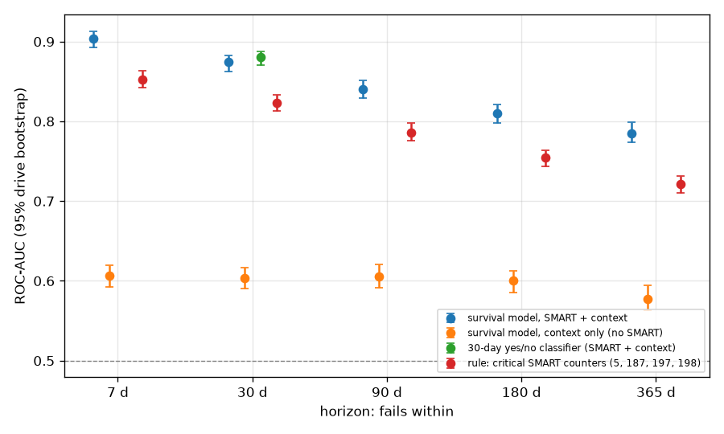
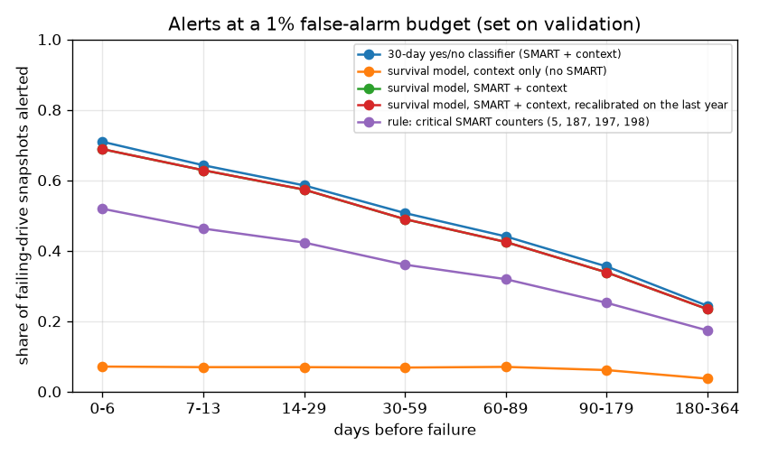
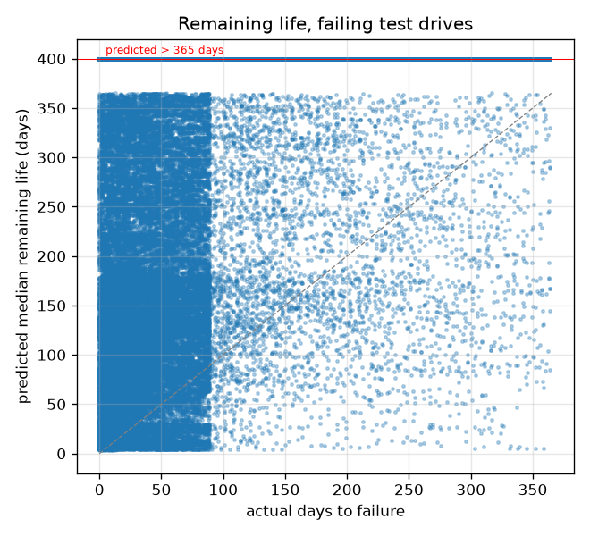
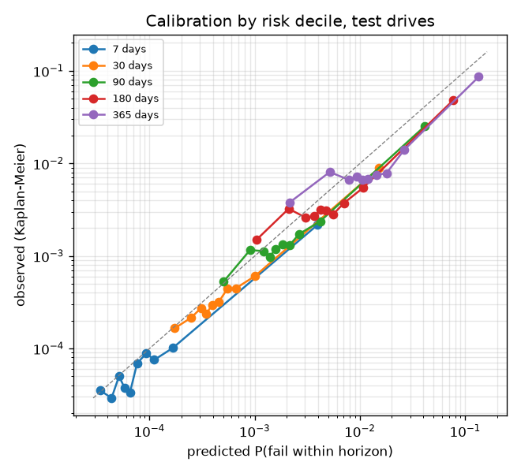

CENTRO ESTADUAL DE EDUCAÇÃO TECNOLÓGICA PAULA SOUZA

FACULDADE DE TECNOLOGIA DA BAIXADA SANTISTA

CURSO SUPERIOR DE TECNOLOGIA EM CIÊNCIA DE DADOS

RELATÓRIO TÉCNICO

**PREVISÃO DE FALHAS EM DISCOS RÍGIDOS COM ATRIBUTOS SMART: análise de sobrevivência sobre o *dataset* Drive Stats da Backblaze**

[PREENCHER: Nome do autor (Titulação, Instituição) e-mail@fatec.sp.gov.br]

SANTOS

NOVEMBRO/2026

# RESUMO

Discos rígidos armazenam a maior parte dos dados em *data centers*, e prever suas falhas permite substituí-los antes que causem perda de dados. Este relatório tem como objetivo avaliar se os atributos de Tecnologia de Automonitoramento, Análise e Relatório (SMART), lidos diariamente pela ferramenta `smartctl`, permitem estimar a probabilidade e o momento provável de falha de discos rígidos. Utilizou-se o *dataset* público Drive Stats, da Backblaze, com 646.777.037 registros diários de 478.464 discos entre 2016 e 2025. O problema foi formulado como análise de sobrevivência em tempo discreto, com censura à direita, e estimado por *gradient boosting* sobre uma amostra ponderada de 57.309 discos; a avaliação usou discos e anos não vistos no treino. Os atributos SMART elevaram a área sob a curva *Receiver Operating Characteristic* de 0,603 para 0,877 no horizonte de 30 dias, e cerca de 61% desse ganho persistiu sem os contadores que o próprio operador usa para decidir substituições. Com orçamento de 1% de falsos alarmes, o modelo alertou 78% dos discos que falharam, contra 59% de uma regra baseada em contadores de setores, mas com precisão de 3,8%. As falhas sem sinal nesses contadores, cerca de 21% do total, foram pouco previsíveis, e as estimativas de vida útil remanescente mostraram-se pessimistas e sujeitas a deriva no segundo ano de teste. Conclui-se que os atributos SMART são úteis para priorizar inspeções a curto prazo, mas não para indicar com meses de antecedência o dia da falha.

Palavras-chave: análise de sobrevivência; atributos SMART; discos rígidos; manutenção preditiva; aprendizado de máquina.

# LISTA DE ILUSTRAÇÕES

Figura 1 – Fluxo das etapas de tratamento de dados e modelagem

Figura 2 – ROC-AUC por horizonte, com intervalos de confiança de 95%

Figura 3 – Proporção de retratos de discos que falham com alerta, por dias antes da falha (orçamento de 1%)

Figura 4 – Mediana prevista da vida útil remanescente contra o tempo real até a falha, discos que falham no teste

Figura 5 – Calibração por decil de risco no conjunto de teste, por horizonte (escalas logarítmicas)

Quadro 1 – Principais atributos SMART utilizados

Quadro 2 – Modelos comparados

# LISTA DE TABELAS

Tabela 1 – Composição da coorte por conjunto e estrato

Tabela 2 – ROC-AUC por horizonte de previsão no conjunto de teste

Tabela 3 – ROC-AUC em 30 dias por modelo e por recorte do conjunto de teste

Tabela 4 – Desempenho dos alertas no conjunto de teste, por orçamento de falsos alarmes

Tabela 5 – Retratos de discos que falham com mediana prevista dentro de um ano, por distância real até a falha

Tabela 6 – Risco de falha em 30 dias previsto e observado, por conjunto e ano

# LISTA DE ABREVIATURAS E SIGLAS

| Sigla | Significado |
|---|---|
| GB | *Gigabyte* |
| HDD | *Hard Disk Drive* (disco rígido) |
| IPCW | *Inverse Probability of Censoring Weighting* (ponderação pelo inverso da probabilidade de censura) |
| PR-AUC | Área sob a curva de precisão e revocação |
| RAID | *Redundant Array of Independent Disks* |
| ROC-AUC | Área sob a curva *Receiver Operating Characteristic* |
| SHA-256 | *Secure Hash Algorithm* de 256 bits |
| SMART | *Self-Monitoring, Analysis and Reporting Technology* (Tecnologia de Automonitoramento, Análise e Relatório) |
| SQL | *Structured Query Language* |
| SSD | *Solid State Drive* (unidade de estado sólido) |
| TB | *Terabyte* |

# SUMÁRIO

1 INTRODUÇÃO

1.1 OBJETIVO GERAL

1.2 OBJETIVOS ESPECÍFICOS

2 CONTEXTUALIZAÇÃO DO CENÁRIO

2.1 ATRIBUTOS SMART E FALHAS DE DISCOS EM CAMPO

2.2 O *DATASET* DA BACKBLAZE E A DEFINIÇÃO DE FALHA

2.3 AVALIAÇÃO DE MODELOS: VAZAMENTO, DESBALANCEAMENTO E DERIVA

2.4 ANÁLISE DE SOBREVIVÊNCIA EM TEMPO DISCRETO

2.5 AMOSTRAGEM, PONDERAÇÃO E CALIBRAÇÃO

3 PROCEDIMENTOS METODOLÓGICOS

3.1 APRESENTAÇÃO DO *DATASET*

3.2 DETALHAMENTO DAS ETAPAS DE TRATAMENTO DE DADOS E FERRAMENTAS

4 RESULTADOS DA ANÁLISE E RECOMENDAÇÕES

4.1 GANHO DOS ATRIBUTOS SMART

4.2 POLÍTICA DE SUBSTITUIÇÃO, USO E FALHAS SILENCIOSAS

4.3 ALERTA ANTECIPADO

4.4 VIDA ÚTIL REMANESCENTE

4.5 CALIBRAÇÃO, DERIVA E RETIRADA DE DISCOS

4.6 COMPARAÇÕES COMPLEMENTARES

4.7 RECOMENDAÇÕES

5 CONSIDERAÇÕES FINAIS E LIMITAÇÕES DO ESTUDO

REFERÊNCIAS

APÊNDICE A – GUIA DE REPRODUÇÃO DOS RESULTADOS

# 1 INTRODUÇÃO

Discos rígidos (*Hard Disk Drives*, HDD) continuam sendo o meio de armazenamento predominante em *data centers* de grande capacidade. A falha de um disco obriga o operador a reconstruir os dados a partir de cópias redundantes, e falhas próximas no tempo podem causar perda de dados. Prever quais discos tendem a falhar permite substituí-los de forma planejada, antes que a falha ocorra.

Os próprios discos registram indicadores internos por meio da Tecnologia de Automonitoramento, Análise e Relatório (*Self-Monitoring, Analysis and Reporting Technology*, SMART). Esses indicadores, chamados atributos SMART, são lidos por ferramentas como o `smartctl`, do pacote *smartmontools*, e incluem contadores de setores realocados, de erros não corrigidos e de horas de funcionamento. A questão que orienta este relatório é se esses atributos permitem estimar a probabilidade de falha de um disco e o momento provável em que ela ocorrerá.

O estudo delimita-se aos discos rígidos do *dataset* público Drive Stats, publicado pela empresa de armazenamento em nuvem Backblaze, no período de 1º de janeiro de 2016 a 31 de dezembro de 2025. O conjunto reúne 646.777.037 registros diários de 478.464 números de série. Unidades de estado sólido (*Solid State Drives*, SSD) foram excluídas, pois constituem outra população de falhas. Os resultados referem-se à carga de trabalho de um *data center* de armazenamento e não se estendem automaticamente a computadores pessoais.

A relevância do tema para a formação do tecnólogo em Ciência de Dados reside na combinação de problemas que o estudo exige tratar: volume de dados acima da memória disponível, eventos raros, observações incompletas (discos retirados antes de falhar ou ainda em operação ao fim do período) e risco de vazamento de informação entre treino e teste. Para o mercado, o estudo fornece critérios para decidir se um sistema de alerta baseado em SMART compensa o custo de falsos alarmes. O público-alvo compreende gestores de infraestrutura de *data centers*, equipes de operação de armazenamento e analistas que desenvolvem modelos de manutenção preditiva.

## 1.1 OBJETIVO GERAL

Avaliar se os atributos SMART coletados diariamente pelo `smartctl` permitem estimar a probabilidade e o momento provável de falha de discos rígidos em operação nos *data centers* da Backblaze, quantificando o ganho que oferecem em relação às informações disponíveis sem eles.

## 1.2 OBJETIVOS ESPECÍFICOS

a) estruturar a previsão de falhas como problema de análise de sobrevivência em tempo discreto, com tratamento de censura à direita;

b) mensurar o ganho de discriminação dos atributos SMART em relação a um modelo que conhece apenas o modelo do disco, a capacidade e o tempo de serviço;

c) avaliar a sensibilidade desse ganho à remoção dos atributos que a política de substituição de discos do operador utiliza;

d) avaliar o desempenho do modelo como sistema de alerta antecipado sob orçamentos fixos de falsos alarmes;

e) verificar a calibração das probabilidades e das estimativas de vida útil remanescente, bem como sua estabilidade ao longo do tempo.

# 2 CONTEXTUALIZAÇÃO DO CENÁRIO

## 2.1 ATRIBUTOS SMART E FALHAS DE DISCOS EM CAMPO

O SMART foi concebido como mecanismo interno de alerta: o próprio disco aciona um sinal binário quando algum atributo ultrapassa um limite definido pelo fabricante. Murray *et al.* (2005) relatam que, com esse algoritmo de limites, os fabricantes estimam a taxa de detecção de falhas entre 3% e 10%, e que testes estatísticos não paramétricos sobre os mesmos atributos detectam uma parcela maior de falhas.

Os estudos de campo publicados em 2007 mostraram que a confiabilidade observada difere da especificada. Schroeder e Gibson (2007), ao analisar registros de substituição de cerca de 100 mil discos, constataram taxas anuais de substituição tipicamente acima de 1%, frequentemente entre 2% e 4% e de até 13%, valores superiores aos derivados do tempo médio até a falha informado pelos fabricantes. Os autores observaram ainda pouca diferença entre discos de interfaces corporativas e de consumo, o que, segundo os autores, sugere que "disk-independent factors, such as operating conditions, affect replacement rates more than component specific factors" (SCHROEDER; GIBSON, 2007, p. 1).

No mesmo ano, Pinheiro *et al.* (2007) analisaram uma população de discos da Google e identificaram atributos SMART fortemente associados à falha: após o primeiro erro de varredura, um disco tinha 39 vezes mais probabilidade de falhar nos 60 dias seguintes do que um disco sem esse erro. Os mesmos autores, porém, verificaram que mais de 56% dos discos que falharam não apresentavam contagem em nenhum dos quatro sinais mais fortes e que mais de 36% não apresentavam contagem em nenhum dos atributos analisados, exceto a temperatura. Concluíram que "models based on SMART parameters alone are unlikely to be useful for predicting individual drive failures" (PINHEIRO *et al.*, 2007, p. 1). Essas falhas sem sinal prévio nos contadores são denominadas, neste relatório, falhas silenciosas.

Outros trabalhos detalham o mecanismo por trás dos contadores. Bairavasundaram *et al.* (2007) acompanharam 1,53 milhão de discos por 32 meses e mostraram que erros latentes de setor apresentam localidade temporal e espacial, isto é, um disco que começa a acumular erros tende a continuar acumulando-os. Ma *et al.* (2015) verificaram que a contagem de setores realocados se correlaciona fortemente com falhas iminentes e que a substituição proativa com base nesse contador eliminaria 88% dos erros triplos de disco em grupos de *Redundant Array of Independent Disks* (RAID). Em sentido complementar, Lu *et al.* (2020), com dados de 380 mil discos distribuídos em 64 *data centers*, mostraram que métricas de desempenho do sistema combinadas aos atributos SMART superam o uso exclusivo dos atributos SMART.

## 2.2 O *DATASET* DA BACKBLAZE E A DEFINIÇÃO DE FALHA

A Backblaze registra diariamente um retrato (*snapshot*) de cada disco em operação, com informações básicas da unidade e os atributos SMART reportados, e publica esses registros em arquivos diários (BACKBLAZE, 2026). O esquema de colunas muda de um trimestre para outro, o que exige alinhamento dos dados antes de qualquer análise. O conjunto tornou-se referência em pesquisa: a empresa contabiliza mais de 227 artigos que o utilizam como fonte primária desde 2018 (DOYLE, 2026).

A definição de falha adotada pelo operador é central para a interpretação de qualquer modelo treinado nesse *dataset*. Beach (2014) informa que a Backblaze considera falho o disco removido e substituído por ter parado de funcionar ou por apresentar evidência de falha iminente, e que essa evidência vem dos atributos SMART 5, 187, 188, 197 e 198. Sobre o atributo 187, o autor afirma: "once SMART 187 goes above zero, we schedule the drive for replacement" (BEACH, 2014, não paginado). Em 2024, a empresa passou a distinguir falhas reativas (o disco não inicia, não responde ou não permanece operacional) de falhas proativas (indicadores como SMART ou verificações do sistema de arquivos apontam falha provável); no terceiro trimestre de 2024, 53,0% das 1.361 falhas foram proativas, e o *dataset* público registra apenas o indicador binário de falha, sem o tipo (BACKBLAZE, 2024). Em 2025, a empresa descreveu um monitor que remove o acesso a discos cujo número de erros não corrigidos ultrapassa um limite e regras baseadas em chamados de manutenção para decidir se um disco falhou; no mesmo relatório, um modelo Toshiba de 16 *terabytes* (TB) apresentou taxa trimestral de falhas de 16,95% por retiradas ligadas a uma correção de *firmware*, falha que, segundo a empresa, não era mecânica (BACKBLAZE, 2025).

Disso decorre um problema de circularidade: parte do rótulo de falha é definida pelos mesmos contadores SMART que o modelo usa como variáveis explicativas. Um modelo que aprende que o atributo 187 acima de zero precede a falha pode estar aprendendo a política de substituição do operador, e não a degradação física do disco. Klein (2016) mostra a dimensão do fenômeno: 76,7% dos discos falhos e 4,2% dos discos em operação tinham ao menos um dos cinco atributos acima de zero, de modo que 23,3% das falhas ocorreram sem aviso nesses atributos.

Há ainda particularidades de codificação. Alguns fabricantes agrupam vários campos no valor bruto (*raw*) de um atributo, de forma que valores elevados não representam contagens reais (KRETZSCHMAR, 2024). Esses atributos exigem tratamento antes do uso como variável numérica.

## 2.3 AVALIAÇÃO DE MODELOS: VAZAMENTO, DESBALANCEAMENTO E DERIVA

Kapoor e Narayanan (2023) identificaram vazamento de dados (*data leakage*) em pelo menos 294 artigos de 17 áreas que empregam aprendizado de máquina, e incluem, entre os tipos descritos, a dependência temporal e a falta de independência entre amostras de treino e teste. Na previsão de falhas de discos, o efeito é mensurável. Xu *et al.* (2018), em dados de produção da Microsoft, obtiveram taxa de verdadeiros positivos de 91,64% com validação cruzada aleatória e de 36,50% com divisão temporal, ambas a 0,1% de falsos positivos, e concluíram que "cross-validation may not always reflect the actual effectiveness of a prediction model" (XU *et al.*, 2018, p. 489). Lu *et al.* (2020, p. 158) avaliaram seus modelos com validação cruzada aleatória em cinco partições, o que torna seus resultados não comparáveis aos de uma divisão por disco e por tempo.

Falhas são eventos raros, e a área sob a curva *Receiver Operating Characteristic* (ROC-AUC) pode ser enganosa nessa condição. Saito e Rehmsmeier (2015) mostram que a curva de precisão e revocação é mais informativa que a curva ROC em dados desbalanceados, e Davis e Goadrich (2006) descrevem a relação entre os dois espaços. Por esse motivo, a área sob a curva de precisão e revocação (PR-AUC) deve acompanhar a ROC-AUC. Na literatura sobre o *dataset* da Backblaze, Han *et al.* (2023) fixam em 1% a taxa diária de falsos positivos nos conjuntos dessa origem e mostram que a distribuição dos atributos muda ao longo do tempo (deriva de conceito, ou *concept drift*); a adaptação a essa deriva elevou o F1 de seus modelos entre 26,8% e 53,2%. Amram *et al.* (2021), com árvores ótimas de sobrevivência e de classificação no mesmo *dataset*, relatam sensibilidade de aproximadamente 50% com taxa de falsos alarmes próxima de 10% para horizontes de 30 a 90 dias.

## 2.4 ANÁLISE DE SOBREVIVÊNCIA EM TEMPO DISCRETO

A pergunta "o disco falhará nos próximos 30 dias?" é uma classificação binária e não informa quando a falha deve ocorrer. Além disso, ela exige decidir o rótulo de discos cujo destino é desconhecido: discos retirados sem falha e discos ainda em operação ao fim do período de observação. Esses casos são observações censuradas à direita. Vock *et al.* (2016) mostram que descartá-los ou tratá-los como não eventos são técnicas *ad hoc* que introduzem viés na estimativa do risco. Na Backblaze, a censura é frequente: Siemroth e Park (2026) contabilizaram 146.943 discos, cerca de 31% de sua amostra, retirados sem falha, em geral por substituição de unidades antigas por outras de maior capacidade, e os trataram como censurados à direita.

A análise de sobrevivência em tempo discreto acomoda a censura e produz uma curva de sobrevivência para cada observação. O horizonte futuro é dividido em intervalos, e cada observação gera uma linha por intervalo em que permanece em risco (formato pessoa-período). Suresh *et al.* (2022) mostram que, como a verossimilhança desse formato é binomial, qualquer algoritmo capaz de otimizar uma verossimilhança binomial estima os riscos por intervalo, inclusive classificadores de aprendizado de máquina; os autores alertam que o desempenho varia com o número de intervalos escolhido. Craig *et al.* (2025) revisam a mesma técnica sob o nome de *survival stacking*, e Kvamme e Borgan (2021) comparam parametrizações da função de risco discreta e esquemas de discretização. A própria Backblaze emprega curvas de Kaplan-Meier para descrever a expectativa de vida de modelos de disco (KLEIN, 2022).

A avaliação de modelos de sobrevivência também exige cuidados. Uno *et al.* (2011) mostram que a estatística C de Harrell converge para uma medida que depende da distribuição de censura do estudo e propõem um estimador ponderado que não depende dela. Kvamme e Borgan (2019) mostram que o escore de Brier ponderado pelo inverso da probabilidade de censura (*Inverse Probability of Censoring Weighting*, IPCW) deixa de ser válido quando os tempos de censura podem ser identificados pelas covariáveis. Xu *et al.* (2026) descrevem o vazamento por corte administrativo: se as variáveis revelam a data da observação, o modelo pode aprender quanto acompanhamento havia disponível, e não o risco real, o que infla a ROC-AUC em horizonte fixo.

## 2.5 AMOSTRAGEM, PONDERAÇÃO E CALIBRAÇÃO

Com eventos raros e dados volumosos, é comum amostrar todos os eventos e uma fração dos não eventos, corrigindo depois as estimativas por ajuste das probabilidades a priori ou por ponderação (KING; ZENG, 2001). Pesos iguais ao inverso da probabilidade de inclusão removem o viés, mas pesos de grande variabilidade aumentam a variância, o que leva a práticas de truncamento de pesos na estatística de levantamentos amostrais (ELLIOTT, 2008). Sugiyama *et al.* (2007) propõem elevar os pesos de importância a um expoente entre 0 e 1, que controla a troca entre consistência e estabilidade, e recomendam escolher esse expoente por validação cruzada ponderada.

O rebalanceamento de classes tem custo na calibração. Goorbergh *et al.* (2022) verificaram que correções de desbalanceamento levaram a superestimação acentuada das probabilidades sem melhorar a ROC-AUC. Elkan (2001) já havia argumentado que alterar a proporção entre exemplos positivos e negativos tem pouco efeito sobre classificadores bayesianos e árvores de decisão, e recomenda ajustar o limiar de decisão. Quando as probabilidades são distorcidas, uma recalibração posterior pode corrigi-las: Niculescu-Mizil e Caruana (2005) mostram que árvores com *boosting* produzem distorção em forma sigmoide, corrigida pelo escalonamento de Platt, um ajuste logístico de dois parâmetros. Para modelos de sobrevivência, Austin *et al.* (2020) propõem curvas de calibração suavizadas e o índice integrado de calibração, e Haider *et al.* (2020) distinguem a calibração em um único horizonte da calibração da distribuição completa.

Por fim, observações diárias de um mesmo disco são quase idênticas e não são independentes. Pang *et al.* (2023) mostram que o *bootstrap* por agrupamento, que reamostra unidades inteiras em vez de linhas, atinge cobertura adequada para intervalos de confiança da ROC-AUC com dados correlacionados.

# 3 PROCEDIMENTOS METODOLÓGICOS

Adotou-se abordagem quantitativa, de caráter descritivo e preditivo, fundamentada em dados secundários. O problema foi formulado como análise de sobrevivência em tempo discreto, e o efeito dos atributos SMART foi medido por comparação entre modelos idênticos que diferem apenas no conjunto de variáveis de entrada (ablação). Todo o processamento foi implementado como um *pipeline* reprodutível, descrito na seção 3.2 e no APÊNDICE A.

## 3.1 APRESENTAÇÃO DO *DATASET*

Selecionou-se o *dataset* Drive Stats da Backblaze por três razões. Quanto à confiabilidade, os registros são coletados de forma automatizada, todos os dias, pela ferramenta *smartmontools* nos discos em produção do operador (BEACH, 2014; BACKBLAZE, 2025). Quanto à credibilidade, o conjunto é público desde 2013 e é utilizado como fonte primária em mais de 227 trabalhos (DOYLE, 2026), entre eles estudos revisados por pares sobre previsão de falhas e confiabilidade de discos (AMRAM *et al.*, 2021; HAN *et al.*, 2023; SIEMROTH; PARK, 2026). Quanto à aplicabilidade, entre as fontes consultadas, é o *dataset* público que combina atributos SMART diários, indicador de falha e uma década de acompanhamento de centenas de milhares de discos, o que permite estimar curvas de sobrevivência e avaliar o modelo em anos posteriores aos de treino.

Utilizou-se o painel de 1º de janeiro de 2016 a 31 de dezembro de 2025, armazenado em um único arquivo Parquet de 21,8 *gigabytes* (GB). O painel contém 646.777.037 linhas, uma por disco e por dia, de 478.464 números de série, dos quais 26.679 têm ao menos um registro de falha. A integridade do arquivo é verificada pelo resumo criptográfico *Secure Hash Algorithm* (SHA-256) antes de cada execução, de modo que uma alteração no arquivo baixado não muda os dados sem aviso. Cada linha contém as seguintes variáveis:

a) **date**: data do registro diário;

b) **serial_number**: número de série, que identifica o disco;

c) **model** e **capacity_bytes**: modelo comercial e capacidade da unidade;

d) **failure**: indicador binário igual a 1 no último dia operacional de um disco considerado falho pelo operador;

e) **smart_N_raw** e **smart_N_normalized**: valor bruto e valor normalizado de cada atributo SMART N reportado pelo disco.

O Quadro 1 apresenta os atributos SMART mais relevantes para a análise. A lista completa de atributos utilizados é fixada antes da modelagem (seção 3.2).

**Quadro 1 – Principais atributos SMART utilizados**

| Atributo | Nome | Papel na análise |
|---|---|---|
| 5 | *Reallocated Sectors Count* (setores realocados) | contador crítico; usado na regra de referência |
| 187 | *Reported Uncorrectable Errors* (erros não corrigidos reportados) | contador crítico; usado na regra de referência |
| 188 | *Command Timeout* (comandos expirados) | usado pela Backblaze na decisão de substituição; apenas o valor normalizado é variável do modelo |
| 197 | *Current Pending Sector Count* (setores pendentes) | contador crítico; usado na regra de referência |
| 198 | *Offline Uncorrectable* (erros não corrigíveis em varredura) | contador crítico; usado na regra de referência |
| 9 | *Power-On Hours* (horas ligado) | idade e uso |
| 4, 12, 193 | partidas e paradas, ciclos de energia, ciclos de carga do cabeçote | uso |
| 240, 241, 242 | horas de voo do cabeçote, blocos lógicos gravados e lidos | uso |

Fonte: Elaborado pelos autores com base em Beach (2014) e no arquivo de configuração `config/study.toml` do projeto.

Na preparação, foram tratadas as seguintes particularidades do painel:

a) **unidades de estado sólido**: 3.898 discos de inicialização (SSD) foram excluídos por padrão de nome de modelo;

b) **nomes de modelo**: a quantidade de espaços em branco nos nomes varia entre anos e foi normalizada;

c) **linhas duplicadas no mesmo dia**: manteve-se uma linha por disco e por dia, a mais completa;

d) **registros após a falha**: 710 discos continuam reportando após o primeiro registro de falha; considerou-se a primeira falha como o evento e descartaram-se as linhas posteriores;

e) **colunas em texto**: atributos armazenados como texto foram convertidos para número, com contagem dos valores que falham na conversão;

f) **valores brutos compactados**: em discos Seagate, o valor bruto do atributo 188 agrupa vários campos de 16 bits (2,9% dos registros Seagate são maiores ou iguais a 65.536) e o do atributo 240 carrega um campo de milissegundos acima do bit 32; para o 188 usou-se apenas o valor normalizado, e para o 240 mantiveram-se os 32 bits inferiores, conforme a codificação descrita por Kretzschmar (2024);

g) **lacunas de registro**: todas as janelas temporais são definidas por datas de calendário, e não por número de linhas, de modo que dias sem registro não distorcem as variáveis de tendência.

## 3.2 DETALHAMENTO DAS ETAPAS DE TRATAMENTO DE DADOS E FERRAMENTAS

Utilizou-se a linguagem Python 3.13, com dependências fixadas pelo gerenciador *uv*, em razão da disponibilidade de bibliotecas para dados volumosos e aprendizado de máquina. O painel completo não cabe na memória de um computador pessoal; por isso, toda operação sobre ele foi feita com o DuckDB, banco de dados analítico que executa consultas em *Structured Query Language* (SQL) diretamente sobre arquivos Parquet, processando um mês por vez. A modelagem utilizou o LightGBM, implementação de *gradient boosting* em árvores de decisão escolhida por aceitar pesos por linha, variáveis categóricas e treino em lotes. As etapas foram encadeadas pelo executor *data-pipeline*, que registra um ponto de verificação por etapa e só executa novamente o que depende de entradas alteradas. A execução completa ocorreu em um computador com processador AMD Ryzen 7 5700X e 31 GB de memória, em cerca de 45 minutos, dos quais cerca de 3 minutos na varredura inicial do painel. A Figura 1 apresenta o fluxo das etapas.

**Figura 1 – Fluxo das etapas de tratamento de dados e modelagem**

Fonte: Elaborado pelos autores (2026).

As etapas são descritas a seguir:

a) **indexação (drive_index)**: varredura do painel completo, mês a mês, que gera uma linha por disco com modelo, capacidade, primeira e última data observada e data da primeira falha;

b) **coorte (cohort)**: divisão dos discos em treino (70%), validação (10%) e teste (20%) por um *hash* SHA-256 do número de série, estável entre versões de bibliotecas, de modo que nenhum disco aparece em mais de um conjunto. A divisão também é temporal: dados de treino e validação vão até 31 de dezembro de 2023, e o teste começa em 1º de janeiro de 2024. Em seguida, aplicou-se amostragem estratificada: todos os discos que falham em algum momento foram mantidos, e 10% dos demais foram sorteados. Cada disco recebe peso igual ao inverso de sua probabilidade de inclusão (1 para discos que falham e 10 para os demais), conforme a estratégia de King e Zeng (2001), de modo que todas as métricas estimam os valores da população real. A Tabela 1 apresenta a composição da coorte;

c) **extração (extract)**: leitura, com o DuckDB, das linhas diárias dos discos da coorte, restrita às colunas de interesse, sem duplicatas e cortada na primeira falha;

d) **retratos e rótulos (snapshots)**: seleção de um retrato a cada 7 dias por disco (peso 7) e de todos os dias nos 90 dias anteriores a uma falha visível no período do conjunto (peso 1), para que o período que antecede a falha seja observado em detalhe. Cada retrato recebe dois rótulos: o número de dias até a primeira falha (evento) ou até o último dia em que o disco é sabidamente operacional (censura). Discos de treino são censurados em 31 de dezembro de 2023, de modo que uma falha posterior é desconhecida para o treino, e não tratada como ausência de falha (VOCK *et al.*, 2016);

e) **variáveis**: 64 variáveis fixadas antes da modelagem, e não escolhidas a partir dos dados: 23 valores brutos e 10 valores normalizados de atributos SMART; para 12 contadores que crescem com a degradação, a variação nos últimos 7 e 30 dias de calendário (24 variáveis de tendência, em linha com a localidade temporal de erros descrita por Bairavasundaram *et al.*, 2007), mais a extensão efetiva de cada janela; e 5 variáveis de contexto: dias em serviço, indicador de disco já em operação no início do painel, capacidade, modelo (os 30 modelos mais frequentes no treino, os demais agrupados) e fabricante. A data de calendário não é variável, para evitar o vazamento por corte administrativo descrito por Xu *et al.* (2026). Pelo mesmo motivo, modelo e capacidade não podem depender de quanto tempo o disco sobrevive: usam-se o primeiro nome de modelo e a primeira capacidade válida informados pelo disco, arredondada a 10 GB. Uma versão anterior tomava a capacidade máxima ao longo da vida do disco; como em um único dia (25 de fevereiro de 2018) o painel informa capacidades arredondadas, esse máximo revelava se o disco ainda estava em operação nessa data. Os 10 discos que nunca informam capacidade, todos com falha em poucos dias, recebem a capacidade mais comum de seu modelo;

f) **portão de verificação (verify)**: antes de qualquer treino, 56 verificações automáticas recalculam todos os rótulos de forma independente e conferem a separação dos conjuntos por disco e por tempo, os pesos, a densidade de amostragem, o esquema de colunas e a ausência de colunas que revelem o desfecho. Qualquer erro interrompe o *pipeline*;

g) **modelagem (train)**: o futuro de cada retrato foi dividido em sete intervalos, de 0 a 7, 7 a 14, 14 a 30, 30 a 60, 60 a 90, 90 a 180 e 180 a 365 dias. Cada retrato gera uma linha por intervalo em que permanece em risco (formato pessoa-período), e o LightGBM estima o risco discreto h_k(x), isto é, a probabilidade de falha no intervalo k dado que o disco estava operacional no início do intervalo, com o início do intervalo como variável adicional (SURESH *et al.*, 2022). A curva de sobrevivência é S(t_k) = Π_{j≤k}(1 − h_j), da qual se obtêm a probabilidade de falha em 7, 30, 90, 180 e 365 dias, a mediana da vida útil remanescente com intervalo de 10% a 90% e o número esperado de dias operacionais no ano seguinte. Um retrato censurado no meio de um intervalo contribui para esse intervalo com peso igual à fração observada. No conjunto completo, os 7.597.961 retratos de treino geraram 48.083.205 linhas pessoa-período;

h) **pesos de treino e calibração**: em testes preliminares na menor escala do projeto, treinar com os pesos completos fez o modelo parar após cerca de 30 iterações, porque um dia saudável pesava dezenas de vezes mais que um dia de falha. Por isso, os pesos de treino foram elevados ao expoente 0,5, na linha da ponderação atenuada de Sugiyama *et al.* (2007); os expoentes 0,75 e 1,0 foram avaliados como análise de sensibilidade. Como a atenuação distorce a escala das probabilidades, cada intervalo recebeu uma recalibração de Platt de dois parâmetros (NICULESCU-MIZIL; CARUANA, 2005), ajustada com os pesos reais em metade dos discos de validação; a outra metade foi usada apenas para a parada antecipada do treino. Os hiperparâmetros principais foram taxa de aprendizado de 0,03, 31 folhas por árvore, no mínimo 200 amostras por folha e parada antecipada após 100 iterações sem melhora, com limite de 2.000. O modelo principal parou na iteração 419;

i) **previsão e avaliação (predict, evaluate)**: aplicação de todos os modelos aos discos de validação e teste e cálculo das métricas descritas a seguir;

j) **relatório (report)**: geração automática das tabelas e figuras usadas no capítulo 4.

**Tabela 1 – Composição da coorte por conjunto e estrato**

| Conjunto | Discos que falham em algum momento | Demais discos (amostra de 10%) | Discos com falha visível no período do conjunto | Retratos |
|---|---|---|---|---|
| Treino | 17.880 | 24.450 | 12.220 | 7.597.961 |
| Validação | 2.566 | 3.431 | 1.772 | 1.077.429 |
| Teste | 1.784 | 7.198 | 1.784 | 825.321 |
| Total | 22.230 | 35.079 | 15.776 | 9.500.711 |

Fonte: Elaborado pelos autores com base em Backblaze (2026), no resumo da coorte e no relatório do portão de verificação.

A diferença entre as duas primeiras colunas e a terceira decorre da divisão temporal: um disco de treino que falha em 2024 pertence ao estrato dos que falham, mas, para o treino, é uma observação censurada em 31 de dezembro de 2023. Dezesseis discos da coorte (14 de treino, 1 de validação e 1 de teste) não geraram retrato por terem menos de sete linhas na janela de seu conjunto, o que o portão de verificação registrou como aviso; por isso, o teste avaliado tem 8.981 discos, e não 8.982.

Para isolar o efeito dos atributos SMART, foram treinados os modelos apresentados no Quadro 2. Todos usam o mesmo algoritmo, os mesmos retratos e os mesmos hiperparâmetros, com uma exceção: o modelo apenas com contexto, que tem só cinco variáveis, usa todas elas em cada árvore (fração de variáveis 1,0 em vez de 0,8).

**Quadro 2 – Modelos comparados**

| Modelo | Variáveis ou definição | Pergunta que responde |
|---|---|---|
| Sobrevivência, SMART + contexto | todas as 64 variáveis | modelo principal |
| Sobrevivência, apenas contexto | modelo, fabricante, capacidade, dias em serviço, indicador de início do painel | o que se prevê sem SMART |
| Sobrevivência sem contadores críticos | todas, exceto os atributos 5, 187, 188, 197 e 198 (brutos, normalizados e tendências) | quanto do ganho resiste à remoção dos atributos da política de substituição |
| Sobrevivência, contexto + uso | contexto mais os contadores de uso 4, 9, 12, 193, 240, 241 e 242 | se o ganho vem apenas de medir idade e desgaste |
| Sobrevivência com expoente 0,75 e 1,0 | variáveis do modelo principal | sensibilidade ao expoente dos pesos de treino |
| Sobrevivência recalibrada no último ano | árvores do modelo principal, recalibradas só com 2023 | se uma recalibração recente corrige a deriva |
| Classificador de 30 dias | variáveis do modelo principal; rótulo "falha em até 30 dias" | se o modelo de sobrevivência perde discriminação em relação a um classificador dedicado |
| Regra dos contadores críticos | soma de log(1 + x) dos valores brutos de 5, 187, 197 e 198, sem treino | desempenho da regra prática usada por operadores |

Fonte: Elaborado pelos autores (2026).

A regra de referência exclui o atributo 188 porque seus valores compactados nos discos Seagate consumiam 89% do orçamento de falsos alarmes da regra em uma execução anterior.

A avaliação usou apenas os discos de teste, observados em 2024 e 2025, e todas as métricas foram ponderadas pelos pesos amostrais. Foram calculadas:

a) **discriminação por horizonte**: ROC-AUC e PR-AUC por retrato para falha em 7, 30, 90, 180 e 365 dias, nos retratos cuja situação no horizonte é conhecida, com uma variante IPCW e uma variante com um retrato por disco. A PR-AUC foi incluída porque a falha é rara (SAITO; REHMSMEIER, 2015);

b) **concordância**: estatísticas C de Harrell e de Uno, esta última por não depender da distribuição de censura (UNO *et al.*, 2011);

c) **recortes**: retratos de falha com pelo menos 7 dias de antecedência, falhas silenciosas (discos que falham sem nenhum dos contadores 5, 187, 197 e 198 acima de zero em qualquer retrato de teste), fabricante e capacidade;

d) **alerta antecipado**: limiares definidos nos discos de validação para que 0,1%, 0,3% ou 1% dos dias saudáveis gerem alerta. O orçamento de 1% segue Han *et al.* (2023), e o de 0,1% corresponde ao ponto de operação de Xu *et al.* (2018). No teste, mediram-se a taxa de falsos alarmes, a precisão e a proporção de discos que falham e recebem alerta em seus últimos 30 dias;

e) **calibração**: probabilidade prevista média contra a proporção observada por Kaplan-Meier, por decil de risco, e razão entre risco previsto e observado em 30 dias por ano de calendário, para detectar deriva;

f) **vida útil remanescente**: proporção de discos que de fato falharam até os dias previstos para 10%, 50% e 90% de probabilidade de falha. As proporções são de retratos ponderados. Retratos censurados antes de o desfecho ser conhecido não entram; como descartá-los favorece os retratos com dia previsto próximo, cada falha conhecida é ponderada pelo inverso da probabilidade de permanecer sem censura até o dia da falha, e cada sobrevivente conhecido, até a véspera do dia previsto (IPCW), com uma única curva de Kaplan-Meier do tempo de censura. A estimativa supõe que a censura independe tanto do tempo de falha quanto do dia previsto, o que é apenas aproximado, pois a maior parte da censura decorre do fim do painel e depende da data do retrato;

g) **retirada de discos**: comparação do risco previsto entre discos saudáveis que deixam o painel no ano seguinte e discos que permanecem, como indício de censura informativa.

Os intervalos de confiança de 95% foram obtidos por *bootstrap* estratificado por disco, com 200 reamostragens (50 para as estatísticas de concordância): reamostram-se discos inteiros, e não linhas, porque os retratos de um mesmo disco são correlacionados (PANG *et al.*, 2023). As diferenças entre modelos foram calculadas de forma pareada nas mesmas reamostragens.

# 4 RESULTADOS DA ANÁLISE E RECOMENDAÇÕES

Os resultados a seguir referem-se à execução completa de 9 de novembro de 2026. O conjunto de teste reúne 8.981 discos nunca vistos no treino, observados em 2024 e 2025, dos quais 1.784 falharam, em 825.321 retratos. No portão de verificação, 55 das 56 verificações foram aprovadas e uma emitiu aviso, sem erro (os 16 discos sem retrato citados na seção 3.2). Os valores entre colchetes são intervalos de confiança de 95% obtidos por *bootstrap* por disco. Salvo indicação em contrário, a ROC-AUC é calculada por retrato diário, e 0,5 corresponde a uma ordenação aleatória.

## 4.1 GANHO DOS ATRIBUTOS SMART

A Tabela 2 compara o modelo principal com o modelo sem SMART, com o modelo sem os contadores críticos e com a regra de referência, em cada horizonte.

**Tabela 2 – ROC-AUC por horizonte de previsão no conjunto de teste**

| Falha em até | Sem SMART | SMART + contexto | Ganho do SMART | Sem contadores críticos | Regra (5, 187, 197, 198) | PR-AUC, SMART + contexto | Taxa-base |
|---|---|---|---|---|---|---|---|
| 7 dias | 0,603 | 0,905 [0,895; 0,914] | +0,302 [0,284; 0,316] | 0,799 | 0,853 | 0,065 | 0,027% |
| 30 dias | 0,603 | 0,877 [0,865; 0,886] | +0,273 [0,260; 0,291] | 0,770 | 0,823 | 0,124 | 0,121% |
| 90 dias | 0,609 | 0,843 [0,832; 0,855] | +0,234 [0,219; 0,253] | 0,745 | 0,786 | 0,182 | 0,388% |
| 180 dias | 0,606 | 0,813 [0,801; 0,825] | +0,207 [0,194; 0,221] | 0,720 | 0,755 | 0,219 | 0,865% |
| 365 dias | 0,585 | 0,787 [0,777; 0,801] | +0,203 [0,188; 0,219] | 0,712 | 0,722 | 0,312 | 2,272% |

Fonte: Elaborado pelos autores com base em Backblaze (2026).

Verifica-se que os atributos SMART elevam a ROC-AUC em todos os horizontes, com intervalos de confiança distantes de zero. O modelo sem SMART, que conhece apenas modelo, capacidade e tempo de serviço, ordena pouco melhor que o acaso (0,59 a 0,61). O ganho é maior perto da falha (+0,302 em 7 dias) e diminui com o horizonte (+0,203 em 365 dias), comportamento compatível tanto com a degradação física quanto com a política de substituição descrita na seção 2.2. O modelo também supera a regra dos contadores críticos em todos os horizontes; em 7 dias, a diferença é de +0,052 [0,045; 0,060].

A taxa-base mostra a raridade do evento: apenas 0,027% dos dias de disco antecedem uma falha em até 7 dias. Por isso, a PR-AUC do modelo principal é baixa em termos absolutos (0,065 em 7 dias), embora cerca de 240 vezes maior que a de uma ordenação aleatória, que seria próxima da taxa-base. A Figura 2 apresenta os mesmos resultados com os intervalos de confiança.

**Figura 2 – ROC-AUC por horizonte, com intervalos de confiança de 95%**

Fonte: Elaborado pelos autores com base em Backblaze (2026). Rótulos em inglês, gerados pelo *pipeline*: azul, modelo SMART + contexto; laranja, apenas contexto; verde, classificador de 30 dias; vermelho, regra dos contadores críticos.

Os horizontes longos são medidos em retratos mais antigos, pois um horizonte de H dias exige H dias de acompanhamento posterior para saber se o disco sobreviveu. A linha de 365 dias usa praticamente só retratos de 2024. Assim, as linhas da Tabela 2 não representam uma tendência medida sobre os mesmos retratos.

## 4.2 POLÍTICA DE SUBSTITUIÇÃO, USO E FALHAS SILENCIOSAS

A Tabela 3 decompõe o ganho em 30 dias. Retirados os atributos 5, 187, 188, 197 e 198, que a Backblaze usa para decidir substituições, o modelo ainda atinge ROC-AUC de 0,770, e o modelo completo fica à frente por +0,106 [0,098; 0,114]. Cerca de 61% do ganho do SMART sobre o modelo sem SMART (0,167 de 0,273) permanece sem esses contadores. Essa comparação é uma análise de sensibilidade, e não uma separação entre política e degradação física: os contadores removidos também medem dano real, e as variáveis restantes podem acompanhá-los. Parte do ganho de +0,273 pode, portanto, refletir a política do operador, em proporção que a comparação não determina. Os contadores de uso (idade, ciclos e volume lido e gravado) explicam pouco: o modelo de contexto com uso atinge 0,654, e o modelo completo o supera em +0,222 [0,211; 0,236].

**Tabela 3 – ROC-AUC em 30 dias por modelo e por recorte do conjunto de teste**

| Recorte | Discos que falham | SMART + contexto | Sem SMART | Regra (5, 187, 197, 198) |
|---|---|---|---|---|
| Todos os retratos | 1.784 | 0,877 [0,865; 0,886] | 0,603 | 0,823 |
| Positivos com 7 ou mais dias de antecedência | 1.755 | 0,868 [0,855; 0,877] | 0,604 | 0,814 |
| Falhas silenciosas | 368 | 0,638 [0,608; 0,666] | 0,562 | 0,473 |
| Falhas com contador crítico acima de zero | 1.416 | 0,939 [0,932; 0,945] | 0,614 | 0,915 |
| Fabricante HGST | 380 | 0,931 | 0,599 | 0,888 |
| Fabricante Seagate | 764 | 0,897 | 0,618 | 0,852 |
| Fabricante Toshiba | 485 | 0,779 | 0,515 | 0,740 |
| Fabricante WDC | 155 | 0,826 | 0,527 | 0,785 |
| Capacidade de 16 TB ou mais | 530 | 0,814 | 0,585 | 0,754 |
| Capacidade abaixo de 16 TB | 1.254 | 0,902 | 0,528 | 0,850 |

Fonte: Elaborado pelos autores com base em Backblaze (2026).

Dos 1.784 discos que falharam no teste, 368 (20,6%) são falhas silenciosas: nenhum dos contadores 5, 187, 197 e 198 ficou acima de zero em seus retratos de teste. Nesse grupo, o modelo cai para 0,638, ainda acima do acaso, enquanto a regra fica abaixo dele (0,473), pois por definição não tem sinal a usar. A proporção é próxima dos 23,3% relatados por Klein (2016) para a Backblaze, que usou definição semelhante com cinco atributos (incluindo o 188), e inferior aos mais de 56% observados por Pinheiro *et al.* (2007) na Google com quatro sinais semelhantes, em uma frota em que o rótulo de falha não dependia dos atributos SMART. A diferença é compatível com a circularidade do rótulo, mas as definições de falha silenciosa não são idênticas e as populações diferem em idade e geração de discos, de modo que a comparação é apenas indicativa.

Ao excluir os retratos dos últimos 7 dias antes da falha, a ROC-AUC em 30 dias quase não muda (0,868), mas a PR-AUC cai de 0,124 para 0,078 [0,065; 0,096]. Grande parte da precisão vem, portanto, dos últimos dias antes da falha, quando os contadores podem já refletir a degradação que motivou a substituição.

Entre fabricantes, o desempenho varia de 0,779 [0,752; 0,804] (Toshiba) a 0,931 [0,916; 0,947] (HGST); o intervalo da WDC, com apenas 155 discos que falham, é largo (0,826 [0,784; 0,874]). Discos de 16 TB ou mais são ordenados pior (0,814 contra 0,902). Esses discos correspondem a cerca de 10% do peso do treino e a 50% do peso do teste, o que indica mudança na composição da frota entre os períodos.

## 4.3 ALERTA ANTECIPADO

A Tabela 4 traduz o modelo em regras de alerta. O limiar de cada orçamento foi fixado nos discos de validação; no teste, mede-se quantos discos que falharam receberam alerta em seus últimos 30 dias e quantos alertas eram verdadeiros.

**Tabela 4 – Desempenho dos alertas no conjunto de teste, por orçamento de falsos alarmes**

| Orçamento | Modelo | Falsos alarmes no teste | Precisão | Discos que falham alertados | Alertados com 7 ou mais dias de antecedência |
|---|---|---|---|---|---|
| 0,1% | SMART + contexto | 0,21% [0,16; 0,25] | 15,3% [12,8; 18,4] | 1.020 (57%) | 763 |
| 0,1% | Regra | 0,48% [0,35; 0,58] | 5,9% [4,8; 7,8] | 664 (37%) | 500 |
| 0,3% | SMART + contexto | 0,57% [0,48; 0,66] | 8,7% [7,6; 10,4] | 1.246 (70%) | 1.015 |
| 0,3% | Regra | 0,79% [0,62; 0,92] | 4,8% [4,1; 6,2] | 839 (47%) | 664 |
| 1% | SMART + contexto | 1,87% [1,64; 2,07] | 3,8% [3,4; 4,4] | 1.391 (78%) | 1.203 |
| 1% | Classificador de 30 dias | 2,22% [1,99; 2,44] | 3,3% [3,0; 3,7] | 1.426 (80%) | 1.231 |
| 1% | Regra | 1,74% [1,48; 2,01] | 3,1% [2,7; 3,7] | 1.051 (59%) | 874 |
| 1% | Sem SMART | 2,55% [2,31; 2,87] | 0,3% [0,3; 0,4] | 141 (8%) | 135 |

Fonte: Elaborado pelos autores com base em Backblaze (2026). Falsos alarmes e precisão por dia de disco, em %, com intervalo de confiança de 95%; discos alertados por disco.

No orçamento de 1%, o modelo alerta 340 discos a mais que a regra (1.391 contra 1.051), com taxa de falsos alarmes semelhante (1,87% contra 1,74%, com intervalos sobrepostos). Sua precisão de 3,8% equivale a cerca de 32 vezes a taxa-base de 0,121%, mas significa que a maioria dos alertas ainda é falsa. No orçamento de 0,1%, próximo ao ponto de operação descrito por Xu *et al.* (2018), a precisão sobe para 15,3% e o modelo ainda alerta 57% dos discos que falham. O classificador de 30 dias alerta 35 discos a mais que o modelo de sobrevivência, mas com mais falsos alarmes (2,22% contra 1,87%), de modo que os dois não são comparados à mesma taxa. Cerca de 6,5% dos alertas ocorrem em datas cujo desfecho em 30 dias não é conhecido, porque o painel termina antes; contados como falsos, a precisão no orçamento de 1% passa a 3,6%.

No orçamento de 1%, a taxa de falsos alarmes no teste ficou acima do orçamento definido na validação, com intervalo de confiança que exclui 1%, no modelo principal (1,87%), no modelo sem SMART (2,55%), no classificador de 30 dias (2,22%) e na regra (1,74%). Os discos saudáveis do teste recebem escores mais altos que os da validação, sinal da deriva tratada na seção 4.5. A Figura 3 mostra a proporção de retratos de discos que falham com alerta, por distância até a falha.

**Figura 3 – Proporção de retratos de discos que falham com alerta, por dias antes da falha (orçamento de 1%)**

Fonte: Elaborado pelos autores com base em Backblaze (2026). Rótulos em inglês, gerados pelo *pipeline*. A linha do modelo SMART + contexto coincide com a do modelo recalibrado no último ano e fica oculta sob ela.

A proporção de retratos alertados cai de cerca de 69% na última semana antes da falha para cerca de 23% entre 180 e 364 dias antes. O alerta é, portanto, mais útil a curto prazo.

## 4.4 VIDA ÚTIL REMANESCENTE

Para cada retrato, o modelo informa o dia em que a probabilidade acumulada de falha atinge 10%, 50% (mediana da vida útil remanescente) e 90%. Para 99,9% dos retratos de discos saudáveis, a mediana prevista fica além de um ano, o que é correto. Para discos que falham em até um ano, porém, o modelo indica mediana dentro do ano em apenas 15,0% dos retratos. A Tabela 5 mostra que essa proporção depende da distância até a falha.

**Tabela 5 – Retratos de discos que falham com mediana prevista dentro de um ano, por distância real até a falha**

| Dias reais até a falha | Retratos | Mediana prevista dentro de um ano |
|---|---|---|
| 0 a 6 | 11.632 | 47,5% |
| 7 a 13 | 11.720 | 38,5% |
| 14 a 29 | 26.982 | 32,5% |
| 30 a 59 | 48.813 | 24,9% |
| 60 a 89 | 46.454 | 19,1% |
| 90 a 179 | 18.146 | 12,5% |
| 180 a 364 | 25.961 | 6,9% |

Fonte: Elaborado pelos autores com base em Backblaze (2026).

Constata-se que o modelo raramente atribui probabilidade de falha acima de 50% dentro de um ano a retratos tomados meses antes da falha. Isso não significa ausência de sinal nesses retratos, já que a ROC-AUC em 365 dias é de 0,787, mas indica que o sinal não basta para apontar o dia da falha, em linha com a conclusão de Pinheiro *et al.* (2007) sobre modelos baseados somente em SMART. Quando o modelo indica um dia dentro do ano, ele é pessimista: com a ponderação IPCW, 6,0% dos retratos ponderados correspondiam a discos que falharam até o dia previsto para 10%, 33,7% até a mediana prevista e 79,8% até o dia previsto para 90% (descartando os retratos sem desfecho conhecido, 7,0%, 38,3% e 82,5%). A estimativa IPCW supõe que a censura independe do tempo de falha e do dia previsto, e nenhuma das duas corrige a retirada de discos relacionada à saúde, questionada na seção 4.5. O erro absoluto médio da mediana, nos retratos de falha em que ela foi prevista dentro do ano, é de 110 dias. A Figura 4 ilustra a dispersão entre a mediana prevista e o tempo real até a falha.

**Figura 4 – Mediana prevista da vida útil remanescente contra o tempo real até a falha, discos que falham no teste**

Fonte: Elaborado pelos autores com base em Backblaze (2026). Rótulos em inglês, gerados pelo *pipeline*. A faixa no topo reúne os retratos com mediana prevista acima de 365 dias; a linha tracejada indica previsão perfeita. A concentração até 90 dias reflete a amostragem diária nos 90 dias anteriores à falha.

## 4.5 CALIBRAÇÃO, DERIVA E RETIRADA DE DISCOS

A Figura 5 compara, por decil de risco, a probabilidade prevista com a proporção observada por Kaplan-Meier. Os pontos acompanham a diagonal ao longo de três ordens de grandeza, mas, nos decis de maior risco, o previsto supera o observado. Esse excesso corresponde à razão entre previsto e observado acima de 1 nos anos de teste, apresentada na Tabela 6.

**Figura 5 – Calibração por decil de risco no conjunto de teste, por horizonte (escalas logarítmicas)**

Fonte: Elaborado pelos autores com base em Backblaze (2026). Rótulos em inglês, gerados pelo *pipeline*; cada cor corresponde a um horizonte, de 7 a 365 dias.

A Tabela 6 mostra a razão entre o risco previsto e o observado em 30 dias por ano. Como os discos de validação pertencem ao período de treino, um desvio que aparece apenas nos anos de teste indica deriva, e não erro de ajuste.

**Tabela 6 – Risco de falha em 30 dias previsto e observado, por conjunto e ano**

| Conjunto | Ano | Observado | Previsto | Razão previsto/observado |
|---|---|---|---|---|
| Validação | 2016 | 0,162% | 0,183% | 1,13 |
| Validação | 2017 | 0,154% | 0,162% | 1,05 |
| Validação | 2018 | 0,134% | 0,127% | 0,95 |
| Validação | 2019 | 0,165% | 0,150% | 0,91 |
| Validação | 2020 | 0,084% | 0,116% | 1,38 |
| Validação | 2021 | 0,088% | 0,100% | 1,13 |
| Validação | 2022 | 0,109% | 0,127% | 1,17 |
| Validação | 2023 | 0,166% | 0,143% | 0,86 |
| Teste | 2024 | 0,133% | 0,157% | 1,18 [1,09; 1,28] |
| Teste | 2025 | 0,103% | 0,225% | 2,18 [1,89; 2,51] |

Fonte: Elaborado pelos autores com base em Backblaze (2026).

Nos anos de validação, a razão variou de 0,86 a 1,38. Em 2024 ficou dentro dessa faixa (1,18), mas em 2025 o modelo previu mais que o dobro das falhas observadas (2,18). A recalibração com dados de 2023 não corrigiu o desvio: o modelo recalibrado obteve razões de 1,42 e 2,64. Entre os demais modelos, o modelo sem SMART derivou menos (1,07 e 1,66), seguido do modelo de contexto com uso (1,16 e 2,03), e o classificador de 30 dias derivou mais que o principal (1,34 e 2,82). O resultado é coerente com a deriva de conceito documentada por Han *et al.* (2023).

A análise de retirada sugere que parte da censura é informativa. Entre discos que nunca falham, os que deixam o painel até o fim do ano seguinte tinham risco previsto médio de 0,88 a 3,17 vezes o dos que permanecem nos anos de validação (acima de 1 em sete dos oito anos), e 2,02 vezes em 2024 (509 discos retirados contra 5.809 mantidos). Essas razões não têm intervalo de confiança e usam o risco estimado pelo próprio modelo, de modo que indicam uma direção, e não constituem um teste. Se discos com aparência de maior risco forem retirados antes de falhar, a taxa de falha observada fica abaixo da real, em magnitude que esta análise não mede, pois ela não informa quantos dos discos retirados teriam falhado. Se a retirada de discos suspeitos tiver se intensificado nos anos recentes, isso poderia explicar parte da deriva.

## 4.6 COMPARAÇÕES COMPLEMENTARES

Em 30 dias, a diferença de ROC-AUC entre o modelo de sobrevivência e o classificador dedicado é de −0,001 [−0,004; +0,002], e a de PR-AUC, de +0,005 [−0,005; +0,015]: nenhum dos dois ordena claramente melhor. Em uma execução anterior, que diferia desta apenas em 10 dos 7,6 milhões de retratos de treino, a diferença de ROC-AUC foi de −0,006 [−0,009; −0,002]. Os intervalos por *bootstrap* cobrem a amostragem dos discos de teste, mas não a variação do treino, de modo que diferenças de poucos milésimos entre modelos devem ser lidas como empate. Na estatística C de Harrell sobre o risco em 30 dias, o classificador fica pouco à frente (0,777 contra 0,771). A vantagem do modelo de sobrevivência está em fornecer, a partir de um único modelo, respostas coerentes para todos os horizontes e uma estimativa de vida útil remanescente, além de tratar a censura de forma explícita.

O expoente dos pesos de treino teve pouco efeito nesta escala, pois os pesos completos não impediram o treino: o expoente 1,0 parou na iteração 191 e ordenou de forma equivalente ao expoente 0,5 (0,876 contra 0,877 em 30 dias). O expoente 0,75 ficou à frente do 0,5 por 0,003 a 0,005 em 30 e 90 dias, diferença dentro da variação do treino. O expoente 0,5 manteve PR-AUC maior que o 1,0 nos cinco horizontes, com intervalo acima de zero em todos.

Os resultados são robustos à forma de cálculo: a ROC-AUC com ponderação IPCW difere da calculada sobre retratos de situação conhecida em no máximo 0,012. Com um retrato por disco, a ROC-AUC em 30 dias é de 0,862. As estatísticas C de Harrell e de Uno sobre o número esperado de dias operacionais no ano seguinte são 0,762 e 0,756.

Por fim, a importância por ganho do LightGBM, registrada nos metadados do modelo principal, concentra-se no início do intervalo de previsão (23%), no modelo do disco (11%), nos setores realocados, atributo 5 (11%), nos erros não corrigidos, atributo 187 (10%), nos setores pendentes, atributo 197 (10%), e no crescimento dos atributos 187 e 5 em 30 dias (4% cada). A capacidade responde por apenas 1,4%. Essa medida reflete o uso das variáveis nas árvores em conjunto e não equivale à ROC-AUC de cada atributo isolado.

## 4.7 RECOMENDAÇÕES

Com base nos resultados, recomenda-se aos operadores de *data centers*:

a) adotar o modelo de sobrevivência com SMART e contexto para priorizar inspeções e substituições, e não como decisão automática de substituição, visto que a maioria dos alertas é falsa;

b) definir o orçamento de falsos alarmes a partir do custo de cada intervenção: 0,1% quando a substituição é cara, com precisão de cerca de 15% e alerta para 57% das falhas, ou 1% quando a substituição é barata, com alerta para 78% das falhas;

c) recalibrar as probabilidades e redefinir os limiares de alerta com dados recentes e monitorar mensalmente a razão entre falhas previstas e observadas;

d) usar a estimativa de vida útil remanescente apenas para horizontes curtos e não para planejamento de compras de longo prazo;

e) registrar separadamente falhas reativas e proativas e o motivo de cada retirada de disco, para permitir medir o poder preditivo do SMART sem a circularidade do rótulo;

f) coletar métricas de desempenho e de ambiente junto aos atributos SMART, a fim de cobrir as falhas silenciosas, que o SMART detecta mal.

Para trabalhos futuros, recomenda-se tratar a retirada sem falha como evento concorrente, adotar avaliação com origem móvel (retreino periódico ao longo do tempo) e escolher o expoente dos pesos por validação, como propõem Sugiyama *et al.* (2007).

# 5 CONSIDERAÇÕES FINAIS E LIMITAÇÕES DO ESTUDO

Este relatório teve como objetivo avaliar se os atributos SMART coletados pelo `smartctl` permitem estimar a probabilidade e o momento provável de falha de discos rígidos nos *data centers* da Backblaze. Conclui-se que o objetivo geral foi atingido: os atributos SMART carregam informação real sobre falhas e permitem ordenar os discos por risco com desempenho superior ao das informações de contexto. A estimativa do momento da falha, porém, só é útil a curto prazo: o modelo raramente indica, com meses de antecedência, um dia de falha dentro do ano.

Quanto aos objetivos específicos, a formulação como análise de sobrevivência em tempo discreto com censura à direita (objetivo a) foi descrita no capítulo 3 e produziu, a partir de um único modelo, probabilidades para todos os horizontes e estimativas de vida útil remanescente. O ganho de discriminação dos atributos SMART sobre o modelo de contexto (objetivo b) foi mensurado na seção 4.1 e mostrou-se positivo em todos os horizontes. A sensibilidade à política de substituição (objetivo c) foi avaliada na seção 4.2: a maior parte do ganho persiste sem os contadores usados pelo operador, mas a comparação não separa política de degradação física, de modo que a parcela atribuível à política permanece indeterminada, e as falhas silenciosas continuam pouco previsíveis. O desempenho como sistema de alerta (objetivo d), apresentado na seção 4.3, mostrou que o modelo alerta mais falhas que a regra prática com taxa de falsos alarmes semelhante, embora a maioria dos alertas permaneça falsa em razão da raridade do evento. A calibração e a estabilidade ao longo do tempo (objetivo e), tratadas nas seções 4.4 e 4.5, revelaram estimativas de vida útil pessimistas e deriva no segundo ano de teste, não corrigida pela recalibração com dados do último ano anterior ao teste.

Como limitações, destacam-se:

a) **rótulo de falha**: a Backblaze decide parte das substituições com base nos mesmos atributos SMART usados pelo modelo, e o *dataset* não distingue falhas reativas de proativas; por isso, os resultados valem para as retiradas registradas por esse operador, e não para falhas físicas em geral;

b) **amostra de um único operador**: os dados vêm de uma única carga de trabalho de armazenamento e de um único histórico de compras; não se testou a transferência do modelo para outro operador nem para computadores pessoais;

c) **censura informativa**: a análise de retirada sugere que discos de maior risco deixam o painel antes de falhar, o que contraria a hipótese de censura independente; a retirada não foi modelada como evento concorrente;

d) **deriva temporal**: o modelo foi treinado uma única vez e avaliado em dois anos posteriores; não se realizou avaliação com origem móvel, e a recalibração testada não removeu a deriva;

e) **horizonte de um ano**: o horizonte de 365 dias só pôde ser medido no primeiro ano de teste, e o modelo não informa nada além de "mais de um ano";

f) **escolhas fixadas**: o expoente dos pesos de treino, a fração de discos saudáveis amostrados e os intervalos de tempo foram fixados, e não ajustados por validação;

g) **dependência entre discos**: o *bootstrap* por disco não captura a correlação entre discos de um mesmo servidor ou de um mesmo dia, de modo que os intervalos de confiança podem estar estreitos;

h) **variação do treino**: cada modelo foi treinado uma única vez, e os intervalos de confiança não incluem a variação do treino; alterar 10 dos 7,6 milhões de retratos de treino mudou a ROC-AUC em 30 dias em 0,002, de modo que diferenças de poucos milésimos entre modelos não são conclusivas;

i) **semântica dos atributos**: o significado e a codificação dos atributos SMART variam entre fabricantes e modelos; modelos raros foram agrupados, e novos atributos exigiriam a mesma verificação de valores compactados.

# REFERÊNCIAS

AMRAM, M. *et al.* **Interpretable predictive maintenance for hard drives**. arXiv:2102.06509, 2021. *Preprint* da versão publicada em *Machine Learning with Applications*. Disponível em: https://arxiv.org/abs/2102.06509. Acesso em: 25 out. 2026.

AUSTIN, P. C.; HARRELL JR., F. E.; KLAVEREN, D. van. Graphical calibration curves and the integrated calibration index (ICI) for survival models. **Statistics in Medicine**, v. 39, n. 21, p. 2714-2742, 2020. DOI: https://doi.org/10.1002/sim.8570.

BACKBLAZE. Backblaze Drive Stats for Q3 2024. **Backblaze Blog**, 12 nov. 2024. Disponível em: https://www.backblaze.com/blog/backblaze-drive-stats-for-q3-2024/. Acesso em: 25 out. 2026.

BACKBLAZE. Backblaze Drive Stats for Q3 2025. **Backblaze Blog**, 11 nov. 2025. Disponível em: https://www.backblaze.com/blog/backblaze-drive-stats-for-q3-2025/. Acesso em: 25 out. 2026.

BACKBLAZE. **Hard Drive Reliability & Test Data**. [*S. l.*]: Backblaze, 2026. Disponível em: https://www.backblaze.com/cloud-storage/resources/hard-drive-test-data. Acesso em: 25 out. 2026.

BAIRAVASUNDARAM, L. N. *et al.* An analysis of latent sector errors in disk drives. *In*: ACM SIGMETRICS INTERNATIONAL CONFERENCE ON MEASUREMENT AND MODELING OF COMPUTER SYSTEMS, 2007, San Diego. **Proceedings** [...]. New York: ACM, 2007. DOI: https://doi.org/10.1145/1254882.1254917.

BEACH, B. Hard drive SMART stats. **Backblaze Blog**, 12 nov. 2014. Disponível em: https://www.backblaze.com/blog/hard-drive-smart-stats/. Acesso em: 25 out. 2026.

CRAIG, E.; ZHONG, C.; TIBSHIRANI, R. A review of survival stacking: a method to cast survival regression analysis as a classification problem. **The International Journal of Biostatistics**, v. 21, n. 1, p. 37-51, 2025. DOI: https://doi.org/10.1515/ijb-2022-0055.

DAVIS, J.; GOADRICH, M. The relationship between precision-recall and ROC curves. *In*: INTERNATIONAL CONFERENCE ON MACHINE LEARNING, 23., 2006, Pittsburgh. **Proceedings** [...]. New York: ACM, 2006. p. 233-240. DOI: https://doi.org/10.1145/1143844.1143874.

DOYLE, S. How the Backblaze Drive Stats dataset powers academic and AI/ML research. **Backblaze Blog**, 13 ago. 2026. Disponível em: https://www.backblaze.com/blog/backblaze-drive-stats-academic-ai-ml-research/. Acesso em: 25 out. 2026.

ELKAN, C. The foundations of cost-sensitive learning. *In*: INTERNATIONAL JOINT CONFERENCE ON ARTIFICIAL INTELLIGENCE, 17., 2001, Seattle. **Proceedings** [...]. [*S. l.*]: IJCAI, 2001. p. 973-978.

ELLIOTT, M. R. Model averaging methods for weight trimming. **Journal of Official Statistics**, v. 24, n. 4, p. 517-540, 2008.

GOORBERGH, R. van den *et al.* The harm of class imbalance corrections for risk prediction models: illustration and simulation using logistic regression. **Journal of the American Medical Informatics Association**, v. 29, n. 9, p. 1525-1534, 2022. DOI: https://doi.org/10.1093/jamia/ocac093.

HAIDER, H. *et al.* Effective ways to build and evaluate individual survival distributions. **Journal of Machine Learning Research**, v. 21, n. 85, p. 1-63, 2020.

HAN, S. *et al.* StreamDFP: a general stream mining framework for adaptive disk failure prediction. **IEEE Transactions on Computers**, v. 72, n. 2, p. 520-534, 2023.

KAPOOR, S.; NARAYANAN, A. Leakage and the reproducibility crisis in machine-learning-based science. **Patterns**, v. 4, 100804, 2023. DOI: https://doi.org/10.1016/j.patter.2023.100804.

KING, G.; ZENG, L. Logistic regression in rare events data. **Political Analysis**, v. 9, n. 2, p. 137-163, 2001. DOI: https://doi.org/10.1093/oxfordjournals.pan.a004868.

KLEIN, A. What SMART stats tell us about hard drives. **Backblaze Blog**, 6 out. 2016. Disponível em: https://www.backblaze.com/blog/what-smart-stats-indicate-hard-drive-failures/. Acesso em: 25 out. 2026.

KLEIN, A. Hard drive life expectancy. **Backblaze Blog**, 20 jul. 2022. Disponível em: https://www.backblaze.com/blog/hard-drive-life-expectancy/. Acesso em: 25 out. 2026.

KRETZSCHMAR, A. Reading obfuscated Seagate SMART stats with smartctl. **ktz.me**, 13 ago. 2024. Disponível em: https://blog.ktz.me/reading-obfuscatedseagate-smart-stats-with-smartctl/. Acesso em: 25 out. 2026.

KVAMME, H.; BORGAN, Ø. **The Brier score under administrative censoring**: problems and solutions. arXiv:1912.08581, 2019. *Preprint*. Disponível em: https://arxiv.org/abs/1912.08581. Acesso em: 25 out. 2026.

KVAMME, H.; BORGAN, Ø. Continuous and discrete-time survival prediction with neural networks. **Lifetime Data Analysis**, v. 27, n. 4, p. 710-736, 2021. DOI: https://doi.org/10.1007/s10985-021-09532-6.

LU, S. *et al.* Making disk failure predictions SMARTer! *In*: USENIX CONFERENCE ON FILE AND STORAGE TECHNOLOGIES, 18., 2020, Santa Clara. **Proceedings** [...]. Berkeley: USENIX Association, 2020. p. 151-167.

MA, A. *et al.* RAIDShield: characterizing, monitoring, and proactively protecting against disk failures. *In*: USENIX CONFERENCE ON FILE AND STORAGE TECHNOLOGIES, 13., 2015, Santa Clara. **Proceedings** [...]. Berkeley: USENIX Association, 2015. p. 241-256.

MURRAY, J. F.; HUGHES, G. F.; KREUTZ-DELGADO, K. Machine learning methods for predicting failures in hard drives: a multiple-instance application. **Journal of Machine Learning Research**, v. 6, p. 783-816, 2005.

NICULESCU-MIZIL, A.; CARUANA, R. Predicting good probabilities with supervised learning. *In*: INTERNATIONAL CONFERENCE ON MACHINE LEARNING, 22., 2005, Bonn. **Proceedings** [...]. New York: ACM, 2005. p. 625-632. DOI: https://doi.org/10.1145/1102351.1102430.

PANG, J. *et al.* Nonparametric bootstrap methods for interval estimation of the area under the ROC curve with correlated diagnostic test data. **Frontiers in Veterinary Science**, v. 10, 1274786, 2023. DOI: https://doi.org/10.3389/fvets.2023.1274786.

PINHEIRO, E.; WEBER, W.-D.; BARROSO, L. A. Failure trends in a large disk drive population. *In*: USENIX CONFERENCE ON FILE AND STORAGE TECHNOLOGIES, 5., 2007, San Jose. **Proceedings** [...]. Berkeley: USENIX Association, 2007.

SAITO, T.; REHMSMEIER, M. The precision-recall plot is more informative than the ROC plot when evaluating binary classifiers on imbalanced datasets. **PLoS ONE**, v. 10, n. 3, e0118432, 2015. DOI: https://doi.org/10.1371/journal.pone.0118432.

SCHROEDER, B.; GIBSON, G. A. Disk failures in the real world: what does an MTTF of 1,000,000 hours mean to you? *In*: USENIX CONFERENCE ON FILE AND STORAGE TECHNOLOGIES, 5., 2007, San Jose. **Proceedings** [...]. Berkeley: USENIX Association, 2007.

SIEMROTH, C.; PARK, Y. Are there manufacturer differences in hard-drive reliability? **IEEE Transactions on Cloud Computing**, v. 14, n. 2, p. 1015-1024, 2026. DOI: https://doi.org/10.1109/TCC.2026.3679404.

SUGIYAMA, M.; KRAULEDAT, M.; MÜLLER, K.-R. Covariate shift adaptation by importance weighted cross validation. **Journal of Machine Learning Research**, v. 8, p. 985-1005, 2007.

SURESH, K.; SEVERN, C.; GHOSH, D. Survival prediction models: an introduction to discrete-time modeling. **BMC Medical Research Methodology**, v. 22, 207, 2022. DOI: https://doi.org/10.1186/s12874-022-01679-6.

UNO, H. *et al.* On the C-statistics for evaluating overall adequacy of risk prediction procedures with censored survival data. **Statistics in Medicine**, v. 30, n. 10, p. 1105-1117, 2011. DOI: https://doi.org/10.1002/sim.4154.

VOCK, D. M. *et al.* Adapting machine learning techniques to censored time-to-event health record data: a general-purpose approach using inverse probability of censoring weighting. **Journal of Biomedical Informatics**, v. 61, p. 119-131, 2016. DOI: https://doi.org/10.1016/j.jbi.2016.03.009.

XU, Y. *et al.* Improving service availability of cloud systems by predicting disk error. *In*: USENIX ANNUAL TECHNICAL CONFERENCE, 2018, Boston. **Proceedings** [...]. Berkeley: USENIX Association, 2018. p. 481-494.

XU, Y. *et al.* **Pitfalls of administrative censoring in survival models with time-indexed inputs**. arXiv:2607.10466, 2026. *Preprint*. Disponível em: https://arxiv.org/abs/2607.10466. Acesso em: 25 out. 2026.

# APÊNDICE A – GUIA DE REPRODUÇÃO DOS RESULTADOS

Este apêndice descreve como reproduzir os resultados do capítulo 4 a partir do repositório do projeto.

a) **requisitos**: computador com Linux, Python 3.13 e o gerenciador *uv*; para a escala completa, ao menos 15 GiB de memória (a execução deste relatório usou 31 GB; uma execução completa em 15 GiB atingiu pico de 11,0 GiB, com pouca folga); o executor *data-pipeline* deve estar no diretório vizinho ao do projeto;

b) **dados**: o painel Drive Stats de 2016 a 2025, convertido para um único arquivo Parquet, deve ser colocado em `dataset/dataset.parquet`; a primeira etapa confere seu resumo SHA-256 contra o valor registrado em `pipeline.toml`;

c) **instalação**: executar `uv sync` na raiz do projeto;

d) **escolha da escala**: em `config/sample.toml`, definir `scale = "full"` para reproduzir este relatório; as escalas `small` e `medium` estimam as mesmas grandezas com intervalos de confiança mais largos e exigem menos memória;

e) **verificação**: executar `uv run pytest` para os testes sobre um painel sintético e `uv run data-pipeline -n` para listar as etapas que seriam executadas;

f) **execução**: executar `uv run data-pipeline`; o progresso das etapas longas é registrado em `build/logs/`;

g) **resultados**: o relatório gerado fica em `build/report/` (`results.md` com os números e `analysis.md` com a explicação e as tabelas detalhadas), com as figuras na mesma pasta; a cópia da execução usada neste relatório está em `results/full-2026-11-09-leakfix/`.

As regras compartilhadas entre etapas (divisão dos conjuntos, intervalos de tempo, variáveis e parâmetros de avaliação) ficam em `config/study.toml`, e os hiperparâmetros de cada modelo, em `pipeline.toml`.
