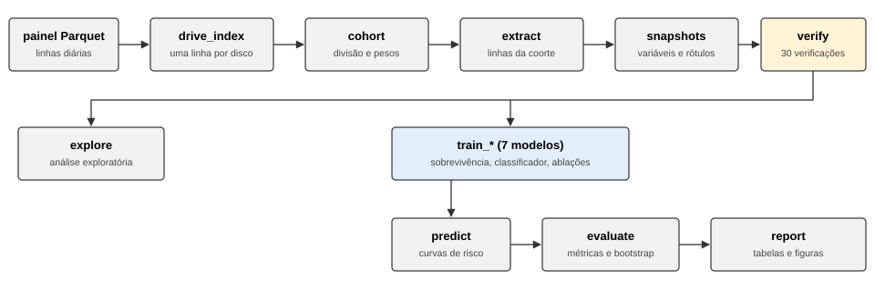
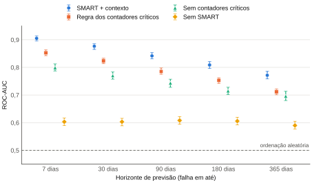
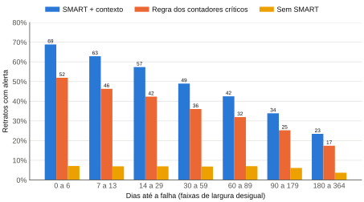
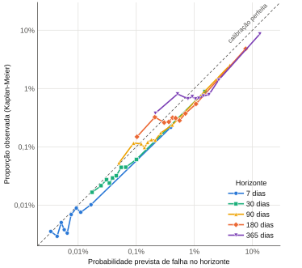

CENTRO ESTADUAL DE EDUCAÇÃO TECNOLÓGICA PAULA SOUZA

FACULDADE DE TECNOLOGIA DA BAIXADA SANTISTA

CURSO SUPERIOR DE TECNOLOGIA EM CIÊNCIA DE DADOS

RELATÓRIO TÉCNICO

**PREVISÃO DE FALHAS EM DISCOS RÍGIDOS COM ATRIBUTOS SMART: análise de sobrevivência sobre o *dataset* Drive Stats da Backblaze**

Kauan Toledo Camargo (Graduando em Ciência de Dados, Fatec Rubens Lara) kauan.camargo01@aluno.cps.sp.gov.br

SANTOS

NOVEMBRO/2026

# RESUMO

Em *data centers*, a falha de um disco rígido exige reconstruir dados de cópias redundantes; prevê-la permite planejar substituições. Este relatório avalia se os atributos de Tecnologia de Automonitoramento, Análise e Relatório (SMART), lidos pelo `smartctl`, estimam a probabilidade e o momento da falha. Utilizou-se o *dataset* Drive Stats, da Backblaze: 646.777.037 registros diários de 478.464 unidades entre 2016 e 2025. Aplicou-se análise de sobrevivência em tempo discreto, com *gradient boosting*, a uma amostra ponderada, avaliada em discos e anos fora do treino. Em 30 dias, os atributos SMART elevaram a área sob a curva *Receiver Operating Characteristic* de 0,603 para 0,873, em média de cinco treinos (regra de contadores SMART: 0,824), e a maior parte desse ganho permaneceu sem os contadores usados pelo operador nas substituições. Por dia de disco, no mesmo limiar nominal, o modelo alertou mais dias anteriores a falhas que a regra (61% contra 46%). Por disco, com igual proporção de discos saudáveis alertados, a vantagem do modelo dependeu de como as inspeções são contadas: foi clara com revisão trimestral dos alertas, mas não com uma única inspeção por disco em dois anos, em que o critério de substituição do operador o igualou ou superou. As falhas sem sinal nesses contadores, cerca de um quinto do total, foram pouco previsíveis, e o risco de 2025 foi superestimado. Conclui-se que os atributos SMART ordenam os discos por risco, mas as probabilidades exigem monitoramento da calibração, e o modelo não prevê a data de falha.

Palavras-chave: análise de sobrevivência; atributos SMART; discos rígidos; manutenção preditiva; aprendizado de máquina.

# LISTA DE ILUSTRAÇÕES

Quadro 1 – Principais atributos SMART utilizados

Figura 1 – Fluxo das etapas de tratamento de dados e modelagem

Quadro 2 – Modelos comparados

Figura 2 – ROC-AUC por horizonte no conjunto de teste, com intervalos de confiança de 95%

Figura 3 – Proporção de retratos de discos que falham com alerta, por dias até a falha (limiar do orçamento de 1%)

Figura 4 – Calibração por decil de risco no conjunto de teste, por horizonte (escalas logarítmicas)

Quadro 3 – Versões do *pipeline* avaliadas no conjunto de teste

# LISTA DE TABELAS

Tabela 1 – Composição da coorte por conjunto e estrato

Tabela 2 – ROC-AUC por horizonte de previsão no conjunto de teste

Tabela 3 – Raridade do evento e precisão média do modelo principal, por horizonte e por estimador

Tabela 4 – ROC-AUC em 30 dias por modelo e por recorte do conjunto de teste

Tabela 5 – Desempenho dos alertas por retrato no conjunto de teste, por orçamento de falsos alarmes

Tabela 6 – Alertas por disco no conjunto de teste, com todos os discos avaliados semanalmente

Tabela 7 – Discos que falham alertados com a mesma proporção de discos sem falha alertados, por janela de contagem

Tabela 8 – Discos que falham alertados no período de teste, considerando o primeiro alerta de qualquer antecedência

Tabela 9 – Retratos de discos que falham com mediana prevista dentro de um ano, por distância real até a falha

Tabela 10 – Risco de falha em 30 dias previsto e observado, por conjunto e ano

Tabela 11 – Razão entre risco previsto e observado em 30 dias no teste, por grupo de discos

# LISTA DE ABREVIATURAS E SIGLAS

| Sigla | Significado |
|---|---|
| F1 | Medida F1 (média harmônica entre precisão e revocação) |
| GB | *Gigabyte* |
| GiB | *Gibibyte* |
| HDD | *Hard Disk Drive* (disco rígido) |
| HGST | *Hitachi Global Storage Technologies* |
| IPCW | *Inverse Probability of Censoring Weighting* (ponderação pelo inverso da probabilidade de censura) |
| LSTM | *Long Short-Term Memory* (rede neural recorrente de memória de longo e curto prazo) |
| PR-AUC | Área sob a curva de precisão e revocação, estimada pela precisão média |
| RAID | *Redundant Array of Independent Disks* |
| ROC | *Receiver Operating Characteristic* |
| ROC-AUC | Área sob a curva ROC |
| SHA-256 | *Secure Hash Algorithm* de 256 bits |
| SMART | *Self-Monitoring, Analysis and Reporting Technology* (Tecnologia de Automonitoramento, Análise e Relatório) |
| SQL | *Structured Query Language* |
| SSD | *Solid State Drive* (unidade de estado sólido) |
| TB | *Terabyte* |
| WDC | *Western Digital Corporation* |

# SUMÁRIO

1 INTRODUÇÃO

1.1 OBJETIVO GERAL

1.2 OBJETIVOS ESPECÍFICOS

2 CONTEXTUALIZAÇÃO DO CENÁRIO

2.1 ATRIBUTOS SMART E FALHAS DE DISCOS EM CAMPO

2.2 O *DATASET* DA BACKBLAZE E A DEFINIÇÃO DE FALHA

2.3 AVALIAÇÃO DE MODELOS: VAZAMENTO, EVENTOS RAROS E DERIVA

2.4 ANÁLISE DE SOBREVIVÊNCIA EM TEMPO DISCRETO E CENSURA

2.5 AMOSTRAGEM, PONDERAÇÃO E CALIBRAÇÃO

2.6 LACUNA E POSICIONAMENTO DO ESTUDO

3 PROCEDIMENTOS METODOLÓGICOS

3.1 APRESENTAÇÃO DO *DATASET*

3.2 DETALHAMENTO DAS ETAPAS DE TRATAMENTO DE DADOS E FERRAMENTAS

4 RESULTADOS DA ANÁLISE E RECOMENDAÇÕES

4.1 GANHO DOS ATRIBUTOS SMART

4.2 POLÍTICA DE SUBSTITUIÇÃO, USO E FALHAS SILENCIOSAS

4.3 ALERTA ANTECIPADO

4.4 VIDA ÚTIL REMANESCENTE

4.5 CALIBRAÇÃO, DERIVA E RETIRADA DE DISCOS

4.6 COMPARAÇÕES COMPLEMENTARES E SENSIBILIDADE

4.7 RECOMENDAÇÕES

5 CONSIDERAÇÕES FINAIS E LIMITAÇÕES DO ESTUDO

REFERÊNCIAS

APÊNDICE A – GUIA DE REPRODUÇÃO DOS RESULTADOS

APÊNDICE B – ANÁLISES DE SENSIBILIDADE

# 1 INTRODUÇÃO

Em *data centers* de armazenamento, a falha de um disco rígido (*Hard Disk Drive*, HDD) obriga o operador a reconstruir os dados a partir de cópias redundantes, e falhas próximas no tempo em um mesmo grupo de discos podem causar perda de dados (MA *et al.*, 2015). Prever quais discos tendem a falhar permite substituí-los de forma planejada, antes que a falha ocorra.

Os próprios discos registram indicadores internos por meio da Tecnologia de Automonitoramento, Análise e Relatório (*Self-Monitoring, Analysis and Reporting Technology*, SMART). Esses indicadores, chamados atributos SMART, são lidos por ferramentas como o `smartctl`, do pacote *smartmontools*, e incluem contadores de setores realocados, de erros não corrigidos e de horas de funcionamento. A questão que orienta este relatório é se esses atributos permitem estimar a probabilidade de falha de um disco e o momento provável em que ela ocorrerá.

O estudo delimita-se aos discos rígidos do *dataset* público Drive Stats, publicado pela empresa de armazenamento em nuvem Backblaze, no período de 1º de janeiro de 2016 a 31 de dezembro de 2025. O painel bruto reúne 646.777.037 registros diários de 478.464 números de série, incluídas as unidades de estado sólido (*Solid State Drives*, SSD), que foram excluídas da análise por constituírem outra população de falhas. Os resultados referem-se à carga de trabalho de um *data center* de armazenamento e ao critério de falha desse operador, e não se estendem automaticamente a outros operadores nem a computadores pessoais.

A relevância do tema para a formação do tecnólogo em Ciência de Dados reside na combinação de problemas que o estudo exige tratar: volume de dados acima da memória disponível, eventos raros, observações incompletas (discos retirados antes de falhar ou ainda em operação ao fim do período) e risco de vazamento de informação entre treino e teste. Para o mercado, o estudo mede, por dia de disco e por disco, quantas falhas um sistema de alerta baseado em SMART antecipa e quantos falsos alarmes gera, medidas das quais depende a decisão de adotá-lo. O público-alvo compreende gestores de infraestrutura de *data centers*, equipes de operação de armazenamento e analistas que desenvolvem modelos de manutenção preditiva.

## 1.1 OBJETIVO GERAL

Avaliar se os atributos SMART coletados diariamente pelo `smartctl` permitem estimar a probabilidade e o momento provável de falha de discos rígidos em operação nos *data centers* da Backblaze, quantificando o ganho que oferecem em relação às informações disponíveis sem eles.

## 1.2 OBJETIVOS ESPECÍFICOS

a) estruturar a previsão de falhas como problema de análise de sobrevivência em tempo discreto, com tratamento de censura à direita;

b) mensurar o ganho de discriminação dos atributos SMART em relação a um modelo que usa apenas o modelo comercial do disco, o fabricante, a capacidade, o tempo de serviço e o indicador de disco já em operação no início do painel;

c) verificar, por ablação, quanto desse ganho permanece quando se retiram do modelo os contadores usados pelo operador para decidir substituições;

d) avaliar o desempenho do modelo como sistema de alerta antecipado sob orçamentos fixos de falsos alarmes;

e) verificar a calibração das probabilidades e das estimativas de vida útil remanescente, bem como sua estabilidade ao longo do tempo.

# 2 CONTEXTUALIZAÇÃO DO CENÁRIO

## 2.1 ATRIBUTOS SMART E FALHAS DE DISCOS EM CAMPO

O SMART foi concebido como mecanismo interno de alerta: o próprio disco aciona um sinal binário quando algum atributo ultrapassa um limite definido pelo fabricante. Murray *et al.* (2005) relatam que, com esse algoritmo de limites, os fabricantes estimam a taxa de detecção de falhas entre 3% e 10%, e que testes estatísticos não paramétricos sobre os mesmos atributos detectam uma parcela maior de falhas.

Os estudos de campo publicados em 2007 mostraram que a confiabilidade observada difere da especificada. Schroeder e Gibson (2007), ao analisar registros de substituição de cerca de 100 mil discos, constataram taxas anuais de substituição tipicamente acima de 1%, frequentemente entre 2% e 4% e de até 13%, valores superiores aos derivados do tempo médio até a falha informado pelos fabricantes. O evento analisado por esses autores é a substituição do disco, e não a falha física comprovada, distinção que reaparece no *dataset* deste estudo (seção 2.2).

No mesmo ano, Pinheiro *et al.* (2007) analisaram uma população de discos da Google e identificaram atributos SMART fortemente associados à falha: após o primeiro erro de varredura, um disco tinha 39 vezes mais probabilidade de falhar nos 60 dias seguintes do que um disco sem esse erro. Os mesmos autores, porém, verificaram que mais de 56% dos discos que falharam não apresentavam contagem em nenhum dos quatro sinais mais fortes e que mais de 36% não apresentavam contagem em nenhum dos atributos analisados, exceto a temperatura. Concluíram que "modelos baseados apenas em parâmetros SMART dificilmente serão úteis para prever falhas de discos individuais" (PINHEIRO *et al.*, 2007, p. 17, tradução própria). Essas falhas sem sinal prévio nos contadores são denominadas, neste relatório, falhas silenciosas.

Outros trabalhos detalham o mecanismo por trás dos contadores. Bairavasundaram *et al.* (2007) acompanharam 1,53 milhão de discos por 32 meses e mostraram que erros latentes de setor apresentam localidade temporal e espacial, isto é, um disco que começa a acumular erros tende a continuar acumulando-os. Ma *et al.* (2015) verificaram que a contagem de setores realocados se correlaciona fortemente com falhas iminentes e relatam que a substituição proativa com base nesse contador eliminou 88% dos erros triplos de disco em grupos de *Redundant Array of Independent Disks* (RAID). Em sentido complementar, Lu *et al.* (2020), com dados de 380 mil discos distribuídos em 64 *data centers*, mostraram que métricas de desempenho do sistema combinadas aos atributos SMART superam o uso exclusivo dos atributos SMART.

## 2.2 O *DATASET* DA BACKBLAZE E A DEFINIÇÃO DE FALHA

A Backblaze registra diariamente um retrato (*snapshot*) de cada disco em operação, com informações básicas da unidade e os atributos SMART reportados, e publica esses registros em arquivos diários (BACKBLAZE, 2026). O esquema de colunas muda de um trimestre para outro, o que exige alinhamento dos dados antes de qualquer análise. Como a falha é definida pela presença do disco no dia anterior, discos que falham no primeiro dia de operação não aparecem no painel (DOYLE, 2026a). O conjunto tornou-se referência em pesquisa: a empresa contabiliza mais de 227 trabalhos e artigos que o citam como fonte primária desde 2018 (DOYLE, 2026b).

A definição de falha adotada pelo operador é central para a interpretação de qualquer modelo treinado nesse *dataset*. Beach (2014) informa que a Backblaze considera falho o disco removido e substituído por ter parado de funcionar ou por apresentar evidência de falha iminente, e que essa evidência vem dos atributos SMART 5, 187, 188, 197 e 198. Sobre o atributo 187, o autor afirma: "assim que o SMART 187 fica acima de zero, a substituição do disco é programada" (BEACH, 2014, não paginado, tradução própria).

Klein (2024) classifica as falhas em reativas (o disco não inicia, não responde ou não permanece operacional) e proativas (indicadores como SMART ou verificações do sistema de arquivos apontam falha provável); no terceiro trimestre de 2024, 53,0% das 1.361 falhas foram proativas, e o *dataset* público registra apenas o indicador binário de falha, sem o tipo. Em 2025, a empresa descreveu um monitor que remove o acesso a discos cujo número de erros não corrigidos ultrapassa um limite e regras baseadas em chamados de manutenção para decidir se um disco falhou. No mesmo relatório, um modelo Toshiba de 16 *terabytes* (TB) apresentou taxa anualizada de falhas de 16,95% no terceiro trimestre de 2025, em razão de retiradas ligadas a uma atualização de *firmware*, falha que, segundo a empresa, não era mecânica (BACKBLAZE, 2025).

Disso decorre um problema de circularidade: parte do rótulo de falha é definida pelos mesmos contadores SMART que o modelo usa como variáveis explicativas. Um modelo que aprende que o atributo 187 acima de zero precede a falha pode estar aprendendo a política de substituição do operador, e não a degradação física do disco. Klein (2016) mostra a dimensão do fenômeno: 76,7% dos discos falhos e 4,2% dos discos em operação tinham ao menos um dos cinco atributos acima de zero, de modo que 23,3% das falhas ocorreram sem aviso nesses atributos.

Há ainda particularidades de codificação. O `smartctl` oferece formatos de leitura específicos para atributos cujo valor bruto (*raw*) reúne vários campos, como três inteiros de 16 bits ou horas e milissegundos, e seu banco de dados de unidades aplica esses formatos aos atributos 188 e 240 de famílias de discos Seagate (SMARTMONTOOLS, 2025). Lidos como um único inteiro, esses valores não representam contagens e exigem tratamento antes do uso como variável numérica.

## 2.3 AVALIAÇÃO DE MODELOS: VAZAMENTO, EVENTOS RAROS E DERIVA

Kapoor e Narayanan (2023) identificaram vazamento de dados (*data leakage*) em pelo menos 294 artigos de 17 áreas que empregam aprendizado de máquina, e incluem, entre os tipos descritos, a dependência temporal e a falta de independência entre amostras de treino e teste. Na previsão de falhas de discos, o efeito é mensurável. Xu *et al.* (2018), em dados de produção da Microsoft, obtiveram taxa de verdadeiros positivos de 91,64% com validação cruzada aleatória e de 36,50% com divisão temporal, ambas a 0,1% de falsos positivos, e concluíram que a validação cruzada nem sempre reflete a eficácia real de um modelo de previsão. Lu *et al.* (2020, p. 158) avaliaram seus modelos com validação cruzada aleatória em cinco partições, o que torna seus resultados não comparáveis aos de uma divisão por disco e por tempo.

Falhas são eventos raros, e a área sob a curva *Receiver Operating Characteristic* (ROC-AUC) pode ser enganosa nessa condição: Saito e Rehmsmeier (2015) mostram que a curva de precisão e revocação é mais informativa que a curva ROC em dados desbalanceados. Por esse motivo, a área sob a curva de precisão e revocação (PR-AUC) deve acompanhar a ROC-AUC. Na literatura sobre o *dataset* da Backblaze, Han *et al.* (2023) avaliam seus modelos com taxa de falsos positivos fixada, em geral, em 1%, calculada por dia e tomada em média no período de avaliação, e mostram que a distribuição dos atributos muda ao longo do tempo, fenômeno que denominam deriva de conceito (*concept drift*). Em 15 conjuntos de dados da Backblaze e da Alibaba, a adaptação a essa deriva elevou a medida F1 (média harmônica entre precisão e revocação) de seus modelos entre 26,8% e 53,2%. Amram *et al.* (2021), com árvores ótimas de sobrevivência e de classificação em um único modelo de disco do mesmo *dataset*, relatam, por disco, sensibilidade de aproximadamente 50% com taxa de falsos alarmes próxima de 10% para horizontes de 30 a 90 dias. Rincón C. *et al.* (2017) treinaram seus modelos com os dados da Backblaze de 2015 e os avaliaram nos de 2016, isto é, em um ano posterior ao de treino. Sua árvore de decisão identificou ao menos 52% das falhas, e o preditor original da Backblaze, usado como comparação, identificou 60%, com quatro a cinco falsos alarmes por previsão correta.

## 2.4 ANÁLISE DE SOBREVIVÊNCIA EM TEMPO DISCRETO E CENSURA

Um classificador binário responde se o disco falhará dentro de um único horizonte, fixado de antemão, e exige decidir o rótulo de discos cujo destino é desconhecido: discos retirados sem falha e discos ainda em operação ao fim do período de observação. Esses casos são observações censuradas à direita, e Vock *et al.* (2016) mostram que descartá-los ou tratá-los como não eventos são técnicas *ad hoc* que introduzem viés na estimativa do risco. O estimador de Kaplan-Meier (KAPLAN; MEIER, 1958) calcula a probabilidade de sobrevivência na presença dessa censura: a cada tempo em que ocorre uma falha, multiplica-se a sobrevivência acumulada pela proporção de unidades ainda em risco que não falharam. Na Backblaze, a censura é frequente: Siemroth e Park (2026) contabilizaram 146.943 discos, cerca de 31% de sua amostra, retirados sem falha, e os trataram como censurados à direita.

A análise de sobrevivência em tempo discreto acomoda a censura e produz, com um único modelo, uma distribuição do tempo até a falha coerente entre horizontes. O futuro de cada observação é dividido em intervalos, e cada observação gera uma linha por intervalo em que permanece em risco (formato pessoa-período). Suresh *et al.* (2022) mostram que, como a verossimilhança desse formato é binomial, qualquer algoritmo capaz de otimizar uma verossimilhança binomial estima os riscos por intervalo, inclusive classificadores de aprendizado de máquina; os autores alertam que o desempenho varia com o número de intervalos escolhido.

A avaliação de modelos de sobrevivência também exige cuidados com a censura. Uno *et al.* (2011) mostram que a estatística C de Harrell (HARRELL *et al.*, 1982) converge para uma medida que depende da distribuição de censura do estudo e propõem um estimador ponderado que, sob censura independente, não depende dela. Quando a censura decorre do encerramento da coleta em uma data fixa (censura administrativa), o tempo máximo de acompanhamento de cada observação é conhecido de antemão.

Kvamme e Borgan (2023) mostram que, nesse caso, o escore de Brier ponderado pelo inverso da probabilidade de censura (*Inverse Probability of Censoring Weighting*, IPCW) pode ser enviesado se as covariáveis informam o tempo de censura, o que ocorre se a distribuição das covariáveis muda com o tempo de calendário. Os autores propõem uma versão do escore que usa os tempos de censura conhecidos, sem estimar a distribuição de censura. Xu *et al.* (2026) descrevem o vazamento correspondente no treino: se as variáveis revelam a data da observação, o modelo pode aprender quanto acompanhamento havia disponível, e não o risco real, o que infla a ROC-AUC em horizonte fixo. Esses autores recomendam que uma tarefa de previsão em horizonte H só use observações com pelo menos H de acompanhamento possível.

## 2.5 AMOSTRAGEM, PONDERAÇÃO E CALIBRAÇÃO

Com eventos raros e dados volumosos, é comum amostrar todos os eventos e uma fração dos não eventos, corrigindo depois as estimativas por ajuste das probabilidades a priori ou por ponderação pelo inverso da probabilidade de inclusão (KING; ZENG, 2001). Sugiyama *et al.* (2007), no contexto de mudança na distribuição das covariáveis, observam que a ponderação completa é consistente, mas pode ter variância elevada, e propõem elevar os pesos de importância a um expoente entre 0 e 1, que controla a troca entre viés e variância; os autores recomendam escolher esse expoente por validação cruzada ponderada.

Alterar o peso relativo das classes tem custo na calibração: Van den Goorbergh *et al.* (2022) verificaram que correções de desbalanceamento levaram a superestimação acentuada das probabilidades sem melhorar a ROC-AUC. Uma recalibração posterior pode corrigir a distorção. Niculescu-Mizil e Caruana (2005) mostram que árvores com *boosting* produzem distorção em forma sigmoide, corrigida pelo escalonamento de Platt, um ajuste logístico de dois parâmetros.

Por fim, observações diárias de um mesmo disco são quase idênticas e não são independentes. Pang *et al.* (2023) mostram que o *bootstrap* por agrupamento, que reamostra unidades inteiras em vez de linhas, atinge cobertura adequada para intervalos de confiança da ROC-AUC com dados correlacionados.

## 2.6 LACUNA E POSICIONAMENTO DO ESTUDO

Os trabalhos revisados deixam dois pontos em aberto para o *dataset* da Backblaze. O primeiro é a circularidade do rótulo: os estudos de previsão consultados sobre esse *dataset* (AMRAM *et al.*, 2021; HAN *et al.*, 2023) usam o indicador de falha como publicado, sem verificar quanto do desempenho depende dos contadores que o operador usa para decidir substituições. O segundo é a avaliação: resultados obtidos com validação cruzada aleatória não indicam o desempenho em discos e períodos novos (XU *et al.*, 2018), e a ROC-AUC isolada não indica o desempenho na prevalência real do evento (SAITO; REHMSMEIER, 2015). A avaliação em anos posteriores aos de treino tem precedente nesse *dataset* (RINCÓN C. *et al.*, 2017), assim como os modelos de sobrevivência (AMRAM *et al.*, 2021). A estimação da vida útil remanescente também foi feita por Basak *et al.* (2018) e Coursey *et al.* (2021) com redes neurais recorrentes (*Long Short-Term Memory*, LSTM) em um único modelo de disco, o Seagate ST4000DM000. Nenhuma dessas técnicas é, portanto, nova isoladamente. A contribuição deste relatório está na combinação desses elementos. Um modelo de sobrevivência em tempo discreto é aplicado a todos os modelos de disco e avaliado em discos e anos não vistos no treino, com métricas ponderadas para a prevalência do evento na população. A ele se somam ablações que retiram do modelo os contadores usados pelo operador, a comparação dos alertas por disco, e não apenas por dia, e a verificação da correspondência entre os quantis previstos de vida útil remanescente e as falhas observadas.

# 3 PROCEDIMENTOS METODOLÓGICOS

Adotou-se abordagem quantitativa, de caráter descritivo e preditivo, fundamentada em dados secundários. O problema foi formulado como análise de sobrevivência em tempo discreto, e o efeito dos atributos SMART foi medido por comparação entre modelos que diferem apenas no conjunto de variáveis de entrada (ablação). Todo o processamento foi implementado como um *pipeline* reprodutível, descrito na seção 3.2 e no APÊNDICE A.

## 3.1 APRESENTAÇÃO DO *DATASET*

Selecionou-se o *dataset* Drive Stats da Backblaze por três razões. Quanto à confiabilidade, os registros são coletados de forma automatizada, todos os dias, com o pacote *smartmontools*, nos discos em produção do operador (BEACH, 2014). Quanto à credibilidade, a empresa coleta e publica os dados desde 2013 (BACKBLAZE, 2026), e o conjunto é utilizado como fonte primária em ao menos 227 trabalhos (DOYLE, 2026b), entre eles estudos revisados por pares sobre previsão de falhas e confiabilidade de discos (AMRAM *et al.*, 2021; HAN *et al.*, 2023; SIEMROTH; PARK, 2026). Quanto à aplicabilidade, entre as fontes consultadas, é o *dataset* público que combina atributos SMART diários, indicador de falha e uma década de acompanhamento de centenas de milhares de discos, o que permite estimar curvas de sobrevivência e avaliar o modelo em anos posteriores aos de treino.

Utilizou-se o painel de 1º de janeiro de 2016 a 31 de dezembro de 2025, armazenado em um único arquivo Parquet de cerca de 21,8 *gibibytes* (GiB). Antes de qualquer filtro, o painel contém 646.777.037 linhas, uma por unidade e por dia, de 478.464 números de série, dos quais 26.679 têm ao menos um registro de falha; essas contagens incluem os SSD. A integridade do arquivo é verificada pelo resumo criptográfico *Secure Hash Algorithm* de 256 bits (SHA-256) antes da varredura do painel, de modo que qualquer alteração no arquivo é detectada antes da análise. Cada linha contém as seguintes variáveis:

a) **date**: data do registro diário;

b) **serial_number**: número de série, que identifica o disco;

c) **model** e **capacity_bytes**: modelo comercial e capacidade da unidade;

d) **failure**: indicador binário igual a 1 no último dia operacional de um disco considerado falho pelo operador;

e) **smart_N_raw** e **smart_N_normalized**: valor bruto e valor normalizado de cada atributo SMART N reportado pelo disco.

O Quadro 1 apresenta os atributos SMART mais relevantes para a análise. A lista completa de variáveis é descrita na seção 3.2.

**Quadro 1 – Principais atributos SMART utilizados**

| Atributo | Nome | Papel na análise |
|---|---|---|
| 5 | *Reallocated Sectors Count* (setores realocados) | contador crítico; usado na regra dos contadores críticos |
| 187 | *Reported Uncorrectable Errors* (erros não corrigidos reportados) | contador crítico; usado na regra dos contadores críticos |
| 188 | *Command Timeout* (comandos expirados) | usado pela Backblaze na decisão de substituição; apenas o valor normalizado é variável do modelo |
| 197 | *Current Pending Sector Count* (setores pendentes) | contador crítico; usado na regra dos contadores críticos |
| 198 | *Offline Uncorrectable* (erros não corrigíveis em varredura) | contador crítico; usado na regra dos contadores críticos |
| 9 | *Power-On Hours* (horas ligado) | idade e uso |
| 4, 12, 193 | partidas e paradas, ciclos de energia, ciclos de carga do cabeçote | uso |
| 240, 241, 242 | horas de voo do cabeçote, blocos lógicos gravados e lidos | uso |

Fonte: Elaborado pelo autor com base em Beach (2014).

Na preparação, foram tratadas as seguintes particularidades do painel:

a) **unidades de estado sólido**: 3.898 SSD foram excluídos por padrão de nome de modelo;

b) **nomes de modelo**: a quantidade de espaços em branco nos nomes varia entre anos e foi normalizada;

c) **linhas duplicadas no mesmo dia**: manteve-se uma linha por disco e por dia, a mais completa;

d) **registros após a falha**: 710 unidades do painel bruto (694 discos rígidos e 16 SSD) continuam reportando após o primeiro registro de falha, das quais 561 pertencem à coorte analisada; considerou-se a primeira falha como o evento e descartaram-se as linhas posteriores;

e) **colunas em texto**: atributos armazenados como texto foram convertidos para número, com contagem dos valores que falham na conversão;

f) **valores brutos compactados**: nos retratos de discos Seagate, 2,9% dos valores brutos do atributo 188 são maiores ou iguais a 65.536, e 1,1% dos valores brutos do atributo 240 são maiores ou iguais a 2³², proporções medidas neste projeto (registradas em `config/study.toml`) e compatíveis com os formatos de vários campos que a documentação do `smartctl` associa a esses atributos (SMARTMONTOOLS, 2025). Para o 188, usou-se apenas o valor normalizado; para o 240, mantiveram-se os 32 bits inferiores, que correspondem às horas nesse formato;

g) **lacunas de registro**: todas as janelas temporais são definidas por datas de calendário, e não por número de linhas, de modo que dias sem registro não deslocam as janelas das variáveis de tendência.

## 3.2 DETALHAMENTO DAS ETAPAS DE TRATAMENTO DE DADOS E FERRAMENTAS

Utilizou-se a linguagem Python 3.13, com dependências fixadas pelo gerenciador *uv*, em razão da disponibilidade de bibliotecas para dados volumosos e aprendizado de máquina. O painel completo não cabe na memória de um computador pessoal; por isso, toda operação sobre ele foi feita com o DuckDB, banco de dados analítico que executa consultas em *Structured Query Language* (SQL) diretamente sobre arquivos Parquet, em blocos de meses. A modelagem utilizou o LightGBM (KE *et al.*, 2017), implementação de *gradient boosting* em árvores de decisão escolhida por aceitar pesos por linha, variáveis categóricas, valores ausentes e treino em lotes. As etapas foram encadeadas pelo executor *data-pipeline*, de código aberto, que registra um ponto de verificação por etapa e só executa novamente o que depende de entradas alteradas. A execução que origina os resultados ocorreu em 10 e 11 de novembro de 2026, em um computador com processador AMD Ryzen 5 4600G e 15 GiB de memória, em cerca de duas horas. Ela reproduziu, com diferença máxima de 1,1 × 10⁻⁴, as métricas de uma execução anterior do mesmo código em outro computador, com processador AMD Ryzen 7 5700X e 31 GiB de memória (APÊNDICE A). A Figura 1 apresenta o fluxo das etapas.

**Figura 1 – Fluxo das etapas de tratamento de dados e modelagem**

Fonte: Elaborado pelo autor (2026).

As etapas são descritas a seguir:

a) **indexação** (`drive_index`): varredura do painel completo com o DuckDB, mês a mês, que gera uma linha por disco com modelo, capacidade, primeira e última data observada e data da primeira falha;

b) **coorte** (`cohort`): divisão dos discos, com a biblioteca *pandas*, em treino (70%), validação (10%) e teste (20%) por um *hash* SHA-256 do número de série, de modo que nenhum disco aparece em mais de um conjunto. A divisão também é temporal: treino e validação vão até 31 de dezembro de 2023, e o teste começa em 1º de janeiro de 2024. Excluíram-se 100.065 discos sem registros na janela de seu conjunto, como discos de teste que saíram do painel antes de 2024, e restaram 374.501 discos elegíveis;

c) **amostragem e pesos**: na mesma etapa, mantiveram-se os 22.230 discos elegíveis que falham em algum momento e sortearam-se cerca de 10% dos demais (35.079 de 352.271), por um segundo *hash* do número de série. Cada disco recebe peso igual ao inverso de sua probabilidade de inclusão, 1 ou 10 (KING; ZENG, 2001). Com esses pesos, proporções, precisão, PR-AUC e calibração referem-se à população de discos rígidos elegíveis, e não à amostra enriquecida com falhas. A Tabela 1 apresenta a composição da coorte;

d) **extração** (`extract`): leitura, com o DuckDB, das linhas diárias dos discos da coorte, restrita às colunas de interesse, sem duplicatas e cortada na primeira falha;

e) **retratos e rótulos** (`snapshots`): seleção, com o DuckDB, de um retrato a cada 7 dias por disco (peso 7) e de todos os dias nos 90 dias anteriores a uma falha visível no período do conjunto (peso 1); o peso final é o produto desse peso pelo peso do disco. Cada retrato recebe a duração, isto é, os dias até a primeira falha ou até o último dia em que o disco é sabidamente operacional (0 é o dia do retrato), e o indicador de falha ou de censura. Discos de treino e validação são censurados em 31 de dezembro de 2023, de modo que uma falha posterior é desconhecida para o treino, e não tratada como ausência de falha (VOCK *et al.*, 2016);

f) **variáveis**: 64 variáveis, calculadas com o DuckDB e definidas por critérios de domínio e de qualidade dos dados, e não selecionadas pelo desempenho: 23 valores brutos e 10 normalizados de atributos SMART; 24 variáveis de tendência, que medem o crescimento de 12 atributos nos 7 e nos 30 dias de calendário anteriores ao retrato, em linha com a localidade temporal de erros descrita por Bairavasundaram *et al.* (2007); 2 variáveis com os dias cobertos por essas janelas; e 5 variáveis de contexto: dias em serviço, indicador de disco já em operação no primeiro dia do painel, capacidade, modelo (os 30 mais frequentes no treino, os demais agrupados) e fabricante. Valores ausentes são tratados pelo próprio LightGBM;

g) **controle de vazamento temporal**: a data de calendário não é variável, para reduzir o vazamento descrito por Xu *et al.* (2026), e modelo e capacidade vêm dos primeiros registros do disco, com a capacidade arredondada a 10 *gigabytes* (GB), para que não dependam de quanto tempo o disco sobrevive. Dias em serviço e modelo ainda revelam parcialmente a data do retrato, de modo que esse vazamento é reduzido, e não eliminado;

h) **portão de verificação** (`verify`): antes de qualquer treino, 56 verificações automáticas, executadas pela biblioteca *data-verify*, que acompanha o executor, conferem a separação dos conjuntos por disco e por tempo, os pesos, o esquema de colunas e a ausência de colunas que revelem o desfecho; parte delas recalcula os rótulos de forma independente. Qualquer erro interrompe o *pipeline*;

i) **análise exploratória** (`explore`): diagnósticos sem uso na escolha das variáveis, como a taxa anualizada de falhas por modelo de disco e a ROC-AUC de cada atributo isolado;

j) **modelagem** (`train`): o futuro de cada retrato foi dividido em sete intervalos (0 a 6, 7 a 13, 14 a 29, 30 a 59, 60 a 89, 90 a 179 e 180 a 364 dias), mais curtos perto do retrato, onde se concentram as decisões de operação. Cada retrato gera uma linha por intervalo em que permanece em risco (formato pessoa-período), e o LightGBM estima o risco discreto hₖ(x), isto é, a probabilidade de falha no intervalo k dado que o disco estava operacional no início dele, com o início do intervalo como variável adicional (SURESH *et al.*, 2022). Um retrato censurado no meio de um intervalo contribui com a fração observada desse intervalo, aproximação atuarial que supõe risco uniforme dentro dele. Os 7.597.961 retratos de treino geraram 48.083.205 linhas pessoa-período;

k) **grandezas previstas**: a probabilidade de sobreviver até o fim do intervalo k é S(tₖ) = [1 − h₁(x)] × [1 − h₂(x)] × … × [1 − hₖ(x)], e a probabilidade de falha em até H dias é 1 − S(H), para H igual a 7, 30, 90, 180 e 365. Da mesma curva, interpolada linearmente dentro de cada intervalo, obtêm-se os dias em que a probabilidade acumulada de falha atinge 10%, 50% (mediana da vida útil remanescente) e 90%. Esses dias são quantis da distribuição prevista, e não intervalos de confiança; além de 365 dias, a resposta é apenas "mais de um ano";

l) **pesos de treino e calibração**: em testes preliminares na menor escala do projeto, os pesos amostrais completos fizeram o treino parar após cerca de 30 iterações, porque um dia saudável pesava dezenas de vezes mais que um dia de falha. Nesses testes, elevar os pesos de treino ao expoente 0,5, heurística inspirada na ponderação atenuada de Sugiyama *et al.* (2007), melhorou a ordenação nos discos de validação, e esse expoente foi adotado sem busca de outros valores. O expoente incide sobre o peso final de cada linha pessoa-período, isto é, sobre o produto do peso amostral *p* pela fração observada do intervalo *f* (item j): o peso de treino é (*p* × *f*)^0,5, e não *f* × *p*^0,5. Essa fração também é, portanto, atenuada, o que constitui uma aproximação adicional. Como a atenuação distorce a escala das probabilidades, cada intervalo recebeu uma recalibração de Platt de dois parâmetros (NICULESCU-MIZIL; CARUANA, 2005), ajustada com os pesos completos em metade dos discos de validação; a outra metade serviu à parada antecipada;

m) **hiperparâmetros**: taxa de aprendizado de 0,03, 31 folhas por árvore, no mínimo 200 amostras por folha, subamostragem de 80% das linhas e das variáveis por árvore e regularização L2 (penalidade quadrática sobre os valores das folhas) de 5,0, suavização de 20 nas variáveis categóricas e parada antecipada após 100 iterações sem melhora na perda de validação, com limite de 2.000 iterações; a melhor iteração do modelo principal foi a 419;

n) **previsão, avaliação e relatório** (`predict`, `evaluate`, `report`): aplicação dos modelos aos discos de validação e teste, cálculo das métricas descritas ao fim desta seção e geração automática das tabelas usadas no capítulo 4.

A amostragem, a janela diária de 90 dias, os intervalos e os hiperparâmetros foram fixados antes da execução completa, por custo computacional, sem busca por validação; o expoente veio dos testes preliminares descritos no item l. Mediu-se o efeito do expoente e da semente de treino (seção 4.6 e APÊNDICE B), mas não o das demais escolhas.

**Tabela 1 – Composição da coorte por conjunto e estrato**

| Conjunto | Discos que falham em algum momento | Demais discos (amostra de 10%) | Discos com falha visível no período do conjunto | Retratos |
|---|---|---|---|---|
| Treino | 17.880 | 24.450 | 12.220 | 7.597.961 |
| Validação | 2.566 | 3.431 | 1.772 | 1.077.429 |
| Teste | 1.784 | 7.198 | 1.784 | 825.321 |
| Total | 22.230 | 35.079 | 15.776 | 9.500.711 |

Fonte: Elaborado pelo autor com base em Backblaze (2026), no resumo da coorte (`cohort-summary.json`) e nas contagens por conjunto (`explore/split_counts.csv`).

A diferença entre a primeira e a terceira coluna decorre da divisão temporal: um disco de treino que falha em 2024 pertence ao estrato dos que falham, mas, para o treino, é uma observação censurada em 31 de dezembro de 2023. Dos 26.679 números de série com registro de falha no painel bruto, 22.230 estão na coorte; os demais 4.449 são SSD ou discos sem registros na janela de seu conjunto.

Para isolar o efeito dos atributos SMART, foram treinados os modelos do Quadro 2, com o mesmo algoritmo, os mesmos retratos e os mesmos hiperparâmetros. Há duas exceções: o modelo apenas com contexto usa suas cinco variáveis em todas as árvores, e os modelos secundários param após menos iterações sem melhora (de 20 a 60), para reduzir o tempo de treino.

**Quadro 2 – Modelos comparados**

| Modelo | Variáveis ou definição | Pergunta que responde |
|---|---|---|
| Sobrevivência, SMART + contexto | todas as 64 variáveis | modelo principal |
| Sobrevivência, apenas contexto (sem SMART) | modelo, fabricante, capacidade, dias em serviço, indicador de início do painel | o que se prevê sem SMART |
| Sobrevivência sem contadores críticos | todas, exceto os atributos 5, 187, 188, 197 e 198 (brutos, normalizados e tendências) | quanto do ganho permanece sem os atributos da política de substituição |
| Sobrevivência, contexto + uso | contexto mais os contadores de uso 4, 9, 12, 193, 240, 241 e 242 | se o ganho vem apenas de medir idade e desgaste |
| Sobrevivência com expoente 0,75 ou 1,0 | variáveis do modelo principal; pesos de treino elevados a 0,75 ou pesos completos | sensibilidade ao expoente dos pesos de treino |
| Sobrevivência recalibrada no último ano | árvores do modelo principal, recalibradas só com 2023 | se uma recalibração recente corrige a perda de calibração |
| Classificador de 30 dias | variáveis do modelo principal; rótulo "falha em até 30 dias" | se o modelo de sobrevivência perde discriminação em relação a um classificador dedicado |
| Réplicas com outras sementes | modelo principal e classificador de 30 dias, treinados com quatro sementes adicionais cada | quanto as métricas variam de um treino para outro |
| Regra dos contadores críticos | soma de log(1 + x) dos valores brutos de 5, 187, 197 e 198, sem treino | desempenho de uma heurística simples baseada nos contadores de setores e de erros não corrigidos |

Fonte: Elaborado pelo autor (2026).

A regra dos contadores críticos é uma heurística construída para este estudo, e não a regra de substituição efetivamente aplicada pelo operador. Ela exclui o atributo 188 porque, em uma execução preliminar, os valores compactados desse atributo nos discos Seagate consumiam 89% de seu orçamento de falsos alarmes. Pelo mesmo motivo, os contadores críticos da regra e da definição de falha silenciosa são os atributos 5, 187, 197 e 198, enquanto a ablação sem contadores críticos retira também o 188.

A avaliação usou apenas os discos de teste, observados em 2024 e 2025, com todas as métricas ponderadas pelos pesos amostrais. A unidade de análise é o retrato (um disco em um dia), salvo indicação em contrário. Foram calculadas:

a) **discriminação por horizonte**: ROC-AUC e PR-AUC para falha em até 7, 30, 90, 180 e 365 dias. A PR-AUC, incluída porque a falha é rara (SAITO; REHMSMEIER, 2015), é estimada pela precisão média (*average precision*). O estimador principal é o de acompanhamento completo, que só usa retratos datados ao menos H − 1 dias antes do fim do painel, como recomendam Xu *et al.* (2026): positivos falham dentro do horizonte, negativos são observados em operação até o fim dele, e os discos retirados antes disso são descartados;

b) **estimadores alternativos**: o estimador de situação conhecida usa todos os retratos cujo desfecho no horizonte é conhecido e infla a proporção de positivos nos horizontes longos; em 30 dias, difere do principal em no máximo 0,001 na ROC-AUC e é usado nos recortes, nos alertas e nas sementes. O estimador IPCW repondera os retratos de situação conhecida pelo inverso da probabilidade de não terem sido censurados (VOCK *et al.*, 2016). Nenhum dos estimadores trata a retirada de discos relacionada à saúde (KVAMME; BORGAN, 2023). Calculou-se ainda a ROC-AUC com um retrato sorteado por disco;

c) **concordância**: estatísticas C de Harrell e de Uno (HARRELL *et al.*, 1982; UNO *et al.*, 2011) entre o escore de risco (o negativo do número esperado de dias operacionais no ano seguinte) e o tempo até a falha, calculadas, por custo computacional, em 299.930 retratos de 3.267 discos inteiros;

d) **recortes**: positivos com pelo menos 7 dias de antecedência, já que os últimos dias podem refletir o defeito que motivou a retirada, e falhas silenciosas, isto é, discos que falham sem nenhum dos contadores 5, 187, 197 e 198 acima de zero em seus retratos de teste; esses dois recortes restringem apenas os positivos. Os recortes de fabricante e de capacidade restringem positivos e negativos;

e) **alerta por retrato**: limiares definidos na metade de calibração da validação para que 0,1%, 0,3% ou 1% dos retratos saudáveis gerem alerta (orçamento de falsos alarmes), valores que correspondem aos pontos de operação de Xu *et al.* (2018) e de Han *et al.* (2023); retrato saudável é o de um disco observado em operação nos 30 dias seguintes; no teste, mediram-se a taxa de falsos alarmes, a precisão e a revocação;

f) **alerta por disco**: todos os discos avaliados no mesmo calendário semanal, o dos retratos amostrados, com a proporção dos discos que falham alertados nos 30 dias anteriores à falha e a dos discos sem falha alertados no período de teste; para comparar modelos com a mesma proporção de discos sem falha alertados, fixou-se ainda, no próprio teste, o limiar que alerta 1%, 2,5% ou 5% deles, com a contagem feita por trimestre, por ano e no período inteiro, neste também com o primeiro alerta de qualquer antecedência e os dias entre ele e a falha e no ponto da regra com limiar zero, que corresponde ao critério do operador, nas cinco sementes do modelo principal;

g) **calibração**: probabilidade prevista média contra a proporção observada por Kaplan-Meier, por decil de risco, e razão entre o risco previsto e o observado em 30 dias por ano, também separada por capacidade, tempo em serviço, fabricante e modelo de disco, inclusive entre os 30 modelos mais frequentes no treino e os demais;

h) **vida útil remanescente**: entre os retratos cujo dia previsto para 10%, 50% ou 90% de probabilidade de falha cai dentro de um ano, a proporção que de fato falhou até esse dia, com e sem ponderação IPCW e com intervalos de confiança; entre os retratos de discos que falham em até um ano, a proporção com mediana prevista dentro do ano, o erro absoluto médio da mediana e a proporção em que a falha ocorre entre os dias previstos para 10% e 90%;

i) **retirada de discos**: comparação do risco previsto entre discos sem falha que deixam o painel até o fim do ano seguinte e discos que permanecem, como diagnóstico da hipótese de censura independente;

j) **variação do treino**: amplitude das métricas entre as cinco sementes do modelo principal e as cinco do classificador de 30 dias.

Os intervalos de confiança de 95% são intervalos percentílicos de um *bootstrap* por disco, com 200 reamostragens (50 para a concordância), número que torna aproximados os limites dos intervalos: reamostram-se discos inteiros, e não linhas, porque os retratos de um mesmo disco são correlacionados (PANG *et al.*, 2023). A reamostragem é estratificada como a amostra, exceto na razão entre risco previsto e observado, e as diferenças entre modelos são pareadas nas mesmas reamostragens. Os intervalos são condicionais aos modelos treinados, aos limiares definidos na validação e à estimativa de censura, que não foram refeitos a cada reamostragem; os limiares da comparação com a mesma proporção de discos sem falha alertados, ao contrário, são recalculados em cada uma. Os intervalos também não capturam a correlação entre discos de um mesmo servidor ou de um mesmo dia, e a variação devida ao treino é medida à parte, pelas sementes. Os intervalos não são corrigidos para comparações múltiplas entre horizontes, modelos e recortes, de modo que um intervalo isolado que exclui zero deve ser lido com cautela. Essas ressalvas valem para todos os intervalos do capítulo 4.

# 4 RESULTADOS DA ANÁLISE E RECOMENDAÇÕES

Os resultados referem-se à execução completa de 10 e 11 de novembro de 2026. O conjunto de teste reúne 8.981 discos nunca vistos no treino, observados em 2024 e 2025, dos quais 1.784 falharam, em 825.321 retratos. O portão de verificação aprovou 55 das 56 verificações aplicáveis, e a restante emitiu um aviso esperado, detalhado no APÊNDICE A. Os valores entre colchetes são intervalos de confiança de 95%, e, na ROC-AUC, 0,5 corresponde a uma ordenação aleatória.

## 4.1 GANHO DOS ATRIBUTOS SMART

Os atributos SMART elevam a ROC-AUC em todos os horizontes, com intervalos de confiança que excluem zero, conforme a Tabela 2, calculada com o estimador de acompanhamento completo. O modelo sem SMART, que conhece apenas as cinco variáveis de contexto, ordena pouco melhor que o acaso (0,59 a 0,61). O modelo completo também supera a regra dos contadores críticos em todos os horizontes, com diferença pareada de +0,052 [0,045; 0,060] em 7 dias a +0,060 [0,050; 0,071] em 365 dias.

**Tabela 2 – ROC-AUC por horizonte de previsão no conjunto de teste**

| Falha em até | Sem SMART | SMART + contexto | Ganho do SMART | Sem contadores críticos | Regra (5, 187, 197, 198) |
|---|---|---|---|---|---|
| 7 dias | 0,603 | 0,905 [0,895; 0,914] | +0,302 [0,284; 0,316] | 0,799 | 0,853 |
| 30 dias | 0,603 | 0,877 [0,865; 0,885] | +0,273 [0,260; 0,291] | 0,770 | 0,824 |
| 90 dias | 0,608 | 0,842 [0,831; 0,854] | +0,234 [0,219; 0,252] | 0,743 | 0,785 |
| 180 dias | 0,606 | 0,809 [0,796; 0,821] | +0,203 [0,188; 0,216] | 0,715 | 0,753 |
| 365 dias | 0,590 | 0,771 [0,758; 0,786] | +0,182 [0,166; 0,196] | 0,696 | 0,712 |

Fonte: Elaborado pelo autor com base em Backblaze (2026). Estimador de acompanhamento completo. Valores do modelo principal (semente 42); em 30 dias, a média de cinco treinos é de 0,873 (seção 4.6). O ganho é a diferença pareada entre o modelo com SMART e o modelo sem SMART, calculada antes do arredondamento.

Em ROC-AUC, o modelo principal é o mais favorável de cinco treinos com sementes diferentes (seção 4.6): em 30 dias, as outras quatro sementes ficaram entre 0,871 e 0,872, e a média das cinco é de 0,873. A diferença é pequena diante do ganho do SMART, mas indica que 0,877 não deve ser lido como o valor esperado de um novo treino. A Figura 2 apresenta os valores da Tabela 2 com os intervalos de confiança; como cada horizonte usa os retratos com acompanhamento completo, horizontes mais longos usam retratos mais antigos, e a queda da ROC-AUC não decorre apenas da distância da previsão.

**Figura 2 – ROC-AUC por horizonte no conjunto de teste, com intervalos de confiança de 95%**

Fonte: Elaborado pelo autor com base em Backblaze (2026).

Os estimadores alternativos alteram pouco a ordenação até 180 dias (APÊNDICE B), mas pesam nas medidas que dependem da proporção de positivos, como mostra a Tabela 3.

**Tabela 3 – Raridade do evento e precisão média do modelo principal, por horizonte e por estimador**

| Falha em até | Positivos, situação conhecida | Positivos, acompanhamento completo | Risco observado, Kaplan-Meier (acompanhamento completo) | PR-AUC, acompanhamento completo | PR-AUC, situação conhecida |
|---|---|---|---|---|---|
| 7 dias | 0,027% | 0,027% | 0,027% | 0,0650 [0,0534; 0,0816] | 0,0650 |
| 30 dias | 0,121% | 0,120% | 0,120% | 0,1229 [0,1043; 0,1461] | 0,1235 |
| 90 dias | 0,388% | 0,375% | 0,373% | 0,1744 [0,1513; 0,2032] | 0,1821 |
| 180 dias | 0,865% | 0,771% | 0,764% | 0,1915 [0,1696; 0,2197] | 0,2194 |
| 365 dias | 2,272% | 1,586% | 1,561% | 0,2298 [0,2062; 0,2590] | 0,3117 |

Fonte: Elaborado pelo autor com base em Backblaze (2026). No acompanhamento completo, o horizonte de 365 dias usa os retratos datados até 1º de janeiro de 2025. O risco de Kaplan-Meier é calculado nos mesmos retratos do acompanhamento completo.

Em 365 dias, o estimador de situação conhecida eleva a proporção de positivos a 2,272%, acima do risco observado (1,561%), e a PR-AUC a 0,3117; com acompanhamento completo, a proporção cai para 1,586%, e a PR-AUC, para 0,2298. A raridade do evento limita a precisão alcançável: apenas 0,027% dos retratos antecedem uma falha em até 7 dias, e a PR-AUC de 0,0650 nesse horizonte corresponde a cerca de 240 vezes a de uma ordenação aleatória.

## 4.2 POLÍTICA DE SUBSTITUIÇÃO, USO E FALHAS SILENCIOSAS

Sem os atributos 5, 187, 188, 197 e 198, que a Backblaze usa para decidir substituições, o modelo ainda atinge ROC-AUC de 0,770 [0,758; 0,784] em 30 dias, e o modelo completo fica à frente por +0,106 [0,098; 0,114]. Cerca de 61% [58; 64] do ganho do SMART sobre o modelo sem SMART (0,167 de 0,273) permanece, portanto, sem esses contadores, com intervalo calculado nas mesmas reamostragens pareadas. Essa razão não mede a parcela do ganho devida à política do operador, pois os contadores retirados também registram degradação física, e os atributos mantidos, como a contagem de eventos de realocação (atributo 196), podem carregar parte da mesma informação. Ela mostra apenas que o ganho não depende exclusivamente dos cinco contadores. Os contadores de uso (idade, ciclos e volume lido e gravado) acrescentam pouco ao contexto: o modelo de contexto com uso atinge 0,654. A Tabela 4 detalha o resultado em 30 dias por recorte.

**Tabela 4 – ROC-AUC em 30 dias por modelo e por recorte do conjunto de teste**

| Recorte | Discos que falham | SMART + contexto | Sem contadores críticos | Sem SMART | Regra (5, 187, 197, 198) |
|---|---|---|---|---|---|
| Todos os retratos | 1.784 | 0,877 [0,865; 0,886] | 0,770 | 0,603 | 0,823 |
| Positivos com 7 ou mais dias de antecedência | 1.755 | 0,868 [0,855; 0,877] | 0,763 | 0,604 | 0,814 |
| Falhas silenciosas | 368 | 0,638 [0,608; 0,666] | 0,594 | 0,562 | 0,473 |
| Fabricante HGST | 380 | 0,931 [0,916; 0,947] | 0,849 | 0,599 | 0,888 |
| Fabricante Seagate | 764 | 0,897 [0,882; 0,910] | 0,754 | 0,618 | 0,852 |
| Fabricante Toshiba | 485 | 0,779 [0,752; 0,804] | 0,679 | 0,515 | 0,740 |
| Toshiba, exceto o modelo MG08ACA16TEY | 411 | 0,816 [0,791; 0,841] | 0,717 | 0,497 | 0,756 |
| Fabricante WDC | 155 | 0,826 [0,784; 0,874] | 0,741 | 0,527 | 0,785 |
| Capacidade de 16 TB ou mais | 530 | 0,814 [0,792; 0,835] | 0,678 | 0,585 | 0,754 |
| Capacidade abaixo de 16 TB | 1.254 | 0,902 [0,890; 0,912] | 0,795 | 0,528 | 0,850 |

Fonte: Elaborado pelo autor com base em Backblaze (2026). Estimador de situação conhecida, praticamente igual ao de acompanhamento completo em 30 dias. Nas linhas 2 e 3, apenas os positivos são restritos; nas demais, positivos e negativos pertencem ao recorte. HGST: Hitachi Global Storage Technologies; WDC: Western Digital Corporation.

Dos 1.784 discos que falharam no teste, 368 (20,6%) são falhas silenciosas: nenhum dos contadores 5, 187, 197 e 198 ficou acima de zero em seus retratos de teste. Como o atributo 188, também usado pelo operador, fica fora dessa definição, 20,6% é um limite superior da proporção de falhas sem sinal nos cinco contadores. Quando apenas esses discos contam como positivos, a ROC-AUC do modelo cai para 0,638, e a PR-AUC, para 0,0007, com proporção de positivos de 0,025%. Parte dessa queda vem dos negativos com contadores acima de zero, que o modelo ordena acima das falhas silenciosas. Comparadas apenas a retratos saudáveis também sem contador acima de zero, as falhas silenciosas têm ROC-AUC de 0,669 [0,638; 0,697] e PR-AUC de 0,0279 [0,0134; 0,0429], cerca de cem vezes a proporção de positivos, embora com intervalo largo. Há, portanto, algum sinal, mas a ordenação dessas falhas continua modesta.

O valor da regra nesse recorte (0,473) decorre da própria seleção, pois todos os positivos têm escore zero. A proporção de falhas silenciosas é próxima dos 23,3% relatados por Klein (2016) para a Backblaze e inferior aos mais de 56% de Pinheiro *et al.* (2007) na Google; como as definições e as populações diferem, a comparação é apenas indicativa.

Sem os retratos dos últimos 7 dias antes da falha, a ROC-AUC quase não muda (0,868), e a PR-AUC cai de 0,1235 para 0,0784 [0,0654; 0,0964], queda que mistura a menor proporção de positivos com a retirada dos dias em que o defeito já pode estar registrado.

O desempenho varia entre fabricantes, de 0,779 na Toshiba a 0,931 na HGST. Parte da diferença da Toshiba decorre do modelo MG08ACA16TEY, cujas retiradas de 2025 foram ligadas a uma atualização de *firmware*, e não a falha mecânica (BACKBLAZE, 2025): sem esse modelo, a ROC-AUC da Toshiba sobe para 0,816. Discos de 16 TB ou mais são ordenados pior que os menores (0,814 contra 0,902, com intervalos disjuntos). Esses discos quase não existiam no período de treino: seu peso foi praticamente nulo nos retratos de validação até 2020 e de 28,6% em 2023, contra 44,0% e 54,0% nos retratos de teste de 2024 e 2025.

## 4.3 ALERTA ANTECIPADO

A comparação entre o modelo e a regra dos contadores críticos depende de como os alertas são contados. Em resumo:

a) **por retrato** (dia de disco), com os limiares fixados na validação, o modelo supera a regra em todos os orçamentos (Tabela 5);

b) **por disco, em revisões trimestrais ou anuais** da lista de alertas, com a mesma proporção de discos sem falha alertados, o modelo supera a regra, exceto no ponto de 5% por ano, resultado que se repete nas cinco sementes (Tabela 7);

c) **por disco, uma única vez no período de teste**, considerando os alertas dos 30 dias anteriores à falha, nenhuma vantagem foi demonstrada, e, no ponto que corresponde ao critério de substituição do operador, a regra supera o modelo (Tabela 7);

d) **por disco, uma única vez no período de teste**, considerando o primeiro alerta de qualquer antecedência, o modelo supera a regra nos pontos de 1% e 2,5%, mas esse alerta chega, em mediana, de 40 a 105 dias antes da falha (Tabela 8).

A Tabela 5 apresenta a contagem por retrato.

**Tabela 5 – Desempenho dos alertas por retrato no conjunto de teste, por orçamento de falsos alarmes**

| Orçamento | Modelo | Falsos alarmes no teste | Precisão | Revocação por retrato |
|---|---|---|---|---|
| 0,1% | SMART + contexto | 0,21% [0,16; 0,25] | 15,3% [12,8; 18,4] | 30,6% [29,0; 32,6] |
| 0,1% | Regra | 0,48% [0,35; 0,58] | 5,9% [4,8; 7,8] | 24,6% [23,1; 26,5] |
| 0,3% | SMART + contexto | 0,57% [0,48; 0,66] | 8,7% [7,6; 10,4] | 45,1% [43,4; 47,0] |
| 0,3% | Regra | 0,79% [0,62; 0,92] | 4,8% [4,1; 6,2] | 33,1% [31,6; 35,2] |
| 1% | SMART + contexto | 1,87% [1,64; 2,07] | 3,8% [3,4; 4,4] | 61,3% [59,1; 63,2] |
| 1% | Classificador de 30 dias | 2,22% [1,99; 2,44] | 3,3% [3,0; 3,7] | 62,7% [60,6; 64,8] |
| 1% | Regra | 1,74% [1,48; 2,01] | 3,1% [2,7; 3,6] | 45,5% [43,2; 47,6] |
| 1% | Sem SMART | 2,55% [2,31; 2,87] | 0,3% [0,3; 0,4] | 7,0% [5,9; 8,3] |

Fonte: Elaborado pelo autor com base em Backblaze (2026). Falsos alarmes: proporção dos retratos saudáveis com alerta. Precisão: proporção dos retratos alertados de desfecho conhecido que antecedem uma falha em até 30 dias; os alertas de desfecho desconhecido, de 2% a 10% do total conforme o modelo e o orçamento, ficam fora dela. Revocação por retrato: proporção dos retratos que antecedem uma falha em até 30 dias e recebem alerta.

Por retrato, o modelo supera a regra em todos os orçamentos: no de 1%, alerta 61,3% dos retratos que antecedem uma falha em 30 dias, contra 45,5%. O modelo sem SMART, com 7,0% de revocação e precisão de 0,3%, não serve como sistema de alerta. A precisão de 3,8% equivale a cerca de 32 vezes a proporção de positivos, mas significa que a maioria dos retratos alertados não antecede uma falha em 30 dias. Nenhum orçamento foi cumprido no teste, nem pelo modelo (0,21%, 0,57% e 1,87%) nem pela regra (0,48%, 0,79% e 1,74%), e o excesso cresceu de 2024 para 2025: no orçamento de 1%, de 1,58% para 2,14% no modelo e de 1,48% para 1,99% na regra. O excesso já existia em 2024, ano em que a razão entre risco previsto e observado ficou dentro da faixa da validação (seção 4.5), o que sugere que mudou também a cauda superior dos escores dos discos saudáveis, e não apenas seu nível médio. O escore da regra é apenas a soma dos contadores e não depende de calibração; seu excesso indica que a proporção de retratos saudáveis com contadores acima do limiar aumentou do período de validação para o de teste. Isso pode decorrer de mudança nos próprios atributos ou do crescimento dos contadores acumulados com o envelhecimento da frota, efeito que se soma à deriva discutida na seção 4.5.

Para uma equipe de operação, porém, o custo é contado em discos inspecionados, e não em dias. A Tabela 6 avalia todos os discos no mesmo calendário semanal. Um disco que falha conta como alertado se um de seus retratos semanais nos 30 dias anteriores à falha gerar alerta; um disco sem falha conta como falso alarme se qualquer de seus retratos semanais no período de teste gerar alerta. A última coluna divide o número estimado de discos sem falha alertados na frota pelo número de discos que falham alertados.

**Tabela 6 – Alertas por disco no conjunto de teste, com todos os discos avaliados semanalmente**

| Orçamento | Modelo | Discos que falham alertados | Discos sem falha alertados | Discos sem falha alertados por disco que falha alertado |
|---|---|---|---|---|
| 0,1% | SMART + contexto | 46,5% [44,4; 48,9] | 1,4% [1,2; 1,7] | 1,3 [1,0; 1,5] |
| 0,1% | Regra | 31,5% [29,8; 33,7] | 0,8% [0,6; 0,9] | 1,0 [0,7; 1,2] |
| 0,3% | SMART + contexto | 61,7% [59,6; 64,0] | 3,8% [3,4; 4,2] | 2,5 [2,2; 2,8] |
| 0,3% | Regra | 40,9% [38,5; 43,1] | 1,4% [1,1; 1,6] | 1,4 [1,1; 1,6] |
| 1% | SMART + contexto | 72,3% [70,1; 74,3] | 7,9% [7,3; 8,5] | 4,5 [4,1; 4,8] |
| 1% | Classificador de 30 dias | 73,7% [71,6; 75,8] | 13,6% [12,9; 14,5] | 7,5 [7,1; 8,1] |
| 1% | Regra | 52,7% [50,3; 54,9] | 2,4% [2,1; 2,8] | 1,9 [1,6; 2,2] |
| 1% | Sem SMART | 7,7% [6,5; 9,1] | 10,4% [9,8; 11,2] | 55,1 [45,3; 65,5] |

Fonte: Elaborado pelo autor com base em Backblaze (2026). Limiares da Tabela 5. Discos que falham: os 1.766 com ao menos um retrato semanal nos 30 dias anteriores à falha. Discos sem falha: os 7.197 discos de teste que não falham no período (os 7.198 da Tabela 1, menos o disco sem retrato), ponderados para a população.

Por disco, a regra é mais parcimoniosa: no orçamento de 1%, alerta 2,4% dos discos sem falha, contra 7,9% do modelo, porque seus alertas se repetem nos mesmos discos, que mantêm contadores acima de zero, enquanto os do modelo se distribuem por mais discos. Para comparar os dois com a mesma proporção de discos sem falha alertados, as Tabelas 7 e 8 fixam o limiar de cada um no próprio teste, o que torna a comparação descritiva. Por empates nos escores, a regra ficou em alguns pontos um pouco abaixo da proporção-alvo (no pior caso, 4,81% em vez de 5%, por ano), o que a desfavorece levemente.

Na Tabela 7, a unidade negativa depende da janela de contagem. Por trimestre ou por ano, é um disco em uma janela em que tem retratos e que não falha nela nem nos 30 dias seguintes (53.669 e 13.850 pares de disco e janela), como em uma revisão periódica da lista de alertas. No período de teste inteiro, cada disco sem falha conta uma única vez, como no total de discos distintos inspecionados em dois anos. Um disco que falha conta na janela da falha, avaliado nos retratos semanais dos 30 dias anteriores a ela.

**Tabela 7 – Discos que falham alertados com a mesma proporção de discos sem falha alertados, por janela de contagem**

| Janela de contagem | Discos sem falha alertados | SMART + contexto | Regra (5, 187, 197, 198) | Diferença (pontos percentuais) |
|---|---|---|---|---|
| Trimestre | 1% | 56,9% | 42,7% | +14,2 [10,6; 17,5] |
| Trimestre | 2,5% | 68,6% | 58,9% | +9,6 [6,5; 13,1] |
| Trimestre | 5% | 75,5% | 70,8% | +4,6 [2,3; 7,4] |
| Ano | 1% | 45,3% | 37,3% | +8,0 [3,3; 10,4] |
| Ano | 2,5% | 60,4% | 55,2% | +5,3 [1,0; 7,8] |
| Ano | 5% | 69,3% | 68,7% | +0,6 [−1,3; 3,1] |
| Período de teste (dois anos) | 1% | 37,1% | 34,4% | +2,7 [−1,7; 7,5] |
| Período de teste (dois anos) | 2,5% | 55,3% | 53,1% | +2,2 [−0,8; 5,8] |
| Período de teste (dois anos) | 5% | 66,9% | 68,4% | −1,5 [−3,6; 2,6] |
| Período de teste (dois anos) | 6,9% (critério do operador) | 68,8% | 75,3% | −6,5 [−7,5; −2,2] |

Fonte: Elaborado pelo autor com base em Backblaze (2026). Todos os discos avaliados semanalmente, como na Tabela 6. Os retratos dos 30 dias anteriores a uma falha podem cair na janela anterior, e fica de fora a janela de um disco que falha nos 30 dias seguintes ao fim dela. Na última linha, a proporção é a alertada pela regra com limiar zero, isto é, com qualquer contador acima de zero. Diferença pareada no mesmo *bootstrap*.

Com os alertas contados por trimestre, o modelo alerta de 4,6 a 14,2 pontos percentuais mais discos que falham do que a regra, com intervalos acima de zero. Das 53.669 unidades negativas por trimestre, 5.139 são de discos que falham depois; como um modelo que antecipa falhas tende a alertá-los, contá-los como falsos alarmes torna conservadora a vantagem do modelo. Por ano, a vantagem diminui e desaparece no ponto de 5%; no período inteiro, os intervalos incluem zero nos pontos de 1% a 5%. A diferença está na persistência dos alertas: a regra volta a alertar os mesmos discos, e uma janela longa conta cada um deles uma única vez. A ordenação dos discos em si favorece o modelo, pois, com um único retrato sorteado por disco, sua ROC-AUC é de 0,862 [0,838; 0,886], contra 0,811 [0,785; 0,836] da regra.

A contagem do período inteiro só considera os alertas dos 30 dias anteriores à falha. Em uma política em que o primeiro alerta leva à inspeção, qualquer que seja a antecedência, um disco que falha conta como alertado se qualquer de seus retratos semanais anteriores à falha gerar alerta. A Tabela 8 apresenta essa contagem, com os 1.770 discos que falham com ao menos um retrato semanal no teste.

**Tabela 8 – Discos que falham alertados no período de teste, considerando o primeiro alerta de qualquer antecedência**

| Discos sem falha alertados | SMART + contexto | Regra (5, 187, 197, 198) | Diferença (pontos percentuais) | Antecedência do primeiro alerta, modelo (dias) | Antecedência do primeiro alerta, regra (dias) |
|---|---|---|---|---|---|
| 1% | 42,3% | 35,0% | +7,3 [2,4; 12,9] | 40 [12; 111] | 50,5 [14; 154] |
| 2,5% | 61,3% | 53,4% | +7,9 [5,1; 11,2] | 75 [22; 165] | 90 [25; 217] |
| 5% | 72,4% | 68,9% | +3,4 [1,6; 7,5] | 105 [31; 226] | 124,5 [35; 268] |

Fonte: Elaborado pelo autor com base em Backblaze (2026). Limiares da Tabela 7 no período de teste. Antecedência: mediana [primeiro quartil; terceiro quartil] dos dias entre o primeiro alerta e a falha, entre os discos que falham alertados. Diferença pareada no mesmo *bootstrap*.

Nessa contagem, o modelo supera a regra nos três pontos, com intervalos acima de zero. Os primeiros alertas, porém, chegam cedo: no ponto de 1%, só 42% dos discos alertados pelo modelo recebem o primeiro alerta nos 30 dias anteriores à falha. Um alerta com meses de antecedência só tem valor se a inspeção nessa data encontrar o problema ou se o disco for substituído preventivamente, o que estes dados não permitem verificar.

A regra também pode ser lida no ponto que corresponde ao critério de substituição do operador: qualquer dos contadores 5, 187, 197 e 198 acima de zero, sem o atributo 188 (seção 3.2). Nesse ponto, ela alerta 6,9% [6,3; 7,4] dos discos sem falha em dois anos e 75,3% [73,1; 77,3] dos discos que falham, nos 30 dias anteriores à falha. Com a mesma proporção de discos sem falha alertados, o modelo alerta 68,8%, 6,5 pontos percentuais a menos [−7,5; −2,2] (última linha da Tabela 7). Com o primeiro alerta de qualquer antecedência, alerta 74,1%, contra 75,8% da regra, diferença de −1,7 [−2,5; 2,1]. Nessa contagem, o critério do operador iguala ou supera o modelo. Parte dessa vantagem pode vir da circularidade do rótulo (seção 4.2): como o operador substitui discos com esses contadores acima de zero, parte das falhas registradas decorre do próprio critério.

As comparações das Tabelas 7 e 8 foram repetidas com as quatro outras sementes do modelo principal. A vantagem por trimestre se repete em todas: nos três pontos, as cinco sementes ficam à frente da regra, com intervalos acima de zero (de +4,0 a +14,2 pontos percentuais). Por ano, isso ocorre nas cinco sementes em 1%, em quatro em 2,5% e em nenhuma em 5%. As contagens do período inteiro variam mais. Com os alertas dos 30 dias anteriores à falha, nenhuma semente supera a regra, e, no ponto de 5%, três das cinco ficam atrás dela, com intervalos abaixo de zero (de −4,6 a −6,1 pontos). Com o primeiro alerta de qualquer antecedência, a vantagem se mantém nas cinco sementes em 2,5%, em quatro em 1% e em duas em 5%. A semente do modelo principal está, portanto, entre as mais favoráveis ao modelo nas contagens do período inteiro.

A contagem por janela supõe que um novo alerta de um disco já inspecionado gere uma nova inspeção na janela seguinte; se um disco inspecionado não for reavaliado, o custo se aproxima do da contagem no período inteiro. Como os limiares foram fixados com os desfechos do teste, resta verificar, em um piloto prospectivo, se uma revisão trimestral real alcança esse resultado com a mesma proporção de discos sem falha alertados.

Os pontos de operação da literatura, com outros rótulos, unidades e janelas, são comparados aos deste relatório no APÊNDICE B, apenas como ordem de grandeza.

A Figura 3 mostra a proporção de retratos de discos que falham com alerta, por distância até a falha, no orçamento de 1%.

**Figura 3 – Proporção de retratos de discos que falham com alerta, por dias até a falha (limiar do orçamento de 1%)**

Fonte: Elaborado pelo autor com base em Backblaze (2026). As faixas de dias têm larguras diferentes, e as taxas de falsos alarmes no teste diferem entre os modelos (Tabela 5).

A proporção de retratos alertados cai de 69% na última semana antes da falha para 23% entre 180 e 364 dias antes. Entre 30 e 59 dias antes da falha, 49% dos retratos já recebem alerta, de modo que parte dos falsos alarmes da Tabela 5 recai sobre discos que falham depois do horizonte de 30 dias.

## 4.4 VIDA ÚTIL REMANESCENTE

O modelo raramente indica uma data de falha dentro do ano seguinte. Entre os retratos de discos observados em operação durante todo o ano seguinte, a mediana prevista fica além de um ano em 99,9% dos casos; entre os de discos que falham em até um ano, fica dentro do ano em apenas 15,0% [14,0; 16,3]. A Tabela 9 mostra que essa proporção cresce à medida que a falha se aproxima, mas não chega à metade nem na última semana.

**Tabela 9 – Retratos de discos que falham com mediana prevista dentro de um ano, por distância real até a falha**

| Dias reais até a falha | Retratos | Mediana prevista dentro de um ano |
|---|---|---|
| 0 a 6 | 11.632 | 47,5% |
| 7 a 13 | 11.720 | 38,5% |
| 14 a 29 | 26.982 | 32,5% |
| 30 a 59 | 48.813 | 24,9% |
| 60 a 89 | 46.454 | 19,1% |
| 90 a 179 | 18.146 | 12,5% |
| 180 a 364 | 25.961 | 6,9% |

Fonte: Elaborado pelo autor com base em Backblaze (2026). A coluna de retratos traz contagens não ponderadas, e as proporções são ponderadas pelos pesos amostrais; a amostragem é diária nos 90 dias anteriores à falha e semanal antes disso.

Esse resultado não indica ausência de sinal, pois um modelo calibrado pode atribuir menos de 50% de probabilidade a um disco que depois falha, e a discriminação em 180 e 365 dias é superior ao acaso (Tabela 2). Indica, porém, que o modelo não fornece datas individuais de falha, em linha com a conclusão de Pinheiro *et al.* (2007) sobre modelos baseados somente em SMART.

Quando o modelo indica um dia dentro do ano, as falhas ocorrem com menos frequência que a nominal. Até o dia previsto para 10%, 50% e 90% de probabilidade de falha, falharam 6,0% [5,3; 6,8], 33,7% [28,2; 41,3] e 79,8% [73,5; 85,6] dos retratos, com a ponderação IPCW; sem ela, 7,0%, 38,3% e 82,5%. Os três intervalos ficam abaixo dos valores nominais, o que indica previsões pessimistas. A ponderação supõe que a censura independe do tempo de falha e do dia previsto, hipótese apenas aproximada, pois a maior parte da censura decorre do fim do painel. Além disso, os resultados juntam 2024 e 2025 e refletem em parte a superestimação de 2025 (seção 4.5). Esses valores indicam, portanto, a direção do desvio, e não sua magnitude na população.

A mediana erra a data real por 110 [106; 114] dias, em média, nos 43.922 retratos de falha em que cai dentro do ano. Entre os retratos de discos que falham em até um ano, a falha ocorre entre os dias previstos para 10% e 90% em 25,4% [24,0; 27,0] dos casos. Essa proporção é condicionada à falha observada e, por isso, não tem 80% como referência.

## 4.5 CALIBRAÇÃO, DERIVA E RETIRADA DE DISCOS

A Figura 4 compara, por decil de risco, a probabilidade prevista com a proporção observada por Kaplan-Meier, com 2024 e 2025 reunidos; como 2025 foi superestimado (seção 4.5), parte do desvio vem desse ano.

**Figura 4 – Calibração por decil de risco no conjunto de teste, por horizonte (escalas logarítmicas)**

Fonte: Elaborado pelo autor com base em Backblaze (2026).

Os pontos acompanham a diagonal ao longo de três ordens de grandeza, com desvio sistemático. Do terceiro ao último decil, o previsto supera o observado em todos os horizontes, em 1,6 a 1,8 vez no decil de maior risco (em 30 dias, 1,52% previsto contra 0,89% observado). Nos dois decis de menor risco, em 90, 180 e 365 dias, ocorre o inverso, com a maior diferença em 365 dias: 0,21% previsto contra 0,38% observado no primeiro decil e 0,51% contra 0,81% no segundo. Em 90 dias, a diferença no primeiro decil é pequena (0,051% previsto contra 0,053% observado), e o mesmo ocorre, por margem mínima, no primeiro decil em 7 dias. Em 365 dias, o risco observado quase não varia entre o terceiro e o oitavo decil (de 0,66% a 0,79%), enquanto o previsto mais que dobra, o que indica pouca discriminação na faixa intermediária de risco nesse horizonte.

Como medida única da qualidade das probabilidades, usou-se o escore de Brier relativo (*Brier skill score*), que compara o escore de Brier com o de uma previsão constante igual à proporção de positivos. Nos retratos de situação conhecida, ele foi de 4,2% em 30 dias e de 9,0% em 90 dias; em 7 dias, foi ligeiramente negativo (−0,3%), isto é, as probabilidades foram um pouco piores que a previsão constante, o que acompanha a superestimação no decil de maior risco (0,39% previsto contra 0,22% observado). Os horizontes longos foram omitidos, porque esse estimador é enviesado neles.

A Tabela 10 mostra a razão entre o risco previsto e o observado em 30 dias, por ano. Os discos de validação pertencem ao período de treino e foram usados na recalibração e na parada antecipada, de modo que a faixa de razões desses anos serve de referência descritiva.

**Tabela 10 – Risco de falha em 30 dias previsto e observado, por conjunto e ano**

| Conjunto | Ano | Retratos | Observado | Previsto | Razão previsto/observado | Razão, sem SMART | Razão, recalibrado com 2023 |
|---|---|---|---|---|---|---|---|
| Validação | 2016 | 70.518 | 0,162% | 0,183% | 1,13 [0,94; 1,37] | 1,08 | 1,37 |
| Validação | 2017 | 85.198 | 0,154% | 0,162% | 1,05 [0,86; 1,30] | 0,99 | 1,27 |
| Validação | 2018 | 102.268 | 0,134% | 0,127% | 0,95 [0,81; 1,10] | 0,94 | 1,14 |
| Validação | 2019 | 116.101 | 0,165% | 0,150% | 0,91 [0,72; 1,16] | 0,86 | 1,10 |
| Validação | 2020 | 137.012 | 0,084% | 0,116% | 1,38 [1,14; 1,73] | 1,33 | 1,67 |
| Validação | 2021 | 169.154 | 0,088% | 0,100% | 1,13 [0,98; 1,31] | 1,13 | 1,37 |
| Validação | 2022 | 191.823 | 0,109% | 0,127% | 1,17 [1,03; 1,34] | 1,18 | 1,41 |
| Validação | 2023 | 205.355 | 0,166% | 0,143% | 0,86 [0,77; 0,97] | 0,92 | 1,04 |
| Teste | 2024 | 422.201 | 0,133% | 0,157% | 1,18 [1,09; 1,28] | 1,07 | 1,42 |
| Teste | 2025 | 403.120 | 0,103% | 0,225% | 2,18 [1,89; 2,51] | 1,66 | 2,64 |

Fonte: Elaborado pelo autor com base em Backblaze (2026). Observado: estimativa de Kaplan-Meier. Razão calculada antes do arredondamento.

O risco observado em 2024, de 0,133% em 30 dias, equivale a uma taxa anualizada de cerca de 1,6%, próxima dos 1,57% publicados pela Backblaze para 2024 (BACKBLAZE, 2025). Como as duas medidas têm construções diferentes, a concordância é uma verificação de plausibilidade dos pesos amostrais, e não uma prova. O risco de 2025 equivale a cerca de 1,25%, perto do limite inferior das taxas trimestrais publicadas para 2025: 1,36% e 1,55% no segundo e no terceiro trimestres (BACKBLAZE, 2025). Segundo o relatório seguinte (DOYLE, 2026a), a taxa do primeiro trimestre de 2026 foi de 1,24%, abaixo da do primeiro trimestre de 2025 e acima da do quarto. Se o risco observado de 2025 estiver subestimado, a superestimação desse ano será menor que a medida; com uma taxa de 1,4%, por exemplo, a razão cairia de 2,18 para cerca de 1,9.

Nos anos de validação, a razão do modelo principal variou de 0,86 a 1,38: uma calibração única não acompanha a variação anual da taxa de falhas nem dentro do período de treino. Em 2023, a razão (0,86) já ficou abaixo da faixa dos anos anteriores (0,91 a 1,38), sinal de mudança visível antes do teste. Em 2024, a razão ficou dentro da faixa da validação (1,18). Em 2025, o modelo previu mais que o dobro das falhas observadas (2,18), e o risco previsto médio subiu 44% em relação a 2024, enquanto o observado caiu 23%. A recalibração com dados de 2023 elevou o desvio (2,64). O modelo sem SMART também superestimou o risco em 2025 (1,66), de modo que a mudança não está apenas nos atributos SMART, mas também no risco de base associado ao modelo, à capacidade e ao tempo de serviço dos discos. A Tabela 11 separa a razão por grupos de discos.

**Tabela 11 – Razão entre risco previsto e observado em 30 dias no teste, por grupo de discos**

| Grupo | Peso nos retratos de 2025 | Discos que falham em 2025 | Razão em 2024 | Razão em 2025 |
|---|---|---|---|---|
| Todos os discos | 100% | 850 | 1,18 [1,09; 1,28] | 2,18 [1,89; 2,51] |
| Capacidade abaixo de 16 TB | 46,0% | 546 | 1,15 [1,06; 1,29] | 2,17 [1,84; 2,59] |
| Capacidade de 16 TB ou mais | 54,0% | 304 | 1,27 [1,07; 1,51] | 2,21 [1,83; 2,74] |
| Menos de 2 anos em serviço | 34,8% | 182 | 1,15 [0,98; 1,39] | 3,10 [2,35; 3,97] |
| De 2 a 4 anos em serviço | 24,3% | 273 | 1,00 [0,86; 1,14] | 1,73 [1,40; 2,23] |
| 4 anos ou mais em serviço | 40,8% | 519 | 1,30 [1,13; 1,47] | 2,05 [1,78; 2,43] |
| 30 modelos mais frequentes no treino | 92,3% | 798 | 1,16 [1,05; 1,28] | 2,07 [1,79; 2,33] |
| Demais modelos | 7,7% | 52 | 1,63 [1,06; 2,93] | 3,75 [2,81; 5,18] |
| HGST | 9,0% | 164 | 0,83 [0,64; 1,03] | 1,75 [1,29; 2,37] |
| Seagate | 34,9% | 335 | 1,41 [1,25; 1,59] | 2,97 [2,41; 3,59] |
| Toshiba | 32,7% | 264 | 1,24 [1,07; 1,45] | 1,71 [1,46; 2,02] |
| Toshiba, exceto MG08ACA16TEY | 31,4% | 206 | 1,29 [1,11; 1,49] | 2,14 [1,85; 2,56] |
| Toshiba MG08ACA16TEY | 1,3% | 58 | 0,60 [0,37; 1,12] | 0,33 [0,18; 0,56] |
| WDC | 23,4% | 87 | 0,64 [0,51; 0,83] | 1,45 [0,99; 2,10] |

Fonte: Elaborado pelo autor com base em Backblaze (2026). Peso: proporção do grupo nos retratos ponderados de 2025. Tempo em serviço contado a partir do primeiro registro do disco no painel; um disco pode mudar de faixa durante o ano, de modo que as faixas somam mais discos que falham que o total.

A superestimação de 2025 aparece nas duas faixas de capacidade (2,17 e 2,21), nas três faixas de tempo em serviço (de 1,73 a 3,10) e em todos os fabricantes, com maior intensidade na Seagate (2,97). O desvio persiste dentro de cada faixa examinada e, portanto, não se deve apenas à mudança na proporção de discos grandes ou ao envelhecimento da frota, embora mudanças de composição dentro das faixas continuem possíveis. O maior desvio está nos discos com menos de 2 anos em serviço (3,10) e nos modelos de disco fora dos 30 mais frequentes no treino (3,75), que a variável de modelo reúne em uma única categoria e cujo peso subiu para 7,7% em 2025. Esses modelos ampliam o desvio, mas não o explicam, pois os 30 modelos mais frequentes, que respondem por 92,3% do peso, também tiveram o risco superestimado (2,07). O modelo Toshiba MG08ACA16TEY segue a direção oposta: em 2025, falhou três vezes mais que o previsto (razão de 0,33), o que é coerente com as retiradas por atualização de *firmware* registradas como falhas (BACKBLAZE, 2025) e mostra que a definição de falha do operador afeta diretamente a calibração. A causa do desvio geral permanece em aberto; ela é compatível com a deriva de conceito descrita por Han *et al.* (2023) e com mudanças nos critérios de registro de falha ou de retirada de discos do operador.

A análise de retirada examina esta última hipótese. Entre discos sem registro de falha, os que deixam o painel até o fim do ano seguinte tinham risco previsto médio de 0,88 a 3,17 vezes o dos que permanecem nos anos de validação (acima de 1 em sete dos oito anos). Em 2024, essa razão foi de 2,02 (509 discos retirados contra 5.809 mantidos). Essa associação pode refletir idade, capacidade ou cronogramas de migração, e não apenas o estado do disco, mas é compatível com censura informativa: se as retiradas removerem preferencialmente discos com maior risco latente, o risco observado será inferior ao que ocorreria sem elas.

## 4.6 COMPARAÇÕES COMPLEMENTARES E SENSIBILIDADE

A variação devida ao treino chega a 0,007 na ROC-AUC. Em cinco treinos do modelo principal com sementes diferentes, a ROC-AUC em 30 dias variou de 0,871 a 0,877, e a PR-AUC, de 0,1235 a 0,1287. O modelo principal, treinado com a semente fixada de antemão, tem a maior ROC-AUC das cinco em todos os horizontes, mas a menor PR-AUC em 7 dias e a segunda menor em 30 dias, a 0,00003 da menor. Diferenças de poucos milésimos entre modelos treinados uma única vez não são, portanto, conclusivas.

Essa variação altera a comparação com o classificador dedicado. Com as sementes originais, a diferença de ROC-AUC em 30 dias entre o modelo de sobrevivência e o classificador é de −0,001 [−0,004; 0,002]. Nos cinco pares de sementes, ela vai de −0,009 a −0,001, sempre favorável ao classificador, enquanto a diferença de PR-AUC vai de +0,0002 a +0,0156, sempre favorável ao modelo de sobrevivência. O modelo de sobrevivência perde, assim, alguns milésimos de ROC-AUC em troca de respostas coerentes para todos os horizontes a partir de um único modelo e do tratamento explícito da censura. As estatísticas de concordância e o efeito do expoente dos pesos de treino estão no APÊNDICE B; com expoente 0,75, a ROC-AUC e parte das comparações por disco melhoraram levemente.

A importância por ganho do LightGBM concentra-se no início do intervalo de previsão (23%), no modelo do disco (11,3%) e nos atributos 5, 187 e 197 (11,3%, 9,8% e 9,6%). A importância do início do intervalo é esperada, pois essa variável define o intervalo de cada linha no formato pessoa-período e, com ele, o nível do risco de base. Essa medida não permite inferir efeito causal, mas os três atributos SMART de maior importância estão entre os que a Backblaze emprega para decidir substituições, o que reforça a ressalva de circularidade da seção 4.2.

## 4.7 RECOMENDAÇÕES

Com base nos resultados, recomenda-se aos operadores de *data centers*:

a) testar o modelo em um piloto prospectivo de priorização de inspeções, sem usá-lo para decidir substituições automaticamente, e compará-lo com o critério de substituição atual, algum contador crítico acima de zero, tanto no número de inspeções por trimestre quanto no número de discos distintos inspecionados;

b) verificar, nesse piloto, se a inspeção de um disco alertado meses antes da falha encontra sinais do problema ou justifica sua substituição preventiva;

c) escolher o limiar de alerta a partir do custo de cada inspeção, da perda evitada e do número de discos alertados por disco que falha, medido em dados recentes;

d) monitorar periodicamente a razão entre falhas previstas e observadas e validar cada recalibração em dados posteriores aos usados para ajustá-la, já que a recalibração com o último ano elevou o desvio;

e) não usar a estimativa de vida útil remanescente como data prevista de falha nem para planejamento de compras de longo prazo;

f) registrar separadamente falhas reativas, falhas proativas e retiradas não mecânicas, como as do modelo MG08ACA16TEY, para permitir medir o poder preditivo do SMART sem a circularidade do rótulo;

g) coletar métricas de desempenho e de ambiente junto aos atributos SMART, que a literatura indica como complemento (LU *et al.*, 2020), a fim de investigar as falhas silenciosas.

Para trabalhos futuros, recomenda-se tratar a retirada sem falha como evento concorrente, adotar avaliação com origem móvel (retreino periódico ao longo do tempo), avaliar alertas por disco com monitoramento diário e incorporar um modelo de custo das inspeções.

# 5 CONSIDERAÇÕES FINAIS E LIMITAÇÕES DO ESTUDO

Este relatório teve como objetivo avaliar se os atributos SMART coletados pelo `smartctl` permitem estimar a probabilidade e o momento provável de falha de discos rígidos nos *data centers* da Backblaze. Conclui-se que o objetivo geral foi atingido, visto que a avaliação respondeu à questão proposta. Os atributos SMART permitem ordenar os discos por risco com desempenho claramente superior ao das informações de contexto, mas as probabilidades perderam calibração no período de teste, o modelo não fornece datas individuais de falha, e sua vantagem sobre uma regra simples de contadores, por disco, depende da forma de contar as inspeções e do valor de alertas antecipados.

Quanto aos objetivos específicos, a formulação como análise de sobrevivência em tempo discreto com censura à direita (objetivo a), descrita no capítulo 3, produziu, a partir de um único modelo, probabilidades para todos os horizontes e estimativas de vida útil remanescente, ao custo de alguns milésimos de ROC-AUC em relação a um classificador dedicado.

O ganho de discriminação dos atributos SMART sobre o modelo de contexto (objetivo b), mensurado na seção 4.1, foi positivo em todos os horizontes e com todos os estimadores. A ablação dos contadores usados pelo operador (objetivo c), na seção 4.2, mostrou que a maior parte do ganho permanece sem esses contadores, mas não permite estimar o efeito da política de substituição, e as falhas silenciosas foram pouco previsíveis pelos modelos avaliados.

O desempenho como sistema de alerta (objetivo d), na seção 4.3, mostrou que o modelo supera a regra dos contadores críticos por dia de disco. Por disco, na comparação retrospectiva, o modelo também a supera quando os alertas são contados por trimestre, resultado que se repetiu nas cinco sementes. Quando cada disco é contado uma única vez em dois anos, a vantagem não se sustenta: com os alertas dos 30 dias anteriores à falha, nenhuma foi demonstrada, e o critério de substituição do operador superou o modelo; com o primeiro alerta de qualquer antecedência, o modelo superou a regra na maioria das sementes, mas com alertas emitidos meses antes da falha. Os orçamentos fixados na validação não foram cumpridos no teste, nem pelo modelo nem pela regra.

A calibração e a estabilidade ao longo do tempo (objetivo e), nas seções 4.4 e 4.5, mostraram previsões de vida útil pessimistas e superestimação do risco no segundo ano de teste, presente em todas as faixas de capacidade e de tempo em serviço e não corrigida pela recalibração com o último ano anterior ao teste.

Como limitações, destacam-se:

a) **rótulo de falha**: a Backblaze decide parte das substituições com base nos mesmos atributos SMART usados pelo modelo, e o *dataset* não distingue falhas reativas, proativas e retiradas não mecânicas; por isso, os resultados valem para as retiradas registradas por esse operador, e não para falhas físicas em geral;

b) **operador único**: os dados vêm de uma única carga de trabalho de armazenamento e de um único histórico de compras, e não se testou a transferência do modelo para outro operador nem para computadores pessoais;

c) **censura possivelmente informativa**: a análise de retirada mostra associação entre retirada e risco previsto; o estimador de acompanhamento completo remove a assimetria criada pelo fim do painel, e o IPCW a compensa apenas sob a hipótese de censura independente, mas nenhum dos dois trata a retirada relacionada à saúde, que não foi modelada como evento concorrente;

d) **perda de calibração ao longo do tempo**: o modelo foi treinado uma única vez e avaliado em dois anos posteriores, sem avaliação com origem móvel, e a causa do desvio não foi identificada, embora os modelos de disco raros ou ausentes no treino o ampliem;

e) **avaliação dos alertas**: as medidas por disco usam um calendário semanal, e um monitoramento diário poderia alterar a comparação entre o modelo e a regra; a comparação com a mesma proporção de discos sem falha alertados fixa os limiares no próprio teste e é descritiva, e seu resultado depende da janela de contagem; a contagem do primeiro alerta não verifica se uma inspeção feita meses antes da falha a teria identificado; a circularidade do rótulo favorece a regra no ponto do critério do operador; nenhuma medida incorpora o custo das inspeções;

f) **escolhas fixadas e reuso do teste**: a fração amostrada, os intervalos de tempo e os hiperparâmetros foram fixados, e não ajustados por validação, e o expoente 0,75 superou o escolhido em parte das comparações (APÊNDICE B); além disso, o conjunto de teste foi avaliado em várias versões do *pipeline* (APÊNDICE A), corrigidas por defeitos nos dados ou no código, e não pelo desempenho, o que reduz, mas não elimina, o risco de ajuste indireto ao teste;

g) **incerteza**: os intervalos de confiança são condicionais aos modelos treinados, não capturam a correlação entre discos de um mesmo servidor ou de um mesmo dia e não são corrigidos para comparações múltiplas; a variação entre sementes, medida à parte, impede conclusões sobre diferenças de poucos milésimos; o modelo principal é o mais favorável das cinco sementes em ROC-AUC e está entre os mais favoráveis nas comparações por disco do período inteiro;

h) **cobertura do painel e reprodução**: discos que falham no primeiro dia de operação não aparecem no painel; o repositório não inclui o procedimento que consolida os arquivos diários no painel, de modo que uma reconstrução pode diferir do original em bytes (APÊNDICE A); e o significado e a codificação dos atributos SMART variam entre fabricantes e modelos, de modo que novos atributos exigiriam a mesma verificação de valores compactados.

# REFERÊNCIAS

AMRAM, M. *et al.* Interpretable predictive maintenance for hard drives. **Machine Learning with Applications**, Amsterdam, v. 5, 100042, 2021. DOI: https://doi.org/10.1016/j.mlwa.2021.100042.

BACKBLAZE. Backblaze Drive Stats for Q3 2025. **Backblaze Blog**, 11 nov. 2025. Disponível em: https://www.backblaze.com/blog/backblaze-drive-stats-for-q3-2025/. Acesso em: 9 nov. 2026.

BACKBLAZE. **Hard Drive Reliability & Test Data**. [*S. l.*]: Backblaze, 2026. Disponível em: https://www.backblaze.com/cloud-storage/resources/hard-drive-test-data. Acesso em: 9 nov. 2026.

BAIRAVASUNDARAM, L. N. *et al.* An analysis of latent sector errors in disk drives. *In*: ACM SIGMETRICS INTERNATIONAL CONFERENCE ON MEASUREMENT AND MODELING OF COMPUTER SYSTEMS, 2007, San Diego. **Proceedings** [...]. New York: ACM, 2007. p. 289-300. DOI: https://doi.org/10.1145/1254882.1254917.

BASAK, S.; SENGUPTA, S.; DUBEY, A. **Mechanisms for integrated feature normalization and remaining useful life estimation using LSTMs applied to hard-disks**. arXiv:1810.08985, 2018. *Preprint*. Disponível em: https://arxiv.org/abs/1810.08985. Acesso em: 10 nov. 2026.

BEACH, B. Hard drive SMART stats. **Backblaze Blog**, 12 nov. 2014. Disponível em: https://www.backblaze.com/blog/hard-drive-smart-stats/. Acesso em: 9 nov. 2026.

COURSEY, A. *et al.* **Remaining useful life estimation of hard disk drives using bidirectional LSTM networks**. arXiv:2109.05351, 2021. *Preprint*. Disponível em: https://arxiv.org/abs/2109.05351. Acesso em: 10 nov. 2026.

DOYLE, S. Backblaze Drive Stats for Q1 2026. **Backblaze Blog**, 9 jul. 2026a. Disponível em: https://www.backblaze.com/blog/backblaze-drive-stats-for-q1-2026/. Acesso em: 11 nov. 2026.

DOYLE, S. How the Backblaze Drive Stats dataset powers academic and AI/ML research. **Backblaze Blog**, 13 ago. 2026b. Disponível em: https://www.backblaze.com/blog/backblaze-drive-stats-academic-ai-ml-research/. Acesso em: 25 out. 2026.

HAN, S. *et al.* StreamDFP: a general stream mining framework for adaptive disk failure prediction. **IEEE Transactions on Computers**, New York, v. 72, n. 2, p. 520-534, 2023. DOI: https://doi.org/10.1109/TC.2022.3160365.

HARRELL, F. E. *et al.* Evaluating the yield of medical tests. **JAMA**, Chicago, v. 247, n. 18, p. 2543-2546, 1982.

KAPLAN, E. L.; MEIER, P. Nonparametric estimation from incomplete observations. **Journal of the American Statistical Association**, [*S. l.*], v. 53, n. 282, p. 457-481, 1958. DOI: https://doi.org/10.1080/01621459.1958.10501452.

KAPOOR, S.; NARAYANAN, A. Leakage and the reproducibility crisis in machine-learning-based science. **Patterns**, Cambridge, v. 4, n. 9, 100804, 2023. DOI: https://doi.org/10.1016/j.patter.2023.100804.

KE, G. *et al.* LightGBM: a highly efficient gradient boosting decision tree. *In*: CONFERENCE ON NEURAL INFORMATION PROCESSING SYSTEMS, 31., 2017, Long Beach. **Advances in Neural Information Processing Systems 30**. Red Hook: Curran Associates, 2017. p. 3146-3154. Disponível em: https://proceedings.neurips.cc/paper/2017/hash/6449f44a102fde848669bdd9eb6b76fa-Abstract.html. Acesso em: 9 nov. 2026.

KING, G.; ZENG, L. Logistic regression in rare events data. **Political Analysis**, Oxford, v. 9, n. 2, p. 137-163, 2001. DOI: https://doi.org/10.1093/oxfordjournals.pan.a004868.

KLEIN, A. What SMART stats tell us about hard drives. **Backblaze Blog**, 6 out. 2016. Disponível em: https://www.backblaze.com/blog/what-smart-stats-indicate-hard-drive-failures/. Acesso em: 25 out. 2026.

KLEIN, A. Backblaze Drive Stats for Q3 2024. **Backblaze Blog**, 12 nov. 2024. Disponível em: https://www.backblaze.com/blog/backblaze-drive-stats-for-q3-2024/. Acesso em: 9 nov. 2026.

KVAMME, H.; BORGAN, Ø. The Brier score under administrative censoring: problems and a solution. **Journal of Machine Learning Research**, [*S. l.*], v. 24, n. 2, p. 1-26, 2023. Disponível em: https://www.jmlr.org/papers/v24/19-1030.html. Acesso em: 9 nov. 2026.

LU, S. *et al.* Making disk failure predictions SMARTer! *In*: USENIX CONFERENCE ON FILE AND STORAGE TECHNOLOGIES, 18., 2020, Santa Clara. **Proceedings** [...]. Berkeley: USENIX Association, 2020. p. 151-167. Disponível em: https://www.usenix.org/conference/fast20/presentation/lu. Acesso em: 25 out. 2026.

MA, A. *et al.* RAIDShield: characterizing, monitoring, and proactively protecting against disk failures. *In*: USENIX CONFERENCE ON FILE AND STORAGE TECHNOLOGIES, 13., 2015, Santa Clara. **Proceedings** [...]. Berkeley: USENIX Association, 2015. p. 241-256. Disponível em: https://www.usenix.org/conference/fast15/technical-sessions/presentation/ma. Acesso em: 25 out. 2026.

MURRAY, J. F.; HUGHES, G. F.; KREUTZ-DELGADO, K. Machine learning methods for predicting failures in hard drives: a multiple-instance application. **Journal of Machine Learning Research**, [*S. l.*], v. 6, p. 783-816, 2005. Disponível em: https://jmlr.org/papers/v6/murray05a.html. Acesso em: 25 out. 2026.

NICULESCU-MIZIL, A.; CARUANA, R. Predicting good probabilities with supervised learning. *In*: INTERNATIONAL CONFERENCE ON MACHINE LEARNING, 22., 2005, Bonn. **Proceedings** [...]. New York: ACM, 2005. p. 625-632. DOI: https://doi.org/10.1145/1102351.1102430.

PANG, J. *et al.* Nonparametric bootstrap methods for interval estimation of the area under the ROC curve with correlated diagnostic test data: application to whole-virus ELISA testing in swine. **Frontiers in Veterinary Science**, Lausanne, v. 10, 1274786, 2023. DOI: https://doi.org/10.3389/fvets.2023.1274786.

PINHEIRO, E.; WEBER, W.-D.; BARROSO, L. A. Failure trends in a large disk drive population. *In*: USENIX CONFERENCE ON FILE AND STORAGE TECHNOLOGIES, 5., 2007, San Jose. **Proceedings** [...]. Berkeley: USENIX Association, 2007. p. 17-28. Disponível em: https://www.usenix.org/legacy/events/fast07/tech/pinheiro.html. Acesso em: 25 out. 2026.

RINCÓN C., C. A. *et al.* Disk failure prediction in heterogeneous environments. *In*: INTERNATIONAL SYMPOSIUM ON PERFORMANCE EVALUATION OF COMPUTER AND TELECOMMUNICATION SYSTEMS, 2017, Bellevue. **Proceedings** [...]. [*S. l.*]: IEEE, 2017. DOI: https://doi.org/10.23919/SPECTS.2017.8046776.

SAITO, T.; REHMSMEIER, M. The precision-recall plot is more informative than the ROC plot when evaluating binary classifiers on imbalanced datasets. **PLoS ONE**, San Francisco, v. 10, n. 3, e0118432, 2015. DOI: https://doi.org/10.1371/journal.pone.0118432.

SCHROEDER, B.; GIBSON, G. A. Disk failures in the real world: what does an MTTF of 1,000,000 hours mean to you? *In*: USENIX CONFERENCE ON FILE AND STORAGE TECHNOLOGIES, 5., 2007, San Jose. **Proceedings** [...]. Berkeley: USENIX Association, 2007. p. 1-16. Disponível em: https://www.usenix.org/conference/fast-07/disk-failures-real-world-what-does-mttf-1000000-hours-mean-you. Acesso em: 25 out. 2026.

SIEMROTH, C.; PARK, Y. Are there manufacturer differences in hard-drive reliability? **IEEE Transactions on Cloud Computing**, New York, v. 14, n. 2, p. 1015-1024, 2026. DOI: https://doi.org/10.1109/TCC.2026.3679404.

SMARTMONTOOLS. **smartctl**: control and monitor utility for SMART disks. Versão 7.5. [*S. l.*]: smartmontools, 2025. Manual de referência smartctl(8) e banco de dados de unidades (drivedb.h). Disponível em: https://www.smartmontools.org/. Acesso em: 9 nov. 2026.

SUGIYAMA, M.; KRAULEDAT, M.; MÜLLER, K.-R. Covariate shift adaptation by importance weighted cross validation. **Journal of Machine Learning Research**, [*S. l.*], v. 8, p. 985-1005, 2007. Disponível em: https://www.jmlr.org/papers/v8/sugiyama07a.html. Acesso em: 25 out. 2026.

SURESH, K.; SEVERN, C.; GHOSH, D. Survival prediction models: an introduction to discrete-time modeling. **BMC Medical Research Methodology**, London, v. 22, 207, 2022. DOI: https://doi.org/10.1186/s12874-022-01679-6.

UNO, H. *et al.* On the C-statistics for evaluating overall adequacy of risk prediction procedures with censored survival data. **Statistics in Medicine**, Chichester, v. 30, n. 10, p. 1105-1117, 2011. DOI: https://doi.org/10.1002/sim.4154.

VAN DEN GOORBERGH, R. *et al.* The harm of class imbalance corrections for risk prediction models: illustration and simulation using logistic regression. **Journal of the American Medical Informatics Association**, Oxford, v. 29, n. 9, p. 1525-1534, 2022. DOI: https://doi.org/10.1093/jamia/ocac093.

VOCK, D. M. *et al.* Adapting machine learning techniques to censored time-to-event health record data: a general-purpose approach using inverse probability of censoring weighting. **Journal of Biomedical Informatics**, San Diego, v. 61, p. 119-131, 2016. DOI: https://doi.org/10.1016/j.jbi.2016.03.009.

XU, Y. *et al.* Improving service availability of cloud systems by predicting disk error. *In*: USENIX ANNUAL TECHNICAL CONFERENCE, 2018, Boston. **Proceedings** [...]. Berkeley: USENIX Association, 2018. p. 481-494. Disponível em: https://www.usenix.org/conference/atc18/presentation/xu-yong. Acesso em: 25 out. 2026.

XU, Y. *et al.* **Pitfalls of administrative censoring in survival models with time-indexed inputs**. arXiv:2607.10466, 2026. *Preprint*. Disponível em: https://arxiv.org/abs/2607.10466. Acesso em: 9 nov. 2026.

# APÊNDICE A – GUIA DE REPRODUÇÃO DOS RESULTADOS

Este apêndice descreve como reproduzir os resultados do capítulo 4 e registra as versões do *pipeline* avaliadas no conjunto de teste. O código do projeto está em repositório público (https://github.com/lazy-machine/hard-drive-analysis-v3), e os resultados vêm do *commit* `f397236` (treino e previsões) e do *commit* `627b1dc` (avaliação), registrados na entrada `full-2026-11-11` de `results/README.md`.

a) **requisitos**: computador com Linux, Python 3.13 e o gerenciador *uv*; a escala completa exige ao menos 15 GiB de memória;

b) **executor**: o *data-pipeline* tem repositório público próprio (https://github.com/lazy-machine/data-pipeline) e deve estar no diretório vizinho ao do projeto (`../data-pipeline`); a execução deste relatório usou a versão `39fb430`;

c) **dados**: os arquivos diários do Drive Stats de 2016 a 2025 (BACKBLAZE, 2026) devem ser consolidados em `dataset/dataset.parquet`. O repositório não inclui esse procedimento. Segundo seus metadados, o arquivo usado foi gravado pelo DuckDB 1.5.5, com uma linha por disco e por dia (646.777.037 linhas) e 198 colunas: as colunas dos arquivos diários, unidas pelo nome entre os trimestres em que o esquema muda, e uma coluna `filename` com o arquivo de origem de cada linha. A primeira etapa confere o arquivo pelo resumo SHA-256 registrado em `pipeline.toml`; um painel consolidado de outra forma exige atualizar esse resumo e pode diferir do original na ordem das linhas e nos tipos inferidos, de modo que uma reconstrução a partir dos arquivos diários pode levar ao mesmo painel analítico, mas sem garantia de bytes idênticos;

d) **instalação**: executar `uv sync` na raiz do projeto;

e) **escala**: em `config/sample.toml`, definir `scale = "full"` para reproduzir este relatório; as escalas `small` e `medium` estimam as mesmas grandezas com intervalos mais largos e exigem menos memória;

f) **verificação**: executar `uv run pytest` para os testes sobre um painel sintético e `uv run data-pipeline -n` para listar as etapas que seriam executadas. Na execução deste relatório, o portão de verificação aprovou 55 das 56 verificações aplicáveis; a restante (`cohort_drives_have_snapshots`, em `pipeline.toml`) emitiu um aviso, esperado, referente aos 16 discos da coorte que, com menos de sete linhas na janela de seu conjunto, não geraram retrato, entre eles um disco de teste. Outras 14 verificações não se aplicam à configuração do estudo, e 2, sobre mudanças de distribuição entre períodos, foram desativadas por serem esperadas na divisão temporal;

g) **execução**: executar `uv run data-pipeline`; o progresso das etapas longas é registrado em `build/logs/`;

h) **resultados**: o relatório gerado fica em `build/report/` (`results.md` com os números e `analysis.md` com as tabelas detalhadas); a cópia da execução usada neste relatório está em `results/full-2026-11-11/`;

i) **figuras e versão Word**: as Figuras 2 a 4 são geradas a partir dessa cópia por `python3 article/figures/figuras.py`, e o documento no modelo da FATEC, por `python3 article/docx/build_docx.py`.

As regras compartilhadas entre etapas (divisão dos conjuntos, intervalos de tempo, variáveis e parâmetros de avaliação) ficam em `config/study.toml`, e os hiperparâmetros de cada modelo, em `pipeline.toml`.

O conjunto de teste foi avaliado em execuções completas de várias versões do *pipeline*, arquivadas em `results/` com a versão do código que as gerou e resumidas no Quadro 3. As correções entre versões foram motivadas por defeitos nos dados ou no código, e não pelo desempenho no teste.

**Quadro 3 – Versões do *pipeline* avaliadas no conjunto de teste**

| Execução | Mudança em relação à anterior | ROC-AUC em 30 dias |
|---|---|---|
| 24 out. 2026 | versão anterior às correções de uma revisão de código; a regra dos contadores críticos incluía os valores compactados do atributo 188 | 0,875 |
| 26 e 27 out. 2026 | correções da revisão; repetida em 30 de outubro em outro computador, com diferença máxima de 4 × 10⁻⁵ entre as métricas | 0,876 |
| 9 nov. 2026, primeira | atributos 18, 23 e 24, sempre nulos nos valores brutos, substituídos pelos valores normalizados de 23 e 24 (de 65 para 64 variáveis) | 0,879 |
| 9 nov. 2026, segunda | modelo e capacidade passaram a vir dos primeiros registros do disco; a capacidade máxima ao longo da vida revelava se o disco ainda operava em 25 de fevereiro de 2018, único dia em que o painel informa capacidades arredondadas | 0,877 |
| 10 e 11 nov. 2026 | mesmo código, mais as réplicas com outras sementes e as medidas de acompanhamento completo, de alertas por disco e de calibração por grupo, calculadas sobre as mesmas previsões; reproduziu as métricas comuns com diferença máxima de 1,1 × 10⁻⁴ | 0,877 |

Fonte: Elaborado pelo autor com base em `results/README.md` (2026).

# APÊNDICE B – ANÁLISES DE SENSIBILIDADE

Este apêndice reúne análises de sensibilidade e comparações secundárias às do capítulo 4.

A escolha do estimador quase não altera a ROC-AUC do modelo principal até 180 dias: o de situação conhecida difere do de acompanhamento completo em no máximo 0,004 nesses horizontes, mas dá 0,787 em 365 dias, contra 0,771. Com o estimador IPCW, a ROC-AUC em 365 dias é de 0,775, e, com um retrato sorteado por disco, a de 30 dias é de 0,862 [0,838; 0,886].

As estatísticas C de Harrell e de Uno do modelo principal, que comparam o escore de risco com o tempo até a falha, são 0,762 [0,739; 0,779] e 0,756 [0,733; 0,774]; os intervalos usam 50 reamostragens, por custo computacional.

O expoente dos pesos de treino pouco alterou a ordenação. Os modelos com expoente 0,75 e 1,0 usaram parada antecipada após 20 iterações sem melhora, contra 100 no modelo principal, de modo que a comparação não isola o expoente. Na escala completa, os pesos menos atenuados não interromperam o treino precocemente, como nos testes preliminares. Na PR-AUC em 30 dias, o expoente 0,5 superou o 1,0 por +0,0215 [0,0110; 0,0314], mas não o 0,75 (+0,0065 [−0,0006; 0,0136]). Na ROC-AUC em 30 dias, o expoente 0,75 superou o 0,5 por 0,003 [0,000; 0,006] (0,880 contra 0,877), valor acima da faixa das sementes do modelo principal, e o 1,0 ficou em 0,876.

Por disco, com a mesma proporção de discos sem falha alertados, o expoente 0,75 alertou de 0,3 ponto percentual a menos a 4,1 pontos a mais de discos que falham que o expoente 0,5, com intervalo pareado acima de zero em 5 das 15 comparações das Tabelas 7 e 8 e abaixo de zero em nenhuma. No orçamento de 1% fixado na validação, os expoentes 0,75 e 1,0 alertaram a mesma proporção de discos que falham que o 0,5 (72%), com menos discos sem falha alertados (5,6% contra 7,9%). O expoente 0,5 foi mantido por ter sido fixado antes do teste, mas não é o melhor dos três para alertas por disco; a escolha do expoente exigiria ajuste na validação.

Os pontos de operação da literatura usam outros rótulos, unidades e janelas e servem apenas como ordem de grandeza para os resultados da seção 4.3. Rincón C. *et al.* (2017) relatam que o preditor original da Backblaze identificava 60% das falhas com quatro a cinco falsos alarmes por previsão correta, ao passo que o modelo, no orçamento de 1%, alerta 72,3% dos discos que falham com 4,5 discos sem falha alertados para cada um deles, contados por disco em dois anos. Amram *et al.* (2021) relatam, para um único modelo de disco, sensibilidade de 52% com 12,6% de falsos alarmes por disco em 30 dias, enquanto o modelo, no orçamento de 0,3%, alerta 61,7% dos discos que falham e 3,8% dos discos sem falha em dois anos. Xu *et al.* (2018) obtiveram 36,50% de verdadeiros positivos a 0,1% de falsos positivos em um de seus conjuntos de dados, contra revocação por retrato de 30,6% deste modelo no limiar do orçamento de 0,1%, cuja taxa no teste foi de 0,21%.
