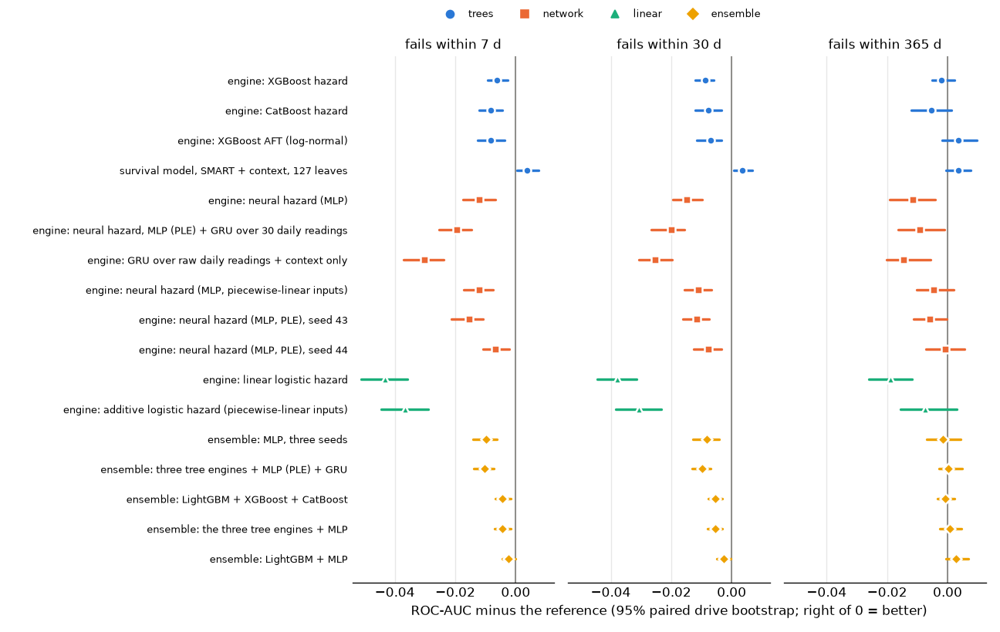

# Prediction engines and the GPU

This fork (`hard-drive-analysis-v3-rocm`) asks two questions of the v3 study:

1. Does the AMD GPU in `info/` (Radeon RX 7800 XT, gfx1101, 16 GiB, ROCm) make the pipeline
   faster?
2. Is LightGBM the right engine? Would another learner rank failures better, or tell a
   different story?

Short answers: the GPU cannot train the tree models on this card (every GPU build of
LightGBM and XGBoost either crashed or produced wrong models, section 1). It does run the
neural engines, which train in seconds per epoch. On ranking, no other learner beats
LightGBM. The one model that beats the reference is LightGBM itself with more leaves
(section 3).

## How an engine plugs in

Every engine fits the reference model's problem: the discrete-time hazard over the bins
of `config/study.toml`, on the same train snapshots, the same tempered weights
(`weight_power = 0.5`), the same early-stopping drives, and the same per-bin Platt
calibration on the other half of the validation drives. A trained engine hands `predict`
one thing, an uncalibrated logit per hazard bin. So two models differ only in the learner,
and `evaluate` compares them like any other pair (paired drive-level bootstrap).

| step | engine | code | rows it trains on |
|---|---|---|---|
| `train_hazard_smart` (reference) | LightGBM | `steps/model.py` | 48.1M person-period rows |
| `train_hazard_smart_big` | LightGBM, 127 leaves | `steps/model.py` | same |
| `train_xgb_hazard` | XGBoost `hist` | `steps/engines.py` | same, streamed in batches |
| `train_catboost_hazard` | CatBoost | `steps/engines.py` | same, through a memory-mapped file |
| `train_xgb_aft` | XGBoost accelerated failure time | `steps/engines.py` | 7.6M snapshots |
| `train_torch_linear`, `train_torch_linear_ple` | linear logistic hazard | `steps/neural.py` | 7.6M snapshots, 7 outputs each |
| `train_torch_mlp`, `train_torch_mlp_ple` (+ seeds 43, 44) | MLP | `steps/neural.py` | same |
| `train_torch_gru` | encoded MLP + GRU over 30 daily readings | `steps/neural.py` | same, plus 53.6M daily panel rows |
| `train_torch_gru_raw` | GRU over daily readings, context features only | `steps/neural.py` | same |

The networks never build the person-period rows: each snapshot gets one output per bin
and a mask of the bins it is at risk in (`engines.dense_targets`), which gives the same
likelihood. `predict` also forms ensembles (`[steps.params.ensembles]`): the mean of the
members' calibrated hazards per bin.

`steps/neural.py` is its own module because the runner checkpoints a step on the hash of
its module: with the networks in `engines.py`, every change to a network would rerun the
tree engines (about 1.5 hours).

## 1. The GPU

Benchmarks are on the full-scale `train_hazard_smart` data (48.1M rows x 66 features), 200
boosting rounds, outside the pipeline (`/home/dev/gpu-bench`, not in the repository).

| learner | build | seconds per round | validation logloss after 200 rounds | verdict |
|---|---|---|---|---|
| LightGBM, CPU, 16 threads | PyPI wheel 4.7.0 | 0.807 | 0.03537 | the pipeline today |
| LightGBM, OpenCL, 63 bins | PyPI wheel + `rocm-opencl-runtime` | 0.766 | 0.03552 | 5% faster, coarser model |
| LightGBM, OpenCL, 252 bins | same | 0.752 | 0.04398 | wrong model |
| LightGBM, OpenCL, 255 bins | same | - | - | refuses: one feature needs 258 bins |
| LightGBM, ROCm (`device_type=cuda`) | 4.7.0 built with `-DUSE_ROCM=ON` | 0.239 | 0.37487 | 3.4x faster, wrong model |
| XGBoost, ROCm | AMD fork 3.2.0, `-DUSE_HIP=ON`, wave32 | - | 5.67 at round 1 on toy data (CPU 0.34) | wrong model |
| XGBoost, ROCm | same, `-mwavefrontsize64` | - | - | GPU memory access fault |
| PyTorch | 2.15.0+rocm10.0 wheel | - | - | works; fp32 matmul 1.9 TFLOPS, fp16 48 |

- **LightGBM OpenCL** moves only histogram building to the GPU. The GPU sat at 5-18% busy
  while the CPU ran at about 1,070%: split finding, bagging and gradients stay on the CPU.
  At 252 bins the model is wrong, at 63 it is right but coarser than the reference.
- **LightGBM ROCm** (the CUDA learner compiled for HIP) matches the CPU exactly on
  synthetic data, with and without bagging, missing values, zeros and 66 features. On
  the real data it diverges. Trained one feature at a time, 7 features break it:
  `smart_183_raw`, the 7- and 30-day trends of 183, 187 and 197. No single property
  (missing share, zeros, negative values, distinct values) separates them from the 59
  that pass. It also segfaults on `lgb.Sequence` input (the pipeline's streaming input)
  and on validation sets loaded from a binary file.
- **XGBoost ROCm**: AMD documents the fork for its datacenter GPUs (CDNA, 64-wide
  wavefronts). On this RDNA3 card it is wrong from the first round on trivial data, and
  forcing 64-wide wavefronts faults.
- **PyTorch on ROCm** works. fp32 matrix products are slow on this card (1.9 TFLOPS against
  48 in fp16), so the networks train in bf16 autocast, the GRU in fp32.

None of the tree learners can use this GPU, so the tree engines run on the CPU. The GPU
trains the networks: an epoch over the 7.6M training snapshots takes 2.5 s for the plain
MLP and about 97 s for the GRU.

## 2. Decisions made on the way

- **XGBoost missing values.** With NaN in the data, XGBoost stores its binned matrix
  sparse, about 630 bytes per person-period row against 66: 30 GB at full scale, which
  swapped the 31 GB machine. Missing values are passed as -1e9, below every real value
  (`engines.XGB_MISSING`), which keeps the dense layout and builds the matrix in 50 s. A
  tree still separates missing from real values with one split, but missing always sits
  on the low side instead of taking a learned default direction.
- **CatBoost** cannot stream batches, so the expanded matrix goes through a memory-mapped
  file. The model and vendor codes are one-hot (`one_hot_max_size = 32`): CatBoost's
  target statistics took 1.32 s per tree on a sixth of the rows, one-hot 0.61 s. The
  training pool is binned before training to free the raw copy: the first full run
  peaked at 26 GiB resident plus 12 GiB of swap.
- **AFT distribution.** XGBoost does not learn the AFT scale, so it was chosen on the
  small scale by the likelihood on the early-stopping drives (never test):

  | distribution | 0.5 | 0.8 | 1.0 | 1.3 | 1.7 | 2.0 | 2.5 | 3.0 |
  |---|---|---|---|---|---|---|---|---|
  | normal | 1.704 | 1.480 | 1.409 | 1.385 | **1.381** | 1.385 | 1.402 | 1.417 |
  | logistic | 3.993 | 3.290 | 2.941 | 1.702 | 1.433 | | | |
  | minimum Gumbel (Weibull time) | 1.582 | 1.417 | 1.393 | 1.389 | 1.404 | | | |

  The pipeline uses normal with scale 1.7: a log-normal time to failure.
- **The MLP.** The first full run left the MLP at 0.0373 validation logloss (trees: 0.0350
  to 0.0353 on the same rows and weights), best after 2 epochs. A full-scale sweep on the
  early-stopping drives:

  | variant | validation logloss | best epoch |
  |---|---|---|
  | plain MLP (512/256/128, dropout 0.1, lr 0.002, batch 8,192) | 0.037298 | 2 |
  | learning rate 0.0005 | 0.037286 | 2 |
  | batch 65,536 | 0.037256 | 11 |
  | dropout 0.3 | 0.037323 | 4 |
  | weight decay 0.01 | 0.037294 | 2 |
  | 256/128, dropout 0.2 | 0.037266 | 5 |
  | batch 65,536, lr 0.001, dropout 0.3, weight decay 0.001 | 0.037317 | 12 |
  | piecewise-linear encoding, 32 bins | 0.035273 | 3 |
  | + dropout 0.3, batch 32,768, lr 0.001 | 0.035186 | 10 |
  | same, 16 bins | 0.035204 | 12 |
  | same, 64 bins | 0.035224 | 13 |
  | same, 1024/512/256 | 0.035190 | 11 |
  | same, dropout 0.5 | 0.035232 | 14 |
  | same, weight decay 0.001 | 0.035184 | 11 |
  | **32 bins, dropout 0.3, batch 65,536, lr 0.002** | **0.035134** | 21 |
  | linear model on the 32-bin encoding (additive) | 0.036897 | 12 |

  Regularisation does nothing for the plain MLP: it does not overfit, it cannot represent
  the inputs. SMART counters act through thresholds (any reallocated sector at all, a
  jump in pending sectors), and a smooth function of a standardized log value bends
  slowly. The piecewise-linear encoding (Gorishniy, Rubachev & Babenko 2022) turns each
  input into 32 ramps between quantiles of its train values, so the first layer can place
  a step where a tree would split. That closed the gap to the trees. The pipeline keeps
  the plain MLP as a baseline and uses the bold row for `torch_mlp_ple`, its seeds and the
  GRUs; the GRUs train with batches of 16,384 and learning rate 0.001, the largest batch
  that fits in GPU memory beside the daily panel (docs/ISSUES.md #23).
- **GRU window.** 30 days, the longest trend window. `extract` gives test drives 30 days
  of history before 2024-01-01, so a longer window would be shorter on early test
  snapshots than on any training snapshot.
- **Not tried: TabPFN.** The current checkpoints (TabPFN-3, 2.5) are gated on Hugging Face
  behind a non-commercial licence request. The open v2 checkpoint works with about 10k
  training rows and has no sample weights; this problem has 48M weighted rows.

## 3. Results

Full scale, 2026-10-31, the step code of the `engines` branch. The tables below are
copied from `build/report/analysis.md` ("Prediction engines"); a copy of the run is in
[`results/full-2026-10-31-engines/`](../results/full-2026-10-31-engines/). Test set:
825,321 snapshots of 2024-2025, 1,784 failing drives. Intervals are 95% drive-level
bootstrap; differences are paired on the same bootstrap rounds.

### Training

Validation logloss is on the early-stopping drives with the tempered weights, the
criterion each engine stopped on. The AFT engine optimises a different likelihood, so its
number is not comparable.

| engine | validation logloss | stopped at | training time |
|---|---|---|---|
| LightGBM, 127 leaves | **0.03494** | 186 trees | 5 min |
| XGBoost hazard | 0.03501 | 1,058 trees | 23 min |
| MLP (PLE), seed 44 | 0.03512 | epoch 17 | 3 min |
| LightGBM, reference (31 leaves) | 0.03516 | 595 trees | 8 min |
| CatBoost hazard | 0.03519 | 838 trees | 80 min |
| MLP (PLE), seed 42 | 0.03522 | epoch 21 | 3 min |
| MLP (PLE) + GRU | 0.03528 | epoch 5 | 17 min |
| MLP (PLE), seed 43 | 0.03534 | epoch 21 | 3 min |
| GRU, context only | 0.03551 | epoch 8 | 21 min |
| additive (PLE) | 0.03690 | epoch 12 | 1.5 min |
| plain MLP | 0.03730 | epoch 2 | < 1 min |
| linear | 0.03967 | epoch 10 | < 1 min |
| XGBoost AFT | (1.222, AFT likelihood) | 652 trees | 4 min |

Times are on the 16-thread CPU (trees) and the RX 7800 XT (networks). CatBoost peaked at
24.7 GiB resident with the binned pool (26 GiB plus 12 GiB of swap without it).

### Ranking on the test years

ROC-AUC of each model minus the reference's (right of 0 = better than the reference):

| model | 7 d | 30 d | 365 d | Harrell's C | PR-AUC 30 d |
|---|---|---|---|---|---|
| reference (LightGBM, 31 leaves) | 0.906 | 0.876 | 0.786 | 0.766 | 0.124 |
| LightGBM, 127 leaves | **+0.004** [0.000, 0.007] | **+0.004** [0.001, 0.007] | +0.004 [-0.000, 0.008] | 0.767 | 0.137 |
| XGBoost hazard | -0.006 [-0.009, -0.003] | -0.009 [-0.012, -0.006] | -0.002 [-0.005, 0.002] | 0.764 | 0.113 |
| CatBoost hazard | -0.008 [-0.012, -0.004] | -0.008 [-0.012, -0.003] | -0.005 [-0.012, 0.001] | 0.771 | 0.117 |
| XGBoost AFT | -0.008 [-0.013, -0.004] | -0.007 [-0.012, -0.003] | +0.004 [-0.002, 0.010] | **0.777** | 0.125 |
| MLP (PLE), seeds 42 / 43 / 44 | -0.012 / -0.016 / -0.007 | -0.011 / -0.012 / -0.008 | -0.005 / -0.006 / -0.001 | 0.768-0.772 | 0.110-0.112 |
| plain MLP | -0.012 [-0.017, -0.007] | -0.015 [-0.020, -0.010] | -0.012 [-0.019, -0.004] | 0.751 | 0.132 |
| MLP (PLE) + GRU | -0.020 [-0.025, -0.015] | -0.020 [-0.027, -0.016] | -0.009 [-0.016, -0.001] | 0.751 | 0.089 |
| GRU, context only | -0.030 [-0.037, -0.024] | -0.025 [-0.031, -0.020] | -0.014 [-0.020, -0.006] | 0.754 | 0.063 |
| additive (PLE) | -0.037 [-0.045, -0.029] | -0.031 [-0.038, -0.023] | -0.007 [-0.016, 0.003] | 0.766 | 0.077 |
| linear | -0.043 [-0.051, -0.036] | -0.038 [-0.044, -0.031] | -0.019 [-0.026, -0.012] | 0.753 | 0.063 |
| ensemble: LightGBM + MLP | -0.002 [-0.004, -0.000] | -0.003 [-0.005, -0.000] | +0.003 [-0.000, 0.007] | 0.771 | 0.124 |
| ensemble: three tree engines | -0.004 [-0.007, -0.002] | -0.005 [-0.008, -0.003] | -0.001 [-0.003, 0.002] | 0.767 | 0.128 |
| ensemble: three trees + MLP | -0.004 [-0.007, -0.002] | -0.005 [-0.008, -0.003] | +0.001 [-0.003, 0.005] | 0.769 | 0.129 |
| ensemble: three trees + MLP + GRU | -0.010 [-0.014, -0.007] | -0.010 [-0.013, -0.007] | +0.000 [-0.003, 0.005] | 0.764 | 0.127 |
| ensemble: MLP, three seeds | -0.010 [-0.014, -0.006] | -0.008 [-0.013, -0.004] | -0.002 [-0.007, 0.004] | 0.772 | 0.114 |

What this says:

- **The reference underfits a little.** The same LightGBM with 127 leaves instead of 31
  ranks better at every horizon (by 0.004; the intervals exclude zero from 30 to 180 days
  and touch it at 7 and 365) and
  has the lowest validation logloss of every engine. It also trains faster: 186 trees
  against 595. Section 4 sweeps the capacity.
- **The other tree learners are slightly worse, not different.** XGBoost and CatBoost
  rank 0.006 to 0.009 below the reference up to 90 days and tie it at a year. XGBoost had
  a *lower* validation logloss than the reference (0.03501 against 0.03516) and still
  ranks the test years worse, so these gaps are within what the shift from the
  2016-2023 validation drives to 2024-2025 can move. The study's conclusions about SMART
  do not depend on LightGBM.
- **AFT trades short-term ranking for the shape of the curve.** One log-normal time per
  snapshot, fitted in 4 minutes on 7.6M rows instead of 48M, ranks worse at 7-30 days
  and level at a year. It has the best Harrell's C (0.777 against 0.766, overlapping
  intervals) and the best-calibrated remaining-life medians: 47.5% of the snapshots whose
  predicted median falls within a year fail by it (target 50%), against 33.0% for the
  reference. Its 2024 predicted/observed ratio is the highest of all models, 1.47
  against 1.21.
- **Seed noise in the networks is as large as the gaps between the tree learners.** The
  three MLP (PLE) seeds differ only in initialisation and batch order, and their 7-day
  gap to the reference runs from -0.007 to -0.016. Seed 44 had a lower validation
  logloss than the reference and still ranks worse on test. Averaging the three seeds
  (-0.010) does not close the gap.
- **The plain MLP ranks worse but alerts well.** Its 7-day PR-AUC is above the
  reference's (0.079 against 0.067), its 2025 predicted/observed ratio is the closest to
  1 (1.84 against 2.28), and its remaining-life medians are calibrated (46.2% fail by the
  predicted median). Its high validation logloss must then come from the bulk of the
  snapshots rather than the riskiest ones.
- **Short-term risk needs interactions, long-term risk is nearly additive.** The additive
  model (one learned curve per feature) is 0.037 below the reference at 7 days but ties
  it at a year (-0.007, interval across zero, same Harrell's C). The linear model on
  scaled inputs is worse everywhere: the curves matter, then the interactions.
- **The raw daily history adds nothing over the trend features.** Adding a GRU over the
  last 30 daily readings to the encoded MLP made it worse (-0.020 against -0.012 at 7
  days); its validation loss rose after epoch 5. Given only the context features
  and the raw history, the GRU reaches 0.851 ROC-AUC at 30 days, against 0.604 for the
  context-only reference and 0.876 for the full one: it learns most of the SMART signal
  from the raw readings, but not as much as the hand-built features carry.
- **No ensemble beats the reference.** Averaging calibrated hazards pulls each ensemble
  towards its weaker members. LightGBM + MLP comes closest (-0.002 at 7 days, +0.003 at
  a year, Harrell's C 0.771).

Every engine overpredicts the 2025 failure rate (predicted/observed 1.84 to 3.32 at 30
days, reference 2.28), so the drift documented in the main study is in the data, not in
LightGBM.

## 4. LightGBM capacity

The 127-leaf model was set up as a capacity check, then it beat the reference on test.
Choosing a capacity from test numbers would leak the test set, so the sweep below is
scored on the early-stopping drives only. It runs outside the pipeline
(`/home/dev/gpu-bench/capacity/`) with the reference's parameters, learning rate 0.03,
early stopping after 100 rounds; at 31 and 127 leaves it reproduces the pipeline's
numbers exactly.

| leaves | min rows per leaf | validation logloss | trees | seconds per tree | training |
|---|---|---|---|---|---|
| 31 (reference) | 200 | 0.035161 | 595 | 0.85 | 10.0 min |
| 63 | 100 | 0.034966 | 355 | 0.76 | 5.9 min |
| 127 (`train_hazard_smart_big`) | 100 | 0.034943 | 186 | 0.93 | 4.6 min |
| 127 | 500 | **0.034903** | 194 | 0.93 | 4.6 min |
| 255 | 100 | 0.035009 | 153 | 1.01 | 4.4 min |
| 511 | 100 | 0.035008 | 163 | 1.10 | 4.9 min |

Validation logloss falls from 31 to 63 leaves, is flat from 63 to 127, and rises after.
A stricter leaf minimum (500 rows) gains 0.00004, a tenth of the difference between two
MLP seeds. 63 to 127 leaves is the right capacity for this data; 31 is on the small side.
Every setting stays within 15.3 GiB resident, and the larger trees stop sooner, so they
also train in half the time.

The reference is not changed here: the upstream study's numbers and its comparisons are
all built on the 31-leaf model, and the gain is 0.004 ROC-AUC. Upstream could move to 127
leaves (or 63) at its next full run, refitting the context-only, no-critical-counter and
usage models at the same capacity so that their comparisons stay fair.
