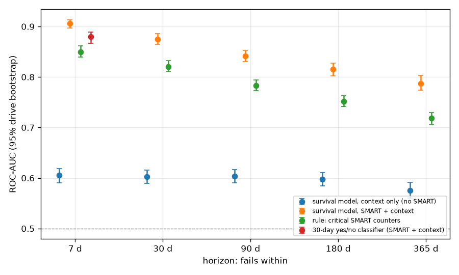
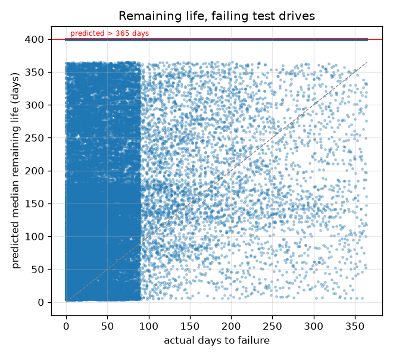
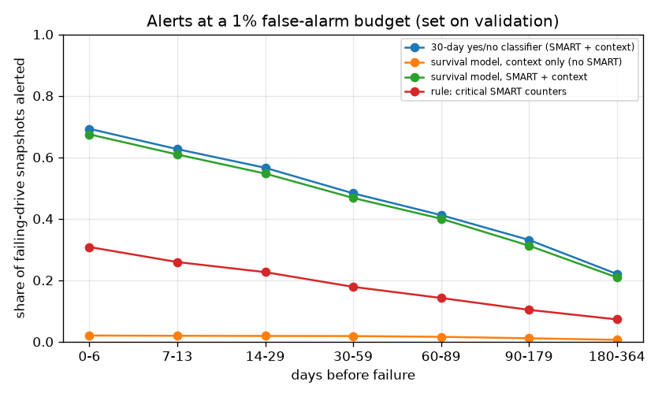
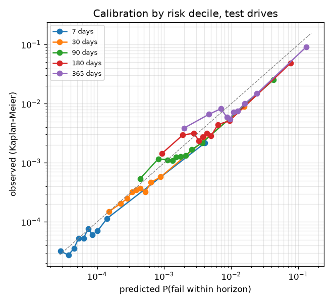
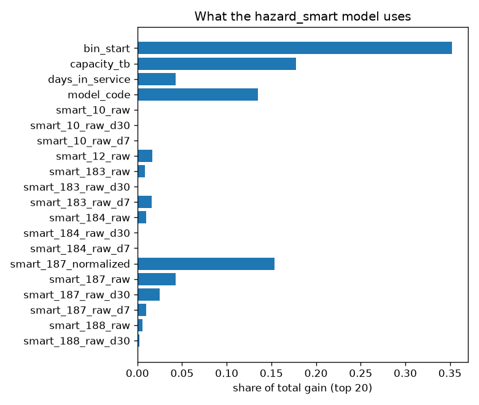

# Can SMART data predict when a hard drive will fail?

Scale **full**: 57309 drives in the cohort (failing drives sampled at 100%, healthy at 10.0%, weighted back to the real population). Test: 8981 drives never seen in training, 1784 of which fail during the test period (825321 snapshots). Verification gate: 26/26 checks passed.

## Answer

- **Do SMART metrics carry failure information?** Yes. Adding SMART to what is known without it (drive model, capacity, time in service) improves ROC-AUC at 5 of 5 horizons with a 95% interval that excludes zero:
  - 7 days: +0.300 [0.287, 0.315]
  - 30 days: +0.273 [0.259, 0.288]
  - 90 days: +0.237 [0.223, 0.250]
  - 180 days: +0.218 [0.203, 0.237]
  - 365 days: +0.212 [0.196, 0.229]
- **How far ahead?** Ranking is strongest close to failure (ROC-AUC 0.906 for 7 days) and weaker for the long term (0.788 for 365 days).
- **But failures are rare.** Even within 7 days only 0.027% of drive-days fail. The model's PR-AUC there is 0.0692 (a random ranking would score about the base rate), so at any useful recall many alerts are false (see Early warning).
- **When will it probably fail?** When the model names a day within the next year, it is too pessimistic (drives fail later than predicted): 7.1% of drives failed by their predicted 10% day, 33.5% by the predicted median and 76.1% by the predicted 90% day (targets 10/50/90%). For drives that do fail within a year it names a median within a year only 15.8% of the time: most failures are not visible in SMART long in advance. For healthy drives it says "more than a year" 99.8% of the time.
- **Against the classic rule** (any reallocated/pending/uncorrectable sector counter), the model gains +0.056 ROC-AUC [0.048, 0.063] at 7 days.

## Discrimination by horizon

ROC-AUC and PR-AUC on test snapshots whose status at the horizon is known, weighted to real prevalence. Brackets: 95% drive-level bootstrap (200 rounds). Base rate = real share of drive-days that fail within the horizon.

| horizon | model | ROC-AUC | PR-AUC | Brier | base rate | failing drives |
|---|---|---|---|---|---|---|
| 7 d | survival model, context only (no SMART) | 0.605 [0.590, 0.618] | 0.0004 [0.0004, 0.0004] | 0.00027 | 0.027% | 1784 |
| 7 d | survival model, SMART + context | 0.906 [0.897, 0.914] | 0.0692 [0.0570, 0.0843] | 0.00027 | 0.027% | 1784 |
| 7 d | rule: critical SMART counters | 0.850 [0.840, 0.862] | 0.0189 [0.0151, 0.0312] | n/a | 0.027% | 1784 |
| 30 d | 30-day yes/no classifier (SMART + context) | 0.879 [0.867, 0.889] | 0.1176 [0.1017, 0.1355] | 0.00125 | 0.121% | 1784 |
| 30 d | survival model, context only (no SMART) | 0.602 [0.589, 0.615] | 0.0017 [0.0016, 0.0019] | 0.00121 | 0.121% | 1784 |
| 30 d | survival model, SMART + context | 0.875 [0.865, 0.886] | 0.1266 [0.1094, 0.1471] | 0.00116 | 0.121% | 1784 |
| 30 d | rule: critical SMART counters | 0.821 [0.812, 0.833] | 0.0269 [0.0217, 0.0426] | n/a | 0.121% | 1784 |
| 90 d | survival model, context only (no SMART) | 0.604 [0.591, 0.617] | 0.0054 [0.0050, 0.0059] | 0.00389 | 0.388% | 1784 |
| 90 d | survival model, SMART + context | 0.841 [0.830, 0.853] | 0.1796 [0.1567, 0.2068] | 0.00357 | 0.388% | 1784 |
| 90 d | rule: critical SMART counters | 0.783 [0.773, 0.795] | 0.0431 [0.0355, 0.0623] | n/a | 0.388% | 1784 |
| 180 d | survival model, context only (no SMART) | 0.597 [0.584, 0.611] | 0.0118 [0.0108, 0.0130] | 0.00863 | 0.865% | 1784 |
| 180 d | survival model, SMART + context | 0.815 [0.802, 0.828] | 0.2127 [0.1847, 0.2400] | 0.00769 | 0.865% | 1784 |
| 180 d | rule: critical SMART counters | 0.752 [0.742, 0.763] | 0.0654 [0.0549, 0.0812] | n/a | 0.865% | 1784 |
| 365 d | survival model, context only (no SMART) | 0.575 [0.560, 0.592] | 0.0307 [0.0275, 0.0344] | 0.02230 | 2.272% | 1784 |
| 365 d | survival model, SMART + context | 0.788 [0.774, 0.803] | 0.2989 [0.2702, 0.3250] | 0.01851 | 2.272% | 1784 |
| 365 d | rule: critical SMART counters | 0.719 [0.706, 0.730] | 0.1145 [0.1026, 0.1319] | n/a | 2.272% | 1784 |

## Ranking over the whole future (concordance)

Harrell's C between each model's risk and the actual time to failure (300000 test snapshots). 0.5 = random.

| model | C-index |
|---|---|
| 30-day yes/no classifier (SMART + context) | 0.780 |
| survival model, context only (no SMART) | 0.589 |
| survival model, SMART + context | 0.774 |
| rule: critical SMART counters | 0.716 |

## When will it fail? Remaining-life estimates

From each snapshot the survival model gives a curve: the day by which the failure probability reaches 10%, 50% (the median remaining life) and 90%. Beyond 365 days the model has no bins, so the answer is "more than a year".

**Are the predicted days right?** Among snapshots whose predicted day falls within a year, the share that actually failed by that day should be close to the target:

| model | failed by predicted 10% day | failed by predicted median | failed by predicted 90% day |
|---|---|---|---|
| survival model, context only (no SMART) | 2.9% (target 10%, 5628 snapshots) | n/a (target 50%, 0 snapshots) | n/a (target 90%, 0 snapshots) |
| survival model, SMART + context | 7.1% (target 10%, 110734 snapshots) | 33.5% (target 50%, 46543 snapshots) | 76.1% (target 90%, 10894 snapshots) |

**How early is a failure visible?** Snapshots of drives that do fail within a year, by how far away the failure actually was. A median within a year means the model already expects the drive to die within a year:

| model | failing snapshots: median within a year | abs. error of median (days) | healthy snapshots: median beyond a year |
|---|---|---|---|
| survival model, context only (no SMART) | 0.0% | n/a | 100.0% |
| survival model, SMART + context | 15.8% | 106 | 99.8% |

By actual time to failure (survival model, SMART + context):

| actual days to failure | snapshots | median predicted within a year | median of predicted median (days) |
|---|---|---|---|
| 0-6 | 11632 | 46.7% | > 1 year |
| 7-13 | 11720 | 38.6% | > 1 year |
| 14-29 | 26982 | 32.8% | > 1 year |
| 30-59 | 48813 | 25.3% | > 1 year |
| 60-89 | 46454 | 19.8% | > 1 year |
| 90-179 | 18146 | 13.5% | > 1 year |
| 180-364 | 25961 | 7.8% | > 1 year |

## Early warning

The alert threshold is set on validation drives so that 1.0% of healthy drive-days raise an alert. Test results:

| model | false alarms (test) | precision | failing drives alerted in their last 30 days |
|---|---|---|---|
| 30-day yes/no classifier (SMART + context) | 1.84% | 3.85% | 1412/1784 |
| survival model, context only (no SMART) | 0.90% | 0.26% | 35/1784 |
| survival model, SMART + context | 1.63% | 4.19% | 1379/1784 |
| rule: critical SMART counters | 1.47% | 2.04% | 661/1784 |

## Calibration

Mean predicted failure probability vs the Kaplan-Meier observed share, by decile of predicted risk. Points on the diagonal mean that a predicted 5% really fails 5% of the time.

**Calibration over time** (mean predicted vs observed risk of failing within 30 days, survival model, SMART + context). Validation drives are from the training era, test from 2024 on. A gap that appears only in the test years is drift:

| split | year | snapshots | predicted | observed |
|---|---|---|---|---|
| test | 2024 | 422201 | 0.154% | 0.133% |
| test | 2025 | 403120 | 0.229% | 0.103% |
| val | 2016 | 70518 | 0.152% | 0.162% |
| val | 2017 | 85198 | 0.143% | 0.154% |
| val | 2018 | 102268 | 0.114% | 0.134% |
| val | 2019 | 116101 | 0.150% | 0.165% |
| val | 2020 | 137012 | 0.111% | 0.084% |
| val | 2021 | 169154 | 0.099% | 0.088% |
| val | 2022 | 191823 | 0.128% | 0.109% |
| val | 2023 | 208591 | 0.145% | 0.166% |

## Which SMART attributes matter

Single-attribute ROC-AUC on train snapshots (fails within 30 days). 0.5 = no signal. Below 0.5 means lower values go with failure (normalized values fall as a drive degrades).

| feature | ROC-AUC | filled |
|---|---|---|
| smart_187_raw | 0.669 | 64% |
| smart_5_raw | 0.661 | 100% |
| smart_187_raw_d30 | 0.642 | 64% |
| smart_197_raw | 0.637 | 99% |
| smart_240_raw | 0.626 | 76% |
| smart_187_raw_d7 | 0.623 | 64% |
| smart_5_raw_d30 | 0.619 | 100% |
| smart_198_raw | 0.613 | 100% |
| smart_4_raw | 0.611 | 100% |
| smart_242_raw | 0.608 | 66% |
| smart_12_raw | 0.607 | 100% |
| smart_188_raw | 0.601 | 64% |
| smart_193_raw | 0.601 | 99% |
| smart_3_normalized | 0.406 | 100% |
| smart_188_raw_d30 | 0.593 | 64% |

Also see `build/explore/km_by_counters.png` and `build/explore/models.csv`.
