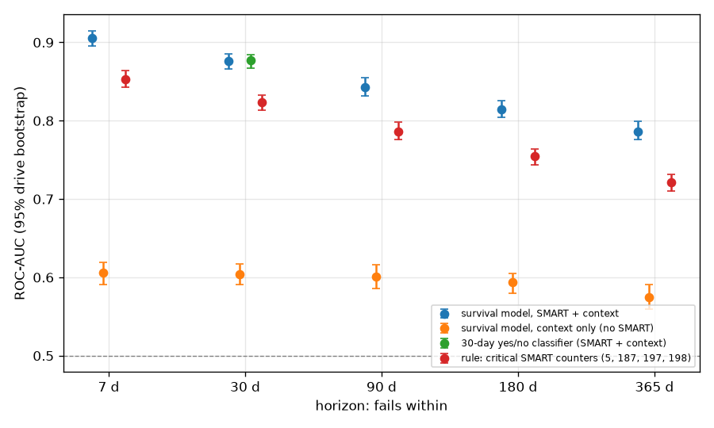
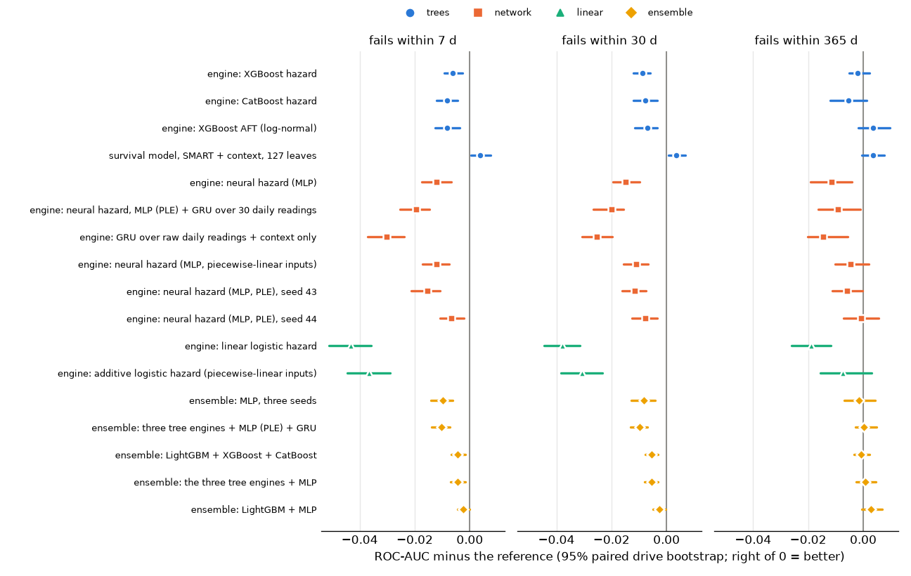
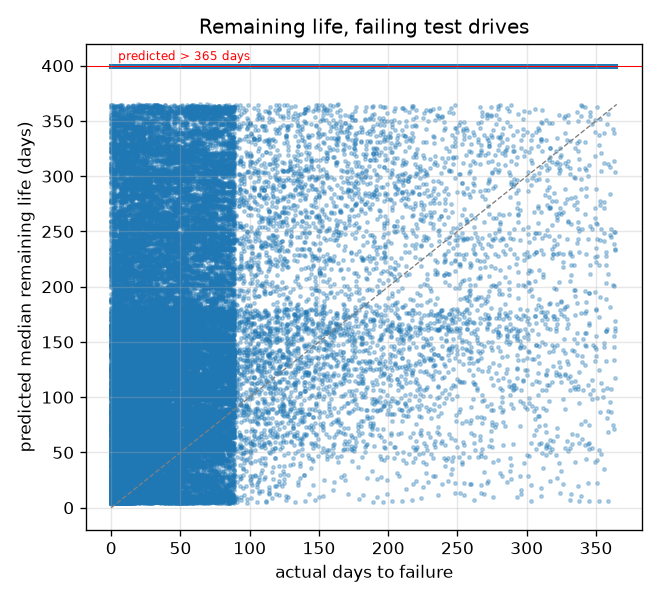
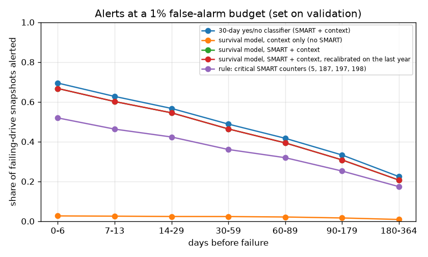
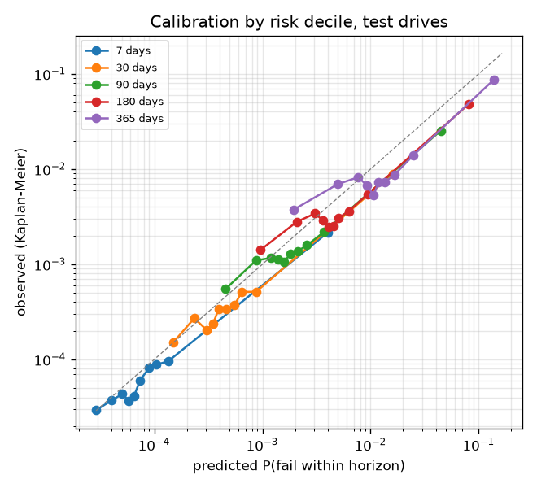
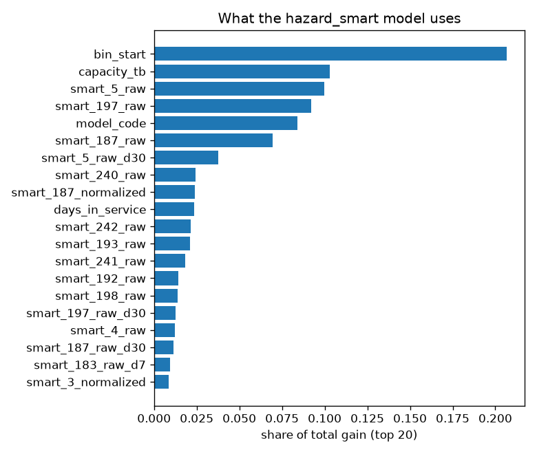

# Can SMART data predict when a hard drive will fail?

The run itself (scale, cohort, test set, gate) and the headline numbers are in [results.md](results.md). This file explains them and holds the detailed tables.

## Answer

- **Do SMART metrics carry failure information?** Yes. Adding SMART to what is known without it (drive model, capacity, time in service) improves ROC-AUC at 5 of 5 horizons with a 95% interval that excludes zero:
  - 7 days: +0.300 [0.282, 0.314]
  - 30 days: +0.273 [0.260, 0.288]
  - 90 days: +0.241 [0.225, 0.259]
  - 180 days: +0.221 [0.208, 0.236]
  - 365 days: +0.211 [0.197, 0.228]
- **How much of that is the replacement policy?** Backblaze replaces drives when counters 5, 187, 188, 197 or 198 rise, so those counters partly define the failure label. The full model's ROC-AUC exceeds the model without them by +0.104 [0.096, 0.112] at 30 days (an interval above zero at 5 of 5 horizons). The SMART gain above is therefore an upper bound on what SMART adds beyond the operator's replacement policy.
- **How far ahead?** Ranking is strongest close to failure (ROC-AUC 0.906 for 7 days) and weaker for the long term (0.786 for 365 days; long horizons are measured on earlier test snapshots, see Discrimination by horizon).
- **But failures are rare.** Even within 7 days only 0.027% of drive-days fail. The model's PR-AUC there is 0.0674 (a random ranking would score about the base rate), so at any useful recall many alerts are false (see Early warning).
- **Is it more than the last days?** Counting as positives only snapshots >= 7 days before failure, the 30-day PR-AUC is 0.0788 [0.0661, 0.0970] against 0.1239 overall (base rate 0.093% vs 0.121%); ROC-AUC 0.868 [0.857, 0.877]. Much of the precision comes from the last days before failure.
- **Silent failures** (no critical counter above zero in any test snapshot): 368 of the 1784 failing test drives. On them the 30-day ROC-AUC of survival model, SMART + context is 0.639 [0.608, 0.666] against 0.876 [0.866, 0.885] overall: still above chance.
- **When will it probably fail?** When the model names a day within the next year, it is too pessimistic (drives fail later than predicted): 6.5% of drives failed by their predicted 10% day, 33.0% by the predicted median and 76.5% by the predicted 90% day (targets 10/50/90%). For drives that do fail within a year it names a median within a year only 16.9% of the time: most failures are not visible in SMART long in advance. For healthy drives it says "more than a year" 99.8% of the time.
- **One survival model or a dedicated 30-day classifier?** At 30 days the survival model's ROC-AUC minus the classifier's is -0.001 [-0.004, 0.002] (paired bootstrap), PR-AUC +0.0069 [-0.0056, 0.0176]; the survival model is not better in 72% of rounds. Neither ranks clearly better, and the survival model also covers the other horizons.
- **Against the classic rule** (log-sum of the reallocated, reported-uncorrectable, pending and offline-uncorrectable sector counters 5, 187, 197, 198), the model gains +0.053 ROC-AUC [0.046, 0.061] at 7 days.

## Discrimination by horizon

ROC-AUC and PR-AUC per drive-day snapshot, on test snapshots whose status at the horizon is known, weighted to real prevalence. Brackets: 95% drive-level bootstrap (200 rounds). Base rate = real share of drive-days that fail within the horizon. All 1784 failing test drives are positive at every horizon (each has snapshots close to its failure day), so the last column counts positive snapshots instead.

| horizon | model | ROC-AUC | PR-AUC | Brier | base rate | positive snapshots |
|---|---|---|---|---|---|---|
| 7 d | survival model, SMART + context | 0.906 [0.896, 0.915] | 0.0674 [0.0574, 0.0809] | 0.00027 | 0.027% | 11632 |
| 7 d | survival model, context only (no SMART) | 0.606 [0.591, 0.619] | 0.0004 [0.0004, 0.0004] | 0.00027 | 0.027% | 11632 |
| 7 d | rule: critical SMART counters (5, 187, 197, 198) | 0.853 [0.842, 0.864] | 0.0295 [0.0225, 0.0400] | n/a | 0.027% | 11632 |
| 30 d | survival model, SMART + context | 0.876 [0.866, 0.885] | 0.1239 [0.1061, 0.1473] | 0.00117 | 0.121% | 50334 |
| 30 d | survival model, context only (no SMART) | 0.604 [0.591, 0.617] | 0.0017 [0.0016, 0.0019] | 0.00121 | 0.121% | 50334 |
| 30 d | 30-day yes/no classifier (SMART + context) | 0.877 [0.867, 0.885] | 0.1170 [0.1000, 0.1372] | 0.00127 | 0.121% | 50334 |
| 30 d | rule: critical SMART counters (5, 187, 197, 198) | 0.823 [0.813, 0.833] | 0.0521 [0.0409, 0.0720] | n/a | 0.121% | 50334 |
| 90 d | survival model, SMART + context | 0.843 [0.832, 0.855] | 0.1798 [0.1568, 0.2099] | 0.00358 | 0.388% | 145601 |
| 90 d | survival model, context only (no SMART) | 0.601 [0.586, 0.616] | 0.0054 [0.0050, 0.0058] | 0.00389 | 0.388% | 145601 |
| 90 d | rule: critical SMART counters (5, 187, 197, 198) | 0.786 [0.776, 0.798] | 0.0893 [0.0733, 0.1164] | n/a | 0.388% | 145601 |
| 180 d | survival model, SMART + context | 0.814 [0.804, 0.826] | 0.2191 [0.1956, 0.2478] | 0.00765 | 0.865% | 163747 |
| 180 d | survival model, context only (no SMART) | 0.593 [0.580, 0.605] | 0.0117 [0.0110, 0.0125] | 0.00865 | 0.865% | 163747 |
| 180 d | rule: critical SMART counters (5, 187, 197, 198) | 0.755 [0.744, 0.764] | 0.1295 [0.1095, 0.1524] | n/a | 0.865% | 163747 |
| 365 d | survival model, SMART + context | 0.786 [0.776, 0.800] | 0.3123 [0.2885, 0.3386] | 0.01830 | 2.272% | 189708 |
| 365 d | survival model, context only (no SMART) | 0.574 [0.560, 0.591] | 0.0305 [0.0280, 0.0340] | 0.02230 | 2.272% | 189708 |
| 365 d | rule: critical SMART counters (5, 187, 197, 198) | 0.722 [0.711, 0.732] | 0.2145 [0.1873, 0.2420] | n/a | 2.272% | 189708 |

A horizon of H days needs H days of follow-up to know that a drive survived it, so the longer the horizon, the earlier the test snapshots it can use. The 365-day row uses only snapshots from roughly the first test year (2024); longer horizons are measured on an earlier, different calendar cohort than the short ones, so the rows are not a like-for-like trend. Test snapshots with a known status (825321 in total): 7 d: 819135 snapshots, known-healthy ones dated up to 2025-12-25; 30 d: 795715 snapshots, known-healthy ones dated up to 2025-12-02; 90 d: 735702 snapshots, known-healthy ones dated up to 2025-10-03; 180 d: 650242 snapshots, known-healthy ones dated up to 2025-07-05; 365 d: 485740 snapshots, known-healthy ones dated up to 2025-01-01.

**Robustness.** The same ranking with inverse-probability-of-censoring weights (IPCW: snapshots whose status is unknown are represented by weighting up comparable known ones, instead of being dropped), and a drive-level ROC-AUC on one random snapshot per drive, weighted per drive (so drives with many snapshots do not dominate). Brier skill = 1 - Brier / Brier of always predicting the base rate; above 0 beats that constant.

| horizon | model | ROC-AUC, IPCW (per drive-day) | PR-AUC, IPCW (per drive-day) | ROC-AUC (per drive) | Brier skill |
|---|---|---|---|---|---|
| 7 d | survival model, SMART + context | 0.906 [0.896, 0.915] | 0.0671 [0.0571, 0.0805] | 0.901 [0.837, 0.940] | -0.012 |
| 7 d | survival model, context only (no SMART) | 0.606 [0.591, 0.619] | 0.0004 [0.0004, 0.0004] | 0.632 [0.578, 0.680] | -0.000 |
| 7 d | rule: critical SMART counters (5, 187, 197, 198) | 0.853 [0.842, 0.864] | 0.0294 [0.0224, 0.0399] | 0.827 [0.763, 0.866] | n/a |
| 30 d | survival model, SMART + context | 0.876 [0.866, 0.885] | 0.1210 [0.1036, 0.1441] | 0.862 [0.836, 0.888] | 0.027 |
| 30 d | survival model, context only (no SMART) | 0.604 [0.591, 0.617] | 0.0017 [0.0016, 0.0019] | 0.626 [0.597, 0.650] | -0.002 |
| 30 d | 30-day yes/no classifier (SMART + context) | 0.877 [0.867, 0.884] | 0.1143 [0.0976, 0.1342] | 0.862 [0.838, 0.885] | -0.056 |
| 30 d | rule: critical SMART counters (5, 187, 197, 198) | 0.823 [0.813, 0.833] | 0.0509 [0.0399, 0.0705] | 0.811 [0.785, 0.836] | n/a |
| 90 d | survival model, SMART + context | 0.841 [0.831, 0.854] | 0.1679 [0.1456, 0.1970] | 0.832 [0.818, 0.850] | 0.074 |
| 90 d | survival model, context only (no SMART) | 0.601 [0.586, 0.616] | 0.0050 [0.0047, 0.0054] | 0.624 [0.608, 0.643] | -0.007 |
| 90 d | rule: critical SMART counters (5, 187, 197, 198) | 0.785 [0.774, 0.797] | 0.0825 [0.0675, 0.1088] | 0.782 [0.768, 0.799] | n/a |
| 180 d | survival model, SMART + context | 0.811 [0.800, 0.823] | 0.1890 [0.1672, 0.2161] | 0.832 [0.820, 0.847] | 0.108 |
| 180 d | survival model, context only (no SMART) | 0.593 [0.580, 0.605] | 0.0099 [0.0092, 0.0105] | 0.626 [0.610, 0.639] | -0.008 |
| 180 d | rule: critical SMART counters (5, 187, 197, 198) | 0.751 [0.740, 0.760] | 0.1094 [0.0915, 0.1308] | 0.778 [0.764, 0.791] | n/a |
| 365 d | survival model, SMART + context | 0.774 [0.763, 0.789] | 0.2323 [0.2101, 0.2574] | 0.829 [0.817, 0.846] | 0.176 |
| 365 d | survival model, context only (no SMART) | 0.575 [0.561, 0.593] | 0.0191 [0.0177, 0.0216] | 0.599 [0.585, 0.616] | -0.004 |
| 365 d | rule: critical SMART counters (5, 187, 197, 198) | 0.710 [0.699, 0.720] | 0.1497 [0.1253, 0.1765] | 0.768 [0.755, 0.781] | n/a |

## Ablations and sensitivity

Each variant against the reference (survival model, SMART + context). Gain = reference minus variant, paired on the same bootstrap rounds; "not better" = share of rounds where the reference's ROC-AUC is not higher.

- **survival model, SMART without counters 5/187/188/197/198**: drops counters 5, 187, 188, 197 and 198 (raw, normalized and trends), the ones behind Backblaze's own replacement decisions. A drive replaced because these counters rose is recorded as failed, so part of the full model's SMART signal may be the replacement policy itself; the full model's gain over context only is an upper bound on what SMART adds beyond that policy.
- **survival model, context + usage counters**: context plus the usage counters only (4, 9, 12, 193, 240-242: power-on hours, start/stop and power cycles, load cycles, head flying hours, LBAs written and read). Tests whether SMART helps only because it measures age and wear.
- **survival model, SMART + context, weight power 0.75**: the reference features with training weights to the power 0.75 instead of 0.5. Tests how much the ranking depends on the weight exponent.
- **survival model, SMART + context, weight power 1.0**: the same with the full inverse-probability weights (power 1.0).
- **survival model, SMART + context, recalibrated on the last year**: the reference trees with probabilities recalibrated on the last validation year before the training cutoff. Tests whether a recent recalibration fixes drift (see Calibration over time); the trees are the same, so ranking changes only through the per-bin recalibration.

| horizon | model | ROC-AUC | reference gain, ROC-AUC | reference gain, PR-AUC | not better |
|---|---|---|---|---|---|
| 7 d | survival model, SMART + context (reference) | 0.906 [0.896, 0.915] |  |  |  |
| 7 d | survival model, SMART without counters 5/187/188/197/198 | 0.801 [0.790, 0.813] | +0.105 [0.096, 0.113] | +0.0449 [0.0335, 0.0566] | 0% |
| 7 d | survival model, context + usage counters | 0.654 [0.639, 0.667] | +0.251 [0.236, 0.264] | +0.0668 [0.0562, 0.0801] | 0% |
| 7 d | survival model, SMART + context, weight power 0.75 | 0.905 [0.896, 0.913] | +0.001 [-0.003, 0.004] | -0.0038 [-0.0131, 0.0050] | 34% |
| 7 d | survival model, SMART + context, weight power 1.0 | 0.904 [0.894, 0.912] | +0.002 [-0.002, 0.006] | +0.0075 [0.0004, 0.0149] | 12% |
| 7 d | survival model, SMART + context, recalibrated on the last year | 0.906 [0.896, 0.915] | 0.000 [0.000, 0.000] | 0.0000 [0.0000, 0.0000] | 100% |
| 30 d | survival model, SMART + context (reference) | 0.876 [0.866, 0.885] |  |  |  |
| 30 d | survival model, SMART without counters 5/187/188/197/198 | 0.772 [0.760, 0.786] | +0.104 [0.096, 0.112] | +0.0866 [0.0650, 0.1034] | 0% |
| 30 d | survival model, context + usage counters | 0.654 [0.641, 0.667] | +0.222 [0.211, 0.236] | +0.1216 [0.1038, 0.1450] | 0% |
| 30 d | survival model, SMART + context, weight power 0.75 | 0.880 [0.868, 0.888] | -0.003 [-0.007, 0.000] | -0.0017 [-0.0103, 0.0072] | 96% |
| 30 d | survival model, SMART + context, weight power 1.0 | 0.878 [0.869, 0.887] | -0.002 [-0.006, 0.000] | +0.0108 [0.0008, 0.0184] | 96% |
| 30 d | survival model, SMART + context, recalibrated on the last year | 0.876 [0.866, 0.885] | -0.000 [-0.000, -0.000] | -0.0001 [-0.0001, -0.0000] | 100% |
| 90 d | survival model, SMART + context (reference) | 0.843 [0.832, 0.855] |  |  |  |
| 90 d | survival model, SMART without counters 5/187/188/197/198 | 0.747 [0.732, 0.760] | +0.096 [0.087, 0.106] | +0.1259 [0.0990, 0.1555] | 0% |
| 90 d | survival model, context + usage counters | 0.654 [0.641, 0.667] | +0.188 [0.177, 0.204] | +0.1725 [0.1496, 0.2020] | 0% |
| 90 d | survival model, SMART + context, weight power 0.75 | 0.846 [0.835, 0.858] | -0.003 [-0.007, 0.001] | +0.0022 [-0.0061, 0.0124] | 93% |
| 90 d | survival model, SMART + context, weight power 1.0 | 0.848 [0.837, 0.860] | -0.006 [-0.009, -0.002] | +0.0093 [-0.0004, 0.0179] | 100% |
| 90 d | survival model, SMART + context, recalibrated on the last year | 0.843 [0.832, 0.855] | +0.000 [0.000, 0.000] | +0.0005 [0.0002, 0.0007] | 0% |
| 180 d | survival model, SMART + context (reference) | 0.814 [0.804, 0.826] |  |  |  |
| 180 d | survival model, SMART without counters 5/187/188/197/198 | 0.721 [0.709, 0.734] | +0.093 [0.084, 0.101] | +0.1464 [0.1195, 0.1718] | 0% |
| 180 d | survival model, context + usage counters | 0.653 [0.638, 0.665] | +0.161 [0.151, 0.175] | +0.2027 [0.1800, 0.2314] | 0% |
| 180 d | survival model, SMART + context, weight power 0.75 | 0.813 [0.801, 0.826] | +0.002 [-0.003, 0.006] | +0.0224 [0.0049, 0.0401] | 26% |
| 180 d | survival model, SMART + context, weight power 1.0 | 0.812 [0.801, 0.823] | +0.002 [-0.002, 0.008] | +0.0236 [0.0101, 0.0429] | 18% |
| 180 d | survival model, SMART + context, recalibrated on the last year | 0.815 [0.804, 0.826] | -0.000 [-0.000, -0.000] | +0.0002 [0.0001, 0.0003] | 100% |
| 365 d | survival model, SMART + context (reference) | 0.786 [0.776, 0.800] |  |  |  |
| 365 d | survival model, SMART without counters 5/187/188/197/198 | 0.707 [0.693, 0.724] | +0.079 [0.070, 0.087] | +0.1817 [0.1543, 0.2043] | 0% |
| 365 d | survival model, context + usage counters | 0.651 [0.638, 0.666] | +0.135 [0.124, 0.146] | +0.2676 [0.2429, 0.2923] | 0% |
| 365 d | survival model, SMART + context, weight power 0.75 | 0.785 [0.772, 0.797] | +0.001 [-0.004, 0.006] | +0.0334 [0.0141, 0.0481] | 38% |
| 365 d | survival model, SMART + context, weight power 1.0 | 0.783 [0.771, 0.796] | +0.003 [-0.003, 0.009] | +0.0314 [0.0114, 0.0531] | 15% |
| 365 d | survival model, SMART + context, recalibrated on the last year | 0.786 [0.776, 0.800] | -0.000 [-0.000, -0.000] | -0.0010 [-0.0015, -0.0005] | 100% |

## Prediction engines

The same discrete-time hazard fitted by other learners. Every engine sees the reference's features, training rows, tempered weights and early-stopping drives, and its raw per-bin scores go through the same per-bin calibration, so only the learner differs. Ensembles average the members' calibrated hazards per bin.

- **engine: XGBoost hazard**: XGBoost's histogram trees on the same person-period rows, with matched capacity (31 leaves, learning rate 0.03, row and column subsampling 0.8); missing values coded below every real value (steps/engines.py). Tests whether the results are specific to LightGBM.
- **engine: CatBoost hazard**: CatBoost's oblivious (symmetric) trees, depth 6, learning rate 0.1, on the same rows; model and vendor one-hot (target statistics took twice as long per tree). A differently regularised tree learner.
- **engine: XGBoost AFT (log-normal)**: XGBoost's accelerated failure time objective on the snapshots themselves (7.6M rows instead of 48M person-period rows): log T = f(x) + 1.7 Z, Z standard normal (a log-normal time; normal with scale 1.7 had the best validation likelihood of normal, logistic and minimum-Gumbel errors at scales 0.5-3 on the small scale). The only engine whose survival curve has a fixed parametric shape.
- **engine: neural hazard (MLP)**: a neural network on the GPU (3 hidden layers of 512/256/128, signed-log scaled inputs with missing-value flags, embeddings for model and vendor) with one output per bin, trained on the snapshots with a mask of the bins each is at risk in. Same likelihood as the person-period rows without building them. Kept as the plain baseline for the encoded MLP below.
- **engine: linear logistic hazard**: the textbook discrete-time model: one linear score shared by every bin plus a per-bin intercept (proportional odds), on the same scaled inputs. Shows how much the trees and the network add over a linear hazard.
- **engine: neural hazard, MLP (PLE) + GRU over 30 daily readings**: the encoded MLP plus a GRU (64 units) over each snapshot's last 30 daily readings of all 34 SMART columns, with the days before the snapshot and a real-row flag per step. Tests whether the raw daily history holds signal that the 7- and 30-day trend features miss.
- **engine: GRU over raw daily readings + context only**: the GRU over the last 30 daily readings with only the context features (model, capacity, age) beside it: no snapshot SMART values and no hand-made trends. Can the network find in the raw history what the features encode?
- **survival model, SMART + context, 127 leaves**: the reference LightGBM model with four times the leaves (127, min 100 rows per leaf). Tests whether the reference underfits.
- **engine: neural hazard (MLP, piecewise-linear inputs)**: the MLP with every numerical input replaced by its piecewise-linear encoding over 32 quantile bins of the train values (Gorishniy et al. 2022), dropout 0.3, batches of 65,536. Chosen by a full-scale sweep on the early-stopping drives (docs/ENGINES.md): no regularisation setting moved the plain MLP off 0.0373 validation logloss, the encoding took it to 0.0351, level with the trees.
- **engine: additive logistic hazard (piecewise-linear inputs)**: the linear model on the same encoded inputs: an additive model, one learned curve per feature, the same for every bin up to the per-bin intercept.
- **engine: neural hazard (MLP, PLE), seed 43**: the encoded MLP with seed 43 (initialisation and batch order). With seed 44, shows how much the network's numbers move from training noise alone.
- **engine: neural hazard (MLP, PLE), seed 44**: the encoded MLP with seed 44.
- **ensemble: MLP, three seeds**: mean of the three encoded MLP seeds.
- **ensemble: three tree engines + MLP (PLE) + GRU**: mean of the three tree engines, the encoded MLP and the GRU.
- **ensemble: LightGBM + XGBoost + CatBoost**: mean of the LightGBM, XGBoost and CatBoost hazards per bin.
- **ensemble: the three tree engines + MLP**: the same plus the neural network.
- **ensemble: LightGBM + MLP**: LightGBM and the neural network only: trees and a network make different errors.

ROC-AUC:

| model | 7 d | 30 d | 90 d | 180 d | 365 d |
|---|---|---|---|---|---|
| survival model, SMART + context | 0.906 [0.896, 0.915] | 0.876 [0.866, 0.885] | 0.843 [0.832, 0.855] | 0.814 [0.804, 0.826] | 0.786 [0.776, 0.800] |
| engine: XGBoost hazard | 0.900 [0.889, 0.910] | 0.868 [0.857, 0.876] | 0.835 [0.824, 0.845] | 0.809 [0.799, 0.820] | 0.784 [0.774, 0.797] |
| engine: CatBoost hazard | 0.898 [0.887, 0.906] | 0.869 [0.856, 0.879] | 0.835 [0.824, 0.847] | 0.809 [0.798, 0.821] | 0.780 [0.768, 0.794] |
| engine: XGBoost AFT (log-normal) | 0.898 [0.889, 0.909] | 0.869 [0.857, 0.879] | 0.840 [0.828, 0.852] | 0.816 [0.806, 0.830] | 0.789 [0.779, 0.802] |
| engine: neural hazard (MLP) | 0.894 [0.883, 0.905] | 0.861 [0.851, 0.871] | 0.827 [0.815, 0.839] | 0.799 [0.788, 0.812] | 0.774 [0.762, 0.787] |
| engine: linear logistic hazard | 0.863 [0.850, 0.873] | 0.839 [0.827, 0.849] | 0.812 [0.801, 0.824] | 0.790 [0.779, 0.803] | 0.767 [0.755, 0.781] |
| engine: neural hazard, MLP (PLE) + GRU over 30 daily readings | 0.886 [0.875, 0.895] | 0.856 [0.844, 0.868] | 0.824 [0.811, 0.836] | 0.799 [0.786, 0.812] | 0.777 [0.765, 0.790] |
| engine: GRU over raw daily readings + context only | 0.876 [0.863, 0.885] | 0.851 [0.840, 0.862] | 0.819 [0.808, 0.831] | 0.794 [0.782, 0.809] | 0.771 [0.759, 0.785] |
| survival model, SMART + context, 127 leaves | 0.910 [0.900, 0.918] | 0.880 [0.869, 0.888] | 0.847 [0.836, 0.858] | 0.821 [0.809, 0.832] | 0.789 [0.778, 0.803] |
| engine: neural hazard (MLP, piecewise-linear inputs) | 0.894 [0.883, 0.904] | 0.865 [0.854, 0.875] | 0.833 [0.822, 0.845] | 0.807 [0.796, 0.819] | 0.781 [0.771, 0.795] |
| engine: additive logistic hazard (piecewise-linear inputs) | 0.869 [0.858, 0.880] | 0.846 [0.833, 0.857] | 0.819 [0.808, 0.833] | 0.797 [0.784, 0.810] | 0.778 [0.766, 0.792] |
| engine: neural hazard (MLP, PLE), seed 43 | 0.890 [0.879, 0.900] | 0.865 [0.854, 0.875] | 0.834 [0.823, 0.846] | 0.807 [0.795, 0.820] | 0.780 [0.769, 0.794] |
| engine: neural hazard (MLP, PLE), seed 44 | 0.899 [0.888, 0.908] | 0.869 [0.857, 0.878] | 0.836 [0.825, 0.847] | 0.811 [0.799, 0.823] | 0.785 [0.774, 0.798] |
| ensemble: MLP, three seeds | 0.896 [0.885, 0.906] | 0.868 [0.856, 0.878] | 0.836 [0.826, 0.848] | 0.810 [0.799, 0.822] | 0.784 [0.774, 0.798] |
| ensemble: three tree engines + MLP (PLE) + GRU | 0.896 [0.884, 0.906] | 0.867 [0.855, 0.877] | 0.835 [0.823, 0.846] | 0.810 [0.798, 0.823] | 0.786 [0.774, 0.800] |
| ensemble: LightGBM + XGBoost + CatBoost | 0.901 [0.890, 0.912] | 0.871 [0.860, 0.879] | 0.838 [0.828, 0.849] | 0.813 [0.801, 0.824] | 0.785 [0.774, 0.798] |
| ensemble: the three tree engines + MLP | 0.901 [0.890, 0.912] | 0.871 [0.860, 0.880] | 0.838 [0.828, 0.849] | 0.812 [0.802, 0.824] | 0.786 [0.776, 0.800] |
| ensemble: LightGBM + MLP | 0.903 [0.892, 0.913] | 0.874 [0.862, 0.882] | 0.841 [0.831, 0.852] | 0.815 [0.803, 0.827] | 0.789 [0.779, 0.803] |

Reference gain over each engine (ROC-AUC; above zero = the reference ranks better):

| model | 7 d | 30 d | 90 d | 180 d | 365 d |
|---|---|---|---|---|---|
| engine: XGBoost hazard | +0.006 [0.003, 0.009] | +0.009 [0.006, 0.012] | +0.008 [0.005, 0.011] | +0.005 [0.002, 0.008] | +0.002 [-0.002, 0.005] |
| engine: CatBoost hazard | +0.008 [0.004, 0.012] | +0.008 [0.003, 0.012] | +0.008 [0.003, 0.012] | +0.005 [-0.001, 0.011] | +0.005 [-0.001, 0.012] |
| engine: XGBoost AFT (log-normal) | +0.008 [0.004, 0.013] | +0.007 [0.003, 0.012] | +0.003 [-0.002, 0.009] | -0.001 [-0.007, 0.004] | -0.004 [-0.010, 0.002] |
| engine: neural hazard (MLP) | +0.012 [0.007, 0.017] | +0.015 [0.010, 0.020] | +0.016 [0.009, 0.022] | +0.015 [0.009, 0.022] | +0.012 [0.004, 0.019] |
| engine: linear logistic hazard | +0.043 [0.036, 0.051] | +0.038 [0.031, 0.044] | +0.031 [0.025, 0.039] | +0.024 [0.018, 0.032] | +0.019 [0.012, 0.026] |
| engine: neural hazard, MLP (PLE) + GRU over 30 daily readings | +0.020 [0.015, 0.025] | +0.020 [0.016, 0.027] | +0.019 [0.012, 0.025] | +0.015 [0.009, 0.021] | +0.009 [0.001, 0.016] |
| engine: GRU over raw daily readings + context only | +0.030 [0.024, 0.037] | +0.025 [0.020, 0.031] | +0.024 [0.018, 0.029] | +0.020 [0.013, 0.027] | +0.014 [0.006, 0.020] |
| survival model, SMART + context, 127 leaves | -0.004 [-0.007, -0.000] | -0.004 [-0.007, -0.001] | -0.004 [-0.007, -0.001] | -0.006 [-0.010, -0.002] | -0.004 [-0.008, 0.000] |
| engine: neural hazard (MLP, piecewise-linear inputs) | +0.012 [0.007, 0.017] | +0.011 [0.007, 0.016] | +0.009 [0.004, 0.014] | +0.007 [0.000, 0.012] | +0.005 [-0.002, 0.010] |
| engine: additive logistic hazard (piecewise-linear inputs) | +0.037 [0.029, 0.045] | +0.031 [0.023, 0.038] | +0.023 [0.015, 0.032] | +0.017 [0.009, 0.026] | +0.007 [-0.003, 0.016] |
| engine: neural hazard (MLP, PLE), seed 43 | +0.016 [0.011, 0.021] | +0.012 [0.007, 0.016] | +0.009 [0.003, 0.014] | +0.007 [0.001, 0.013] | +0.006 [0.000, 0.011] |
| engine: neural hazard (MLP, PLE), seed 44 | +0.007 [0.002, 0.011] | +0.008 [0.003, 0.013] | +0.006 [0.001, 0.012] | +0.004 [-0.002, 0.009] | +0.001 [-0.006, 0.007] |
| ensemble: MLP, three seeds | +0.010 [0.006, 0.014] | +0.008 [0.004, 0.013] | +0.007 [0.001, 0.011] | +0.004 [-0.002, 0.009] | +0.002 [-0.004, 0.007] |
| ensemble: three tree engines + MLP (PLE) + GRU | +0.010 [0.007, 0.014] | +0.010 [0.007, 0.013] | +0.008 [0.005, 0.011] | +0.004 [0.001, 0.008] | -0.000 [-0.005, 0.003] |
| ensemble: LightGBM + XGBoost + CatBoost | +0.004 [0.002, 0.007] | +0.005 [0.003, 0.008] | +0.004 [0.002, 0.007] | +0.002 [-0.001, 0.005] | +0.001 [-0.002, 0.003] |
| ensemble: the three tree engines + MLP | +0.004 [0.002, 0.007] | +0.005 [0.003, 0.008] | +0.004 [0.002, 0.007] | +0.002 [-0.001, 0.006] | -0.001 [-0.005, 0.003] |
| ensemble: LightGBM + MLP | +0.002 [0.000, 0.004] | +0.003 [0.000, 0.005] | +0.002 [-0.002, 0.004] | -0.000 [-0.003, 0.003] | -0.003 [-0.007, 0.000] |

PR-AUC:

| model | 7 d | 30 d | 90 d | 180 d | 365 d |
|---|---|---|---|---|---|
| survival model, SMART + context | 0.0674 [0.0574, 0.0809] | 0.1239 [0.1061, 0.1473] | 0.1798 [0.1568, 0.2099] | 0.2191 [0.1956, 0.2478] | 0.3123 [0.2885, 0.3386] |
| engine: XGBoost hazard | 0.0637 [0.0541, 0.0752] | 0.1127 [0.0947, 0.1376] | 0.1604 [0.1371, 0.1845] | 0.2018 [0.1807, 0.2304] | 0.2914 [0.2631, 0.3221] |
| engine: CatBoost hazard | 0.0627 [0.0533, 0.0778] | 0.1169 [0.1018, 0.1409] | 0.1645 [0.1347, 0.1961] | 0.2098 [0.1800, 0.2529] | 0.3059 [0.2748, 0.3476] |
| engine: XGBoost AFT (log-normal) | 0.0732 [0.0595, 0.0877] | 0.1245 [0.1059, 0.1456] | 0.1818 [0.1588, 0.2095] | 0.2247 [0.2012, 0.2564] | 0.3259 [0.3042, 0.3511] |
| engine: neural hazard (MLP) | 0.0789 [0.0680, 0.0941] | 0.1318 [0.1124, 0.1512] | 0.1850 [0.1639, 0.2102] | 0.2153 [0.1934, 0.2446] | 0.2941 [0.2715, 0.3242] |
| engine: linear logistic hazard | 0.0349 [0.0277, 0.0469] | 0.0627 [0.0518, 0.0798] | 0.1009 [0.0853, 0.1223] | 0.1394 [0.1192, 0.1627] | 0.2268 [0.2027, 0.2589] |
| engine: neural hazard, MLP (PLE) + GRU over 30 daily readings | 0.0475 [0.0397, 0.0609] | 0.0885 [0.0732, 0.1074] | 0.1395 [0.1212, 0.1695] | 0.1828 [0.1620, 0.2138] | 0.2871 [0.2614, 0.3164] |
| engine: GRU over raw daily readings + context only | 0.0312 [0.0249, 0.0451] | 0.0629 [0.0499, 0.0809] | 0.1102 [0.0917, 0.1393] | 0.1511 [0.1320, 0.1792] | 0.2482 [0.2193, 0.2822] |
| survival model, SMART + context, 127 leaves | 0.0820 [0.0700, 0.0957] | 0.1366 [0.1162, 0.1569] | 0.1860 [0.1652, 0.2126] | 0.2180 [0.1968, 0.2466] | 0.3066 [0.2833, 0.3329] |
| engine: neural hazard (MLP, piecewise-linear inputs) | 0.0576 [0.0466, 0.0713] | 0.1121 [0.0928, 0.1323] | 0.1741 [0.1530, 0.2025] | 0.2144 [0.1910, 0.2428] | 0.3084 [0.2876, 0.3337] |
| engine: additive logistic hazard (piecewise-linear inputs) | 0.0430 [0.0342, 0.0541] | 0.0767 [0.0655, 0.0944] | 0.1214 [0.0984, 0.1484] | 0.1646 [0.1438, 0.1982] | 0.2601 [0.2307, 0.2984] |
| engine: neural hazard (MLP, PLE), seed 43 | 0.0550 [0.0449, 0.0683] | 0.1097 [0.0896, 0.1294] | 0.1713 [0.1496, 0.1990] | 0.2144 [0.1889, 0.2449] | 0.3126 [0.2885, 0.3389] |
| engine: neural hazard (MLP, PLE), seed 44 | 0.0593 [0.0476, 0.0765] | 0.1110 [0.0875, 0.1339] | 0.1653 [0.1413, 0.1936] | 0.2011 [0.1789, 0.2325] | 0.2943 [0.2713, 0.3197] |
| ensemble: MLP, three seeds | 0.0590 [0.0472, 0.0742] | 0.1135 [0.0923, 0.1354] | 0.1738 [0.1517, 0.2011] | 0.2141 [0.1912, 0.2436] | 0.3108 [0.2877, 0.3364] |
| ensemble: three tree engines + MLP (PLE) + GRU | 0.0689 [0.0590, 0.0837] | 0.1268 [0.1089, 0.1489] | 0.1827 [0.1610, 0.2098] | 0.2232 [0.1998, 0.2547] | 0.3195 [0.2956, 0.3461] |
| ensemble: LightGBM + XGBoost + CatBoost | 0.0702 [0.0605, 0.0843] | 0.1277 [0.1089, 0.1504] | 0.1790 [0.1574, 0.2012] | 0.2201 [0.1955, 0.2540] | 0.3129 [0.2892, 0.3426] |
| ensemble: the three tree engines + MLP | 0.0714 [0.0614, 0.0859] | 0.1293 [0.1103, 0.1511] | 0.1834 [0.1618, 0.2085] | 0.2240 [0.2003, 0.2568] | 0.3185 [0.2950, 0.3459] |
| ensemble: LightGBM + MLP | 0.0671 [0.0566, 0.0808] | 0.1244 [0.1052, 0.1463] | 0.1848 [0.1622, 0.2139] | 0.2248 [0.1986, 0.2533] | 0.3210 [0.2995, 0.3489] |

Harrell's C (score -rmst_days), alerts at the 1.0% budget (failing drives alerted in their last 30 days, precision), and predicted / observed 30-day risk per test year (drift; 1 = right):

| model | Harrell's C | failing drives alerted | precision | ratio 2024 | ratio 2025 |
|---|---|---|---|---|---|
| survival model, SMART + context | 0.766 [0.745, 0.783] | 1372/1784 | 4.38% [3.94%, 5.05%] | 1.21 | 2.28 |
| engine: XGBoost hazard | 0.764 [0.747, 0.781] | 1396/1784 | 3.37% [3.03%, 3.85%] | 1.30 | 2.85 |
| engine: CatBoost hazard | 0.771 [0.751, 0.787] | 1361/1784 | 3.56% [3.21%, 4.00%] | 1.28 | 2.67 |
| engine: XGBoost AFT (log-normal) | 0.777 [0.759, 0.796] | 1377/1784 | 4.17% [3.72%, 4.75%] | 1.47 | 2.65 |
| engine: neural hazard (MLP) | 0.751 [0.726, 0.768] | 1348/1784 | 4.22% [3.80%, 4.89%] | 1.10 | 1.84 |
| engine: linear logistic hazard | 0.753 [0.733, 0.770] | 1032/1784 | 3.55% [3.13%, 4.33%] | 1.18 | 2.22 |
| engine: neural hazard, MLP (PLE) + GRU over 30 daily readings | 0.751 [0.725, 0.766] | 1366/1784 | 3.06% [2.73%, 3.41%] | 1.41 | 3.32 |
| engine: GRU over raw daily readings + context only | 0.754 [0.736, 0.769] | 1221/1784 | 2.56% [2.34%, 2.86%] | 1.33 | 3.12 |
| survival model, SMART + context, 127 leaves | 0.767 [0.745, 0.784] | 1394/1784 | 4.14% [3.74%, 4.75%] | 1.20 | 2.15 |
| engine: neural hazard (MLP, piecewise-linear inputs) | 0.768 [0.749, 0.785] | 1391/1784 | 3.88% [3.46%, 4.35%] | 1.27 | 2.52 |
| engine: additive logistic hazard (piecewise-linear inputs) | 0.766 [0.750, 0.786] | 1210/1784 | 3.51% [3.15%, 4.06%] | 1.44 | 2.61 |
| engine: neural hazard (MLP, PLE), seed 43 | 0.768 [0.745, 0.784] | 1377/1784 | 4.23% [3.75%, 4.81%] | 1.26 | 2.37 |
| engine: neural hazard (MLP, PLE), seed 44 | 0.772 [0.753, 0.788] | 1386/1784 | 3.00% [2.73%, 3.31%] | 1.28 | 2.64 |
| ensemble: MLP, three seeds | 0.772 [0.753, 0.787] | 1385/1784 | 3.72% [3.35%, 4.16%] | 1.27 | 2.51 |
| ensemble: three tree engines + MLP (PLE) + GRU | 0.764 [0.744, 0.782] | 1394/1784 | 3.53% [3.18%, 3.99%] | 1.30 | 2.76 |
| ensemble: LightGBM + XGBoost + CatBoost | 0.767 [0.747, 0.784] | 1388/1784 | 3.63% [3.29%, 4.07%] | 1.27 | 2.63 |
| ensemble: the three tree engines + MLP | 0.769 [0.750, 0.785] | 1393/1784 | 3.79% [3.43%, 4.29%] | 1.27 | 2.61 |
| ensemble: LightGBM + MLP | 0.771 [0.751, 0.788] | 1391/1784 | 4.32% [3.88%, 4.96%] | 1.24 | 2.41 |

## Where the signal comes from

The ranking metrics on parts of the test set, per drive-day snapshot. Positive-side slices (lead time, silent or not) keep every known-healthy snapshot and restrict the failing ones, so their base rate is lower; population slices (vendor, capacity, entry date) restrict both. "Silent" failures are drives that fail with none of the critical counters (5, 187, 197, 198) above zero in any test snapshot. At 30 days:

| slice | model | ROC-AUC | PR-AUC | base rate | positive drives |
|---|---|---|---|---|---|
| all test snapshots | survival model, SMART + context | 0.876 [0.866, 0.885] | 0.1239 [0.1061, 0.1473] | 0.121% | 1784 |
| all test snapshots | survival model, context only (no SMART) | 0.604 [0.591, 0.617] | 0.0017 [0.0016, 0.0019] | 0.121% | 1784 |
| all test snapshots | rule: critical SMART counters (5, 187, 197, 198) | 0.823 [0.813, 0.833] | 0.0521 [0.0409, 0.0720] | 0.121% | 1784 |
| positives >= 7 days before failure | survival model, SMART + context | 0.868 [0.857, 0.877] | 0.0788 [0.0661, 0.0970] | 0.093% | 1755 |
| positives >= 7 days before failure | survival model, context only (no SMART) | 0.604 [0.591, 0.617] | 0.0013 [0.0012, 0.0015] | 0.093% | 1755 |
| positives >= 7 days before failure | rule: critical SMART counters (5, 187, 197, 198) | 0.814 [0.804, 0.825] | 0.0333 [0.0259, 0.0485] | 0.093% | 1755 |
| silent failures (no critical counter above zero) | survival model, SMART + context | 0.639 [0.608, 0.666] | 0.0007 [0.0005, 0.0012] | 0.025% | 368 |
| silent failures (no critical counter above zero) | survival model, context only (no SMART) | 0.549 [0.516, 0.580] | 0.0003 [0.0003, 0.0003] | 0.025% | 368 |
| silent failures (no critical counter above zero) | rule: critical SMART counters (5, 187, 197, 198) | 0.473 [0.470, 0.475] | 0.0002 [0.0002, 0.0003] | 0.025% | 368 |
| failures with a critical counter above zero | survival model, SMART + context | 0.938 [0.931, 0.945] | 0.1498 [0.1271, 0.1775] | 0.096% | 1416 |
| failures with a critical counter above zero | survival model, context only (no SMART) | 0.618 [0.602, 0.634] | 0.0015 [0.0014, 0.0017] | 0.096% | 1416 |
| failures with a critical counter above zero | rule: critical SMART counters (5, 187, 197, 198) | 0.915 [0.907, 0.922] | 0.0653 [0.0519, 0.0892] | 0.096% | 1416 |
| vendor HGST | survival model, SMART + context | 0.923 [0.906, 0.940] | 0.0841 [0.0615, 0.1232] | 0.235% | 380 |
| vendor HGST | survival model, context only (no SMART) | 0.612 [0.583, 0.643] | 0.0033 [0.0029, 0.0040] | 0.235% | 380 |
| vendor HGST | rule: critical SMART counters (5, 187, 197, 198) | 0.888 [0.870, 0.908] | 0.0436 [0.0317, 0.0727] | 0.235% | 380 |
| vendor Seagate | survival model, SMART + context | 0.895 [0.880, 0.908] | 0.1770 [0.1478, 0.2130] | 0.139% | 764 |
| vendor Seagate | survival model, context only (no SMART) | 0.614 [0.592, 0.637] | 0.0022 [0.0020, 0.0026] | 0.139% | 764 |
| vendor Seagate | rule: critical SMART counters (5, 187, 197, 198) | 0.852 [0.837, 0.868] | 0.0881 [0.0659, 0.1332] | 0.139% | 764 |
| vendor Toshiba | survival model, SMART + context | 0.792 [0.763, 0.813] | 0.1179 [0.0982, 0.1473] | 0.104% | 485 |
| vendor Toshiba | survival model, context only (no SMART) | 0.513 [0.485, 0.535] | 0.0011 [0.0009, 0.0022] | 0.104% | 485 |
| vendor Toshiba | rule: critical SMART counters (5, 187, 197, 198) | 0.740 [0.716, 0.760] | 0.0674 [0.0516, 0.0973] | 0.104% | 485 |
| vendor WDC | survival model, SMART + context | 0.827 [0.788, 0.874] | 0.0619 [0.0355, 0.1064] | 0.054% | 155 |
| vendor WDC | survival model, context only (no SMART) | 0.543 [0.500, 0.586] | 0.0007 [0.0005, 0.0025] | 0.054% | 155 |
| vendor WDC | rule: critical SMART counters (5, 187, 197, 198) | 0.785 [0.751, 0.823] | 0.0427 [0.0280, 0.0775] | 0.054% | 155 |
| capacity >= 16 TB | survival model, SMART + context | 0.815 [0.791, 0.835] | 0.0740 [0.0544, 0.1021] | 0.075% | 530 |
| capacity >= 16 TB | survival model, context only (no SMART) | 0.585 [0.561, 0.615] | 0.0011 [0.0009, 0.0013] | 0.075% | 530 |
| capacity >= 16 TB | rule: critical SMART counters (5, 187, 197, 198) | 0.754 [0.733, 0.773] | 0.0396 [0.0293, 0.0645] | 0.075% | 530 |
| capacity < 16 TB | survival model, SMART + context | 0.901 [0.890, 0.911] | 0.1459 [0.1219, 0.1779] | 0.165% | 1254 |
| capacity < 16 TB | survival model, context only (no SMART) | 0.531 [0.514, 0.546] | 0.0020 [0.0018, 0.0023] | 0.165% | 1254 |
| capacity < 16 TB | rule: critical SMART counters (5, 187, 197, 198) | 0.850 [0.838, 0.863] | 0.0591 [0.0453, 0.0873] | 0.165% | 1254 |
| in service before the panel starts | survival model, SMART + context | 0.903 [0.308, 0.984] | 0.1601 [0.0001, 0.8890] | 0.100% | 5 |
| in service before the panel starts | survival model, context only (no SMART) | 0.637 [0.293, 0.980] | 0.0142 [0.0001, 0.1640] | 0.100% | 5 |
| in service before the panel starts | rule: critical SMART counters (5, 187, 197, 198) | 0.482 [0.447, 0.611] | 0.0010 [0.0001, 0.0024] | 0.100% | 5 |
| first seen after the panel starts | survival model, SMART + context | 0.876 [0.866, 0.885] | 0.1241 [0.1065, 0.1477] | 0.121% | 1779 |
| first seen after the panel starts | survival model, context only (no SMART) | 0.604 [0.591, 0.617] | 0.0017 [0.0016, 0.0019] | 0.121% | 1779 |
| first seen after the panel starts | rule: critical SMART counters (5, 187, 197, 198) | 0.824 [0.814, 0.833] | 0.0522 [0.0410, 0.0721] | 0.121% | 1779 |

The same two slices for survival model, SMART + context across horizons:

| slice | horizon | ROC-AUC | PR-AUC | base rate | positive drives |
|---|---|---|---|---|---|
| silent failures (no critical counter above zero) | 7 d | 0.658 [0.627, 0.686] | 0.0002 [0.0001, 0.0004] | 0.006% | 368 |
| silent failures (no critical counter above zero) | 30 d | 0.639 [0.608, 0.666] | 0.0007 [0.0005, 0.0012] | 0.025% | 368 |
| silent failures (no critical counter above zero) | 90 d | 0.616 [0.583, 0.643] | 0.0018 [0.0013, 0.0029] | 0.078% | 368 |
| silent failures (no critical counter above zero) | 180 d | 0.594 [0.566, 0.629] | 0.0034 [0.0026, 0.0052] | 0.172% | 368 |
| silent failures (no critical counter above zero) | 365 d | 0.572 [0.542, 0.606] | 0.0082 [0.0065, 0.0119] | 0.452% | 368 |
| positives >= 7 days before failure | 30 d | 0.868 [0.857, 0.877] | 0.0788 [0.0661, 0.0970] | 0.093% | 1755 |
| positives >= 7 days before failure | 90 d | 0.837 [0.826, 0.850] | 0.1516 [0.1311, 0.1792] | 0.357% | 1757 |
| positives >= 7 days before failure | 180 d | 0.811 [0.800, 0.822] | 0.1988 [0.1763, 0.2269] | 0.829% | 1758 |
| positives >= 7 days before failure | 365 d | 0.783 [0.772, 0.797] | 0.2983 [0.2741, 0.3253] | 2.215% | 1758 |

## Ranking over the whole future (concordance)

Concordance between each model's risk score and the actual time to failure; 0.5 = random. Harrell's C counts the comparable pairs (the earlier time is a failure) where the riskier snapshot fails first. Uno's C weights each pair by the inverse probability of staying uncensored, so it does not depend on how much follow-up the test period allows, and is truncated at 365 days. Computed on 299930 test snapshots of 3267 drives (drives sampled whole up to a row cap). Score: -rmst_days = minus the expected days survived within a year; p30 = predicted 30-day risk, so hazard models can be compared with the classifier on the same kind of score. Intervals only on each model's main score.

| model | score | Harrell's C | Uno's C |
|---|---|---|---|
| survival model, SMART + context | -rmst_days | 0.766 [0.745, 0.783] | 0.760 [0.740, 0.779] |
| survival model, SMART + context | p30 | 0.773 | 0.768 |
| survival model, context only (no SMART) | -rmst_days | 0.583 [0.559, 0.603] | 0.585 [0.559, 0.606] |
| survival model, context only (no SMART) | p30 | 0.597 | 0.599 |
| 30-day yes/no classifier (SMART + context) | p30 | 0.783 [0.768, 0.799] | 0.779 [0.763, 0.798] |
| rule: critical SMART counters (5, 187, 197, 198) | score | 0.717 [0.698, 0.730] | 0.709 [0.689, 0.723] |
| survival model, SMART without counters 5/187/188/197/198 | -rmst_days | 0.675 [0.651, 0.698] | 0.670 [0.646, 0.695] |
| survival model, SMART without counters 5/187/188/197/198 | p30 | 0.687 | 0.682 |
| survival model, context + usage counters | -rmst_days | 0.625 [0.602, 0.648] | 0.626 [0.603, 0.649] |
| survival model, context + usage counters | p30 | 0.632 | 0.633 |
| survival model, SMART + context, weight power 0.75 | -rmst_days | 0.765 [0.740, 0.783] | 0.758 [0.734, 0.778] |
| survival model, SMART + context, weight power 0.75 | p30 | 0.786 | 0.781 |
| survival model, SMART + context, weight power 1.0 | -rmst_days | 0.763 [0.742, 0.781] | 0.756 [0.735, 0.775] |
| survival model, SMART + context, weight power 1.0 | p30 | 0.785 | 0.780 |
| survival model, SMART + context, recalibrated on the last year | -rmst_days | 0.766 [0.746, 0.784] | 0.761 [0.740, 0.779] |
| survival model, SMART + context, recalibrated on the last year | p30 | 0.773 | 0.768 |
| engine: CatBoost hazard | -rmst_days | 0.771 [0.751, 0.787] | 0.766 [0.746, 0.784] |
| engine: CatBoost hazard | p30 | 0.772 | 0.768 |
| survival model, SMART + context, 127 leaves | -rmst_days | 0.767 [0.745, 0.784] | 0.761 [0.740, 0.778] |
| survival model, SMART + context, 127 leaves | p30 | 0.783 | 0.779 |
| engine: neural hazard, MLP (PLE) + GRU over 30 daily readings | -rmst_days | 0.751 [0.725, 0.766] | 0.744 [0.719, 0.762] |
| engine: neural hazard, MLP (PLE) + GRU over 30 daily readings | p30 | 0.751 | 0.744 |
| engine: GRU over raw daily readings + context only | -rmst_days | 0.754 [0.736, 0.769] | 0.750 [0.733, 0.767] |
| engine: GRU over raw daily readings + context only | p30 | 0.756 | 0.752 |
| engine: linear logistic hazard | -rmst_days | 0.753 [0.733, 0.770] | 0.749 [0.728, 0.765] |
| engine: linear logistic hazard | p30 | 0.753 | 0.749 |
| engine: additive logistic hazard (piecewise-linear inputs) | -rmst_days | 0.766 [0.750, 0.786] | 0.764 [0.746, 0.786] |
| engine: additive logistic hazard (piecewise-linear inputs) | p30 | 0.766 | 0.764 |
| engine: neural hazard (MLP) | -rmst_days | 0.751 [0.726, 0.768] | 0.745 [0.720, 0.762] |
| engine: neural hazard (MLP) | p30 | 0.756 | 0.751 |
| engine: neural hazard (MLP, piecewise-linear inputs) | -rmst_days | 0.768 [0.749, 0.785] | 0.764 [0.745, 0.782] |
| engine: neural hazard (MLP, piecewise-linear inputs) | p30 | 0.769 | 0.764 |
| engine: neural hazard (MLP, PLE), seed 43 | -rmst_days | 0.768 [0.745, 0.784] | 0.764 [0.740, 0.780] |
| engine: neural hazard (MLP, PLE), seed 43 | p30 | 0.763 | 0.757 |
| engine: neural hazard (MLP, PLE), seed 44 | -rmst_days | 0.772 [0.753, 0.788] | 0.768 [0.748, 0.784] |
| engine: neural hazard (MLP, PLE), seed 44 | p30 | 0.775 | 0.770 |
| engine: XGBoost AFT (log-normal) | -rmst_days | 0.777 [0.759, 0.796] | 0.773 [0.755, 0.792] |
| engine: XGBoost AFT (log-normal) | p30 | 0.777 | 0.773 |
| engine: XGBoost hazard | -rmst_days | 0.764 [0.747, 0.781] | 0.760 [0.741, 0.775] |
| engine: XGBoost hazard | p30 | 0.764 | 0.759 |
| ensemble: three tree engines + MLP (PLE) + GRU | -rmst_days | 0.764 [0.744, 0.782] | 0.760 [0.739, 0.777] |
| ensemble: three tree engines + MLP (PLE) + GRU | p30 | 0.760 | 0.755 |
| ensemble: LightGBM + MLP | -rmst_days | 0.771 [0.751, 0.788] | 0.766 [0.746, 0.784] |
| ensemble: LightGBM + MLP | p30 | 0.773 | 0.768 |
| ensemble: MLP, three seeds | -rmst_days | 0.772 [0.753, 0.787] | 0.767 [0.748, 0.784] |
| ensemble: MLP, three seeds | p30 | 0.772 | 0.767 |
| ensemble: LightGBM + XGBoost + CatBoost | -rmst_days | 0.767 [0.747, 0.784] | 0.762 [0.741, 0.779] |
| ensemble: LightGBM + XGBoost + CatBoost | p30 | 0.768 | 0.764 |
| ensemble: the three tree engines + MLP | -rmst_days | 0.769 [0.750, 0.785] | 0.764 [0.744, 0.780] |
| ensemble: the three tree engines + MLP | p30 | 0.769 | 0.764 |

## When will it fail? Remaining-life estimates

From each snapshot the survival model gives a curve: the day by which the failure probability reaches 10%, 50% (the median remaining life) and 90%. Beyond 365 days the model has no bins, so the answer is "more than a year". For 0.6% of all test snapshots the predicted median of survival model, SMART + context is within a year; otherwise the answer is "more than a year".

**Are the predicted days right?** Among snapshots whose predicted day falls within a year, the share that actually failed by that day should be close to the target:

| model | failed by predicted 10% day | failed by predicted median | failed by predicted 90% day |
|---|---|---|---|
| survival model, SMART + context | 6.5% (target 10%, 113226 snapshots) | 33.0% (target 50%, 49398 snapshots) | 76.5% (target 90%, 12210 snapshots) |
| survival model, context only (no SMART) | 2.8% (target 10%, 7216 snapshots) | n/a (target 50%, 0 snapshots) | n/a (target 90%, 0 snapshots) |
| survival model, SMART without counters 5/187/188/197/198 | 6.7% (target 10%, 61537 snapshots) | 29.3% (target 50%, 10987 snapshots) | 22.6% (target 90%, 2018 snapshots) |
| survival model, context + usage counters | 3.5% (target 10%, 18024 snapshots) | 6.4% (target 50%, 99 snapshots) | n/a (target 90%, 0 snapshots) |
| survival model, SMART + context, weight power 0.75 | 6.7% (target 10%, 113604 snapshots) | 29.7% (target 50%, 50594 snapshots) | 45.3% (target 90%, 12010 snapshots) |
| survival model, SMART + context, weight power 1.0 | 6.8% (target 10%, 110707 snapshots) | 30.2% (target 50%, 48494 snapshots) | 51.8% (target 90%, 10317 snapshots) |
| survival model, SMART + context, recalibrated on the last year | 5.8% (target 10%, 116092 snapshots) | 30.6% (target 50%, 52254 snapshots) | 68.4% (target 90%, 14116 snapshots) |
| engine: CatBoost hazard | 6.9% (target 10%, 110935 snapshots) | 28.8% (target 50%, 55398 snapshots) | 53.2% (target 90%, 23085 snapshots) |
| survival model, SMART + context, 127 leaves | 7.0% (target 10%, 111671 snapshots) | 31.6% (target 50%, 46059 snapshots) | 87.6% (target 90%, 9438 snapshots) |
| engine: neural hazard, MLP (PLE) + GRU over 30 daily readings | 6.1% (target 10%, 113690 snapshots) | 29.3% (target 50%, 49373 snapshots) | 85.5% (target 90%, 8564 snapshots) |
| engine: GRU over raw daily readings + context only | 7.4% (target 10%, 105803 snapshots) | 28.3% (target 50%, 29446 snapshots) | 77.0% (target 90%, 4204 snapshots) |
| engine: linear logistic hazard | 8.9% (target 10%, 69111 snapshots) | 23.9% (target 50%, 33262 snapshots) | 37.8% (target 90%, 15384 snapshots) |
| engine: additive logistic hazard (piecewise-linear inputs) | 7.7% (target 10%, 100101 snapshots) | 25.2% (target 50%, 47703 snapshots) | 45.7% (target 90%, 21512 snapshots) |
| engine: neural hazard (MLP) | 8.2% (target 10%, 105949 snapshots) | 46.2% (target 50%, 45438 snapshots) | 95.6% (target 90%, 2750 snapshots) |
| engine: neural hazard (MLP, piecewise-linear inputs) | 6.6% (target 10%, 115426 snapshots) | 39.9% (target 50%, 44657 snapshots) | 91.5% (target 90%, 5685 snapshots) |
| engine: neural hazard (MLP, PLE), seed 43 | 6.6% (target 10%, 114694 snapshots) | 39.1% (target 50%, 48984 snapshots) | 85.9% (target 90%, 6918 snapshots) |
| engine: neural hazard (MLP, PLE), seed 44 | 5.7% (target 10%, 115323 snapshots) | 38.9% (target 50%, 46785 snapshots) | 92.1% (target 90%, 4714 snapshots) |
| engine: XGBoost AFT (log-normal) | 5.5% (target 10%, 126430 snapshots) | 47.5% (target 50%, 51275 snapshots) | 98.0% (target 90%, 3816 snapshots) |
| engine: XGBoost hazard | 5.7% (target 10%, 116958 snapshots) | 28.0% (target 50%, 50078 snapshots) | 64.4% (target 90%, 13392 snapshots) |
| ensemble: three tree engines + MLP (PLE) + GRU | 6.4% (target 10%, 116903 snapshots) | 34.0% (target 50%, 51329 snapshots) | 84.8% (target 90%, 11641 snapshots) |
| ensemble: LightGBM + MLP | 6.8% (target 10%, 114742 snapshots) | 38.6% (target 50%, 48221 snapshots) | 87.9% (target 90%, 7951 snapshots) |
| ensemble: MLP, three seeds | 6.4% (target 10%, 115926 snapshots) | 40.9% (target 50%, 47055 snapshots) | 90.4% (target 90%, 5677 snapshots) |
| ensemble: LightGBM + XGBoost + CatBoost | 6.5% (target 10%, 114211 snapshots) | 30.7% (target 50%, 52873 snapshots) | 70.1% (target 90%, 16354 snapshots) |
| ensemble: the three tree engines + MLP | 6.6% (target 10%, 115206 snapshots) | 32.9% (target 50%, 51546 snapshots) | 80.1% (target 90%, 12967 snapshots) |

**How early is a failure visible?** Snapshots of drives that do fail within a year, by how far away the failure actually was. A median within a year means the model already expects the drive to die within a year. The absolute error is over the failing snapshots whose median is within a year (count in brackets):

| model | failing snapshots: median within a year | abs. error of median (days) | all test snapshots: median within a year | healthy snapshots: median beyond a year |
|---|---|---|---|---|
| survival model, SMART + context | 16.9% | 103 (47578 snapshots) | 0.6% | 99.8% |
| survival model, context only (no SMART) | 0.0% | n/a (0 snapshots) | 0.0% | 100.0% |
| survival model, SMART without counters 5/187/188/197/198 | 3.6% | 132 (10539 snapshots) | 0.2% | 99.9% |
| survival model, context + usage counters | 0.0% | 169 (82 snapshots) | 0.0% | 100.0% |
| survival model, SMART + context, weight power 0.75 | 17.3% | 106 (48414 snapshots) | 0.6% | 99.7% |
| survival model, SMART + context, weight power 1.0 | 16.5% | 105 (46390 snapshots) | 0.6% | 99.7% |
| survival model, SMART + context, recalibrated on the last year | 18.0% | 98 (50222 snapshots) | 0.6% | 99.8% |
| engine: CatBoost hazard | 19.1% | 102 (53152 snapshots) | 0.7% | 99.8% |
| survival model, SMART + context, 127 leaves | 15.2% | 101 (44409 snapshots) | 0.5% | 99.8% |
| engine: neural hazard, MLP (PLE) + GRU over 30 daily readings | 16.6% | 110 (47253 snapshots) | 0.7% | 99.7% |
| engine: GRU over raw daily readings + context only | 9.2% | 118 (28187 snapshots) | 0.4% | 99.8% |
| engine: linear logistic hazard | 11.4% | 104 (31642 snapshots) | 0.5% | 99.8% |
| engine: additive logistic hazard (piecewise-linear inputs) | 16.8% | 107 (45428 snapshots) | 0.7% | 99.7% |
| engine: neural hazard (MLP) | 15.2% | 127 (44212 snapshots) | 0.5% | 99.8% |
| engine: neural hazard (MLP, piecewise-linear inputs) | 14.7% | 123 (43295 snapshots) | 0.5% | 99.8% |
| engine: neural hazard (MLP, PLE), seed 43 | 16.4% | 119 (47396 snapshots) | 0.6% | 99.8% |
| engine: neural hazard (MLP, PLE), seed 44 | 15.8% | 121 (45163 snapshots) | 0.6% | 99.8% |
| engine: XGBoost AFT (log-normal) | 17.5% | 130 (49806 snapshots) | 0.6% | 99.8% |
| engine: XGBoost hazard | 17.0% | 107 (47889 snapshots) | 0.7% | 99.7% |
| ensemble: three tree engines + MLP (PLE) + GRU | 17.5% | 106 (49527 snapshots) | 0.6% | 99.8% |
| ensemble: LightGBM + MLP | 16.3% | 112 (46699 snapshots) | 0.5% | 99.8% |
| ensemble: MLP, three seeds | 15.7% | 122 (45594 snapshots) | 0.5% | 99.8% |
| ensemble: LightGBM + XGBoost + CatBoost | 18.1% | 104 (50842 snapshots) | 0.6% | 99.8% |
| ensemble: the three tree engines + MLP | 17.6% | 105 (49688 snapshots) | 0.6% | 99.8% |

By actual time to failure (survival model, SMART + context). Shares are of the failing drives' snapshots in each bucket:

| actual days to failure | snapshots | median predicted within a year | median of predicted median (days) |
|---|---|---|---|
| 0-6 | 11632 | 48.4% | > 1 year |
| 7-13 | 11720 | 40.6% | > 1 year |
| 14-29 | 26982 | 34.5% | > 1 year |
| 30-59 | 48813 | 26.8% | > 1 year |
| 60-89 | 46454 | 21.4% | > 1 year |
| 90-179 | 18146 | 14.6% | > 1 year |
| 180-364 | 25961 | 8.5% | > 1 year |

## Early warning

Each alert threshold is set on validation drives so that a given share of healthy drive-days raises an alert (the budget). At the main budget of 1.0%, 1.00% of validation drive-days alert for survival model, SMART + context; budgets of 0.1%, 0.3% are shown too. Test results: false alarms and precision are per drive-day; precision counts alerts whose outcome at 30 days is known, and the alerts that cannot be judged yet (panel end) are shown separately and, in the next column, counted as false. Failing drives alerted = drives failing in the test period that get at least one alert in their last 30 days.

| budget | model | false alarms, test (share of healthy drive-days) | precision (per alerted drive-day) | alerts with unknown outcome | precision, unknown as false | failing drives alerted (drives) | alerted >= 7 days before failure (drives) |
|---|---|---|---|---|---|---|---|
| 0.1% | survival model, SMART + context | 0.22% [0.17%, 0.27%] | 14.55% [12.24%, 17.56%] | 9.4% | 13.19% [11.05%, 16.03%] | 1021/1784, 57% [55%, 59%] | 782/1784 |
| 0.1% | survival model, context only (no SMART) | 0.03% [0.02%, 0.05%] | 0.69% [0.00%, 1.78%] | 0.0% | 0.69% [0.00%, 1.78%] | 3/1784, 0% [0%, 0%] | 3/1784 |
| 0.1% | 30-day yes/no classifier (SMART + context) | 0.35% [0.28%, 0.41%] | 10.96% [9.42%, 13.36%] | 8.3% | 10.05% [8.60%, 12.16%] | 1115/1784, 62% [60%, 65%] | 846/1784 |
| 0.1% | rule: critical SMART counters (5, 187, 197, 198) | 0.48% [0.35%, 0.58%] | 5.89% [4.83%, 7.84%] | 6.6% | 5.50% [4.53%, 7.30%] | 664/1784, 37% [35%, 39%] | 500/1784 |
| 0.1% | survival model, SMART + context, recalibrated on the last year | 0.22% [0.17%, 0.27%] | 14.59% [12.28%, 17.65%] | 9.4% | 13.22% [11.09%, 16.08%] | 1021/1784, 57% [55%, 59%] | 783/1784 |
| 0.3% | survival model, SMART + context | 0.61% [0.51%, 0.70%] | 8.31% [7.26%, 9.88%] | 7.9% | 7.65% [6.69%, 9.10%] | 1264/1784, 71% [69%, 73%] | 1028/1784 |
| 0.3% | survival model, context only (no SMART) | 0.36% [0.30%, 0.44%] | 0.29% [0.13%, 0.46%] | 2.2% | 0.28% [0.13%, 0.45%] | 17/1784, 1% [1%, 1%] | 15/1784 |
| 0.3% | 30-day yes/no classifier (SMART + context) | 0.81% [0.69%, 0.93%] | 6.97% [6.08%, 8.20%] | 7.5% | 6.45% [5.60%, 7.58%] | 1308/1784, 73% [71%, 75%] | 1086/1784 |
| 0.3% | rule: critical SMART counters (5, 187, 197, 198) | 0.79% [0.62%, 0.92%] | 4.84% [4.08%, 6.16%] | 6.9% | 4.51% [3.82%, 5.75%] | 839/1784, 47% [45%, 49%] | 664/1784 |
| 0.3% | survival model, SMART + context, recalibrated on the last year | 0.61% [0.51%, 0.70%] | 8.32% [7.28%, 9.89%] | 8.0% | 7.66% [6.71%, 9.11%] | 1265/1784, 71% [69%, 73%] | 1028/1784 |
| 1.0% | survival model, SMART + context | 1.55% [1.35%, 1.70%] | 4.38% [3.94%, 5.05%] | 6.8% | 4.09% [3.67%, 4.72%] | 1372/1784, 77% [75%, 79%] | 1181/1784 |
| 1.0% | survival model, context only (no SMART) | 1.11% [0.96%, 1.31%] | 0.27% [0.19%, 0.36%] | 12.4% | 0.23% [0.17%, 0.31%] | 47/1784, 3% [2%, 3%] | 46/1784 |
| 1.0% | 30-day yes/no classifier (SMART + context) | 1.88% [1.67%, 2.07%] | 3.77% [3.41%, 4.29%] | 6.8% | 3.51% [3.17%, 4.02%] | 1412/1784, 79% [77%, 81%] | 1216/1784 |
| 1.0% | rule: critical SMART counters (5, 187, 197, 198) | 1.74% [1.48%, 2.01%] | 3.06% [2.67%, 3.65%] | 6.0% | 2.88% [2.51%, 3.43%] | 1051/1784, 59% [57%, 61%] | 874/1784 |
| 1.0% | survival model, SMART + context, recalibrated on the last year | 1.54% [1.35%, 1.70%] | 4.39% [3.95%, 5.06%] | 6.8% | 4.09% [3.67%, 4.73%] | 1372/1784, 77% [75%, 79%] | 1181/1784 |

At the main budget the test false-alarm rate is above the budget, with an interval that excludes it, for survival model, SMART + context, 30-day yes/no classifier (SMART + context), rule: critical SMART counters (5, 187, 197, 198), survival model, SMART + context, recalibrated on the last year: healthy test drives score higher than the validation drives the threshold was set on. This is the same shift over time that Calibration over time shows (drift).

## Calibration

Mean predicted failure probability vs the Kaplan-Meier observed share, by decile of predicted risk. Points on the diagonal mean that a predicted 5% really fails 5% of the time.

**Calibration over time** (mean predicted vs observed risk of failing within 30 days; ratio = predicted / observed with a 95% drive bootstrap). Validation drives are from the training era, test from 2024 on. A gap that appears only in the test years is drift. "Outside band" = the test year's ratio is outside the range of the validation-year ratios. Reference = survival model, SMART + context; recalibrated = survival model, SMART + context, recalibrated on the last year.

| split | year | snapshots | observed | predicted (reference) | ratio (reference) | outside band (reference) | predicted (recalibrated) | ratio (recalibrated) | outside band (recalibrated) |
|---|---|---|---|---|---|---|---|---|---|
| val | 2016 | 70518 | 0.162% | 0.154% | 0.95 [0.80, 1.12] | - | 0.175% | 1.08 [0.91, 1.27] | - |
| val | 2017 | 85198 | 0.154% | 0.154% | 0.99 [0.80, 1.21] | - | 0.173% | 1.12 [0.90, 1.36] | - |
| val | 2018 | 102268 | 0.134% | 0.119% | 0.89 [0.74, 1.06] | - | 0.136% | 1.01 [0.85, 1.20] | - |
| val | 2019 | 116101 | 0.165% | 0.156% | 0.94 [0.76, 1.20] | - | 0.176% | 1.07 [0.86, 1.36] | - |
| val | 2020 | 137012 | 0.084% | 0.120% | 1.44 [1.16, 1.78] | - | 0.137% | 1.63 [1.32, 2.01] | - |
| val | 2021 | 169154 | 0.088% | 0.103% | 1.17 [1.00, 1.36] | - | 0.117% | 1.33 [1.14, 1.54] | - |
| val | 2022 | 191823 | 0.109% | 0.136% | 1.25 [1.09, 1.43] | - | 0.153% | 1.41 [1.23, 1.61] | - |
| val | 2023 | 205355 | 0.166% | 0.153% | 0.92 [0.83, 1.03] | - | 0.172% | 1.03 [0.93, 1.16] | - |
| test | 2024 | 422201 | 0.133% | 0.161% | 1.21 [1.11, 1.30] | no | 0.181% | 1.36 [1.25, 1.46] | no |
| test | 2025 | 403120 | 0.103% | 0.236% | 2.28 [1.97, 2.67] | yes | 0.264% | 2.55 [2.21, 2.97] | yes |

- survival model, SMART + context: predicted/observed ratio over validation years spans 0.89 to 1.44. The last validation year (2023, ratio 0.92) is inside the band of the earlier validation years. Test years outside the band: 2025.
- survival model, SMART + context, recalibrated on the last year: predicted/observed ratio over validation years spans 1.01 to 1.63. The last validation year (2023, ratio 1.03) is inside the band of the earlier validation years. Test years outside the band: 2025.

## Retirement

Drives that never fail and have snapshots in a year, split into those that stop reporting before the end of the next year (left) and those still reporting (stayed). The survival estimates assume that leaving is unrelated to health; then both groups would carry about the same predicted risk. A ratio above 1 means the drives that leave already looked riskier beforehand: censoring is probably informative (drives are retired before they can fail), and the observed failure risk is underestimated. The alert threshold is the main-budget threshold of survival model, SMART + context.

| split | year | drives left | drives stayed | mean predicted 30-day risk, left | mean predicted 30-day risk, stayed | ratio left/stayed | above alert threshold, left | above alert threshold, stayed |
|---|---|---|---|---|---|---|---|---|
| val | 2016 | 170 | 538 | 0.232% | 0.036% | 6.48 | 1.91% | 0.17% |
| val | 2017 | 280 | 672 | 0.206% | 0.041% | 5.08 | 2.51% | 0.33% |
| val | 2018 | 236 | 869 | 0.157% | 0.070% | 2.24 | 1.26% | 0.42% |
| val | 2019 | 233 | 964 | 0.137% | 0.113% | 1.21 | 0.30% | 0.81% |
| val | 2020 | 357 | 1270 | 0.134% | 0.064% | 2.10 | 0.81% | 0.42% |
| val | 2021 | 202 | 1828 | 0.116% | 0.058% | 2.00 | 0.86% | 0.28% |
| val | 2022 | 101 | 2040 | 0.160% | 0.070% | 2.29 | 3.49% | 0.44% |
| val | 2023 | 282 | 2383 | 0.191% | 0.078% | 2.45 | 2.72% | 0.55% |
| test | 2024 | 509 | 5809 | 0.226% | 0.100% | 2.25 | 2.05% | 0.88% |

The ratio is above 1 in 9 of 9 split-years with drives in both groups (no intervals: read it as a direction, not a test).

## Which SMART attributes matter

Single-attribute ROC-AUC on train snapshots (fails within 30 days), computed only on the drive-days where the attribute is reported; "filled" is that share. 0.5 = no signal. Below 0.5 means lower values go with failure (normalized values fall as a drive degrades).

| feature | ROC-AUC | filled |
|---|---|---|
| smart_187_raw | 0.699 | 64% |
| smart_187_normalized | 0.301 | 64% |
| smart_5_raw | 0.662 | 100% |
| smart_197_raw | 0.638 | 99% |
| smart_187_raw_d30 | 0.635 | 64% |
| smart_5_raw_d30 | 0.619 | 100% |
| smart_198_raw | 0.614 | 100% |
| smart_4_raw | 0.611 | 100% |
| smart_193_raw | 0.608 | 99% |
| smart_12_raw | 0.607 | 100% |
| smart_183_raw | 0.596 | 21% |
| smart_3_normalized | 0.406 | 100% |
| smart_187_raw_d7 | 0.592 | 64% |
| smart_5_raw_d7 | 0.589 | 100% |
| smart_196_raw | 0.589 | 36% |

Also see `build/explore/km_by_counters.png` and `build/explore/models.csv`.

