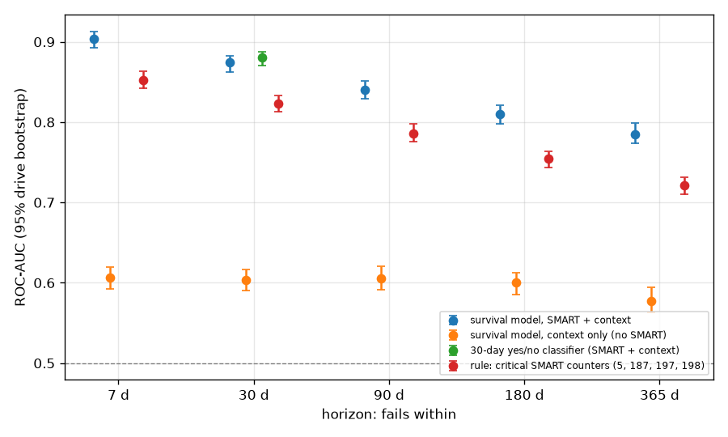
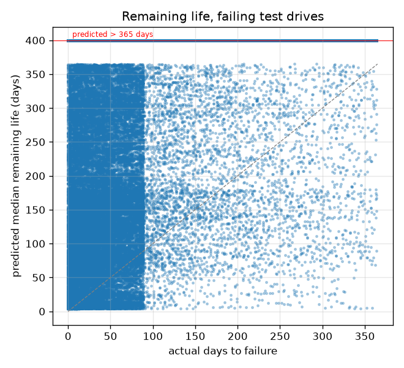
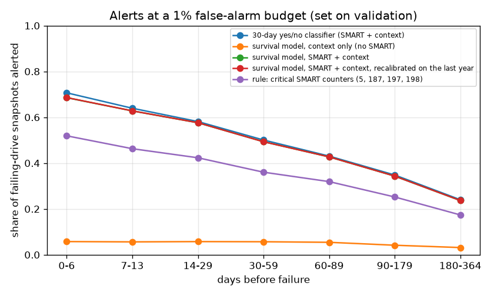
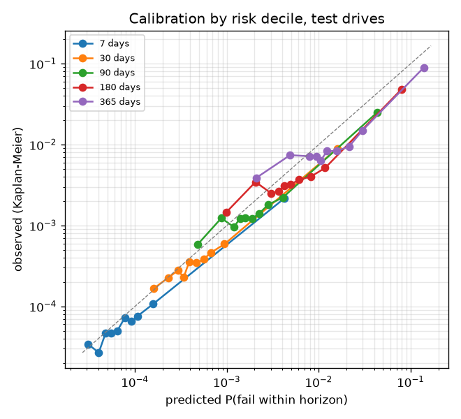
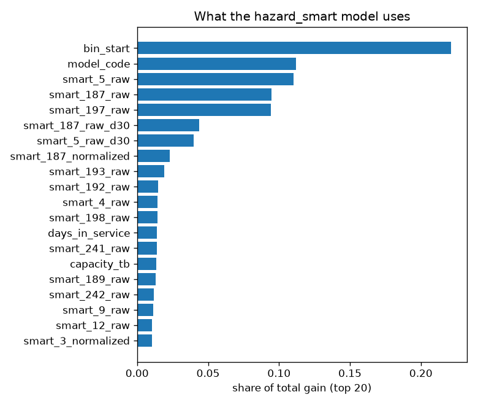

# Can SMART data predict when a hard drive will fail?

The run itself (scale, cohort, test set, gate) and the headline numbers are in [results.md](results.md). This file explains them and holds the detailed tables.

## Answer

- **Do SMART metrics carry failure information?** Yes. Adding SMART to what is known without it (drive model, capacity, time in service) improves ROC-AUC at 5 of 5 horizons with a 95% interval that excludes zero:
  - 7 days: +0.297 [0.280, 0.310]
  - 30 days: +0.271 [0.257, 0.287]
  - 90 days: +0.234 [0.218, 0.252]
  - 180 days: +0.210 [0.195, 0.224]
  - 365 days: +0.208 [0.189, 0.224]
- **How much of that is the replacement policy?** Backblaze replaces drives when counters 5, 187, 188, 197 or 198 rise, so those counters partly define the failure label. The full model's ROC-AUC exceeds the model without them by +0.101 [0.092, 0.109] at 30 days (an interval above zero at 5 of 5 horizons). Part of the SMART gain above may be the operator's policy rather than physics; this comparison cannot say how much, because the dropped counters also carry physical signal.
- **How far ahead?** Ranking is strongest close to failure (ROC-AUC 0.904 for 7 days) and weaker for the long term (0.785 for 365 days; long horizons are measured on earlier test snapshots, see Discrimination by horizon).
- **But failures are rare.** Even within 7 days only 0.027% of drive-days fail. The model's PR-AUC there is 0.0648 (a random ranking would score about the base rate), so at any useful recall many alerts are false (see Early warning).
- **Is it more than the last days?** Counting as positives only snapshots >= 7 days before failure, the 30-day PR-AUC is 0.0793 [0.0669, 0.0969] against 0.1237 overall (base rate 0.093% vs 0.121%); ROC-AUC 0.866 [0.853, 0.875]. Much of the precision comes from the last days before failure.
- **Silent failures** (no critical counter above zero in any test snapshot): 368 of the 1784 failing test drives. On them the 30-day ROC-AUC of survival model, SMART + context is 0.634 [0.601, 0.660] against 0.875 [0.863, 0.883] overall: still above chance.
- **When will it probably fail?** When the model names a day within the next year, it is too pessimistic (drives fail later than predicted): 5.9% of drives failed by their predicted 10% day, 30.6% by the predicted median and 75.5% by the predicted 90% day (targets 10/50/90%; censoring-weighted, assuming retirement is unrelated to failure). For drives that do fail within a year it names a median within a year only 15.9% of the time: most failures are not visible in SMART long in advance. For healthy drives it says "more than a year" 99.8% of the time.
- **One survival model or a dedicated 30-day classifier?** At 30 days the survival model's ROC-AUC minus the classifier's is -0.006 [-0.009, -0.002] (paired bootstrap), PR-AUC -0.0034 [-0.0103, 0.0042]; the survival model is not better in 100% of rounds. The classifier ranks better.
- **Against the classic rule** (log-sum of the reallocated, reported-uncorrectable, pending and offline-uncorrectable sector counters 5, 187, 197, 198), the model gains +0.051 ROC-AUC [0.043, 0.059] at 7 days.

## Discrimination by horizon

ROC-AUC and PR-AUC per drive-day snapshot, on test snapshots whose status at the horizon is known, weighted to real prevalence. Brackets: 95% drive-level bootstrap (200 rounds). Base rate = real share of drive-days that fail within the horizon. All 1784 failing test drives are positive at every horizon (each has snapshots close to its failure day), so the last column counts positive snapshots instead.

| horizon | model | ROC-AUC | PR-AUC | Brier | base rate | positive snapshots |
|---|---|---|---|---|---|---|
| 7 d | survival model, SMART + context | 0.904 [0.893, 0.913] | 0.0648 [0.0541, 0.0784] | 0.00027 | 0.027% | 11632 |
| 7 d | survival model, context only (no SMART) | 0.606 [0.592, 0.620] | 0.0004 [0.0004, 0.0005] | 0.00027 | 0.027% | 11632 |
| 7 d | rule: critical SMART counters (5, 187, 197, 198) | 0.853 [0.842, 0.864] | 0.0295 [0.0225, 0.0400] | n/a | 0.027% | 11632 |
| 30 d | survival model, SMART + context | 0.875 [0.863, 0.883] | 0.1237 [0.1059, 0.1475] | 0.00117 | 0.121% | 50334 |
| 30 d | survival model, context only (no SMART) | 0.604 [0.590, 0.617] | 0.0018 [0.0017, 0.0020] | 0.00121 | 0.121% | 50334 |
| 30 d | 30-day yes/no classifier (SMART + context) | 0.880 [0.870, 0.888] | 0.1272 [0.1100, 0.1464] | 0.00118 | 0.121% | 50334 |
| 30 d | rule: critical SMART counters (5, 187, 197, 198) | 0.823 [0.813, 0.833] | 0.0521 [0.0409, 0.0720] | n/a | 0.121% | 50334 |
| 90 d | survival model, SMART + context | 0.840 [0.829, 0.851] | 0.1769 [0.1532, 0.2040] | 0.00357 | 0.388% | 145601 |
| 90 d | survival model, context only (no SMART) | 0.606 [0.591, 0.621] | 0.0058 [0.0053, 0.0063] | 0.00388 | 0.388% | 145601 |
| 90 d | rule: critical SMART counters (5, 187, 197, 198) | 0.786 [0.776, 0.798] | 0.0893 [0.0733, 0.1164] | n/a | 0.388% | 145601 |
| 180 d | survival model, SMART + context | 0.810 [0.798, 0.821] | 0.2166 [0.1940, 0.2478] | 0.00762 | 0.865% | 163747 |
| 180 d | survival model, context only (no SMART) | 0.600 [0.586, 0.612] | 0.0128 [0.0119, 0.0139] | 0.00860 | 0.865% | 163747 |
| 180 d | rule: critical SMART counters (5, 187, 197, 198) | 0.755 [0.744, 0.764] | 0.1295 [0.1095, 0.1524] | n/a | 0.865% | 163747 |
| 365 d | survival model, SMART + context | 0.785 [0.774, 0.798] | 0.3130 [0.2894, 0.3402] | 0.01824 | 2.272% | 189708 |
| 365 d | survival model, context only (no SMART) | 0.578 [0.563, 0.595] | 0.0340 [0.0307, 0.0389] | 0.02223 | 2.272% | 189708 |
| 365 d | rule: critical SMART counters (5, 187, 197, 198) | 0.722 [0.711, 0.732] | 0.2145 [0.1873, 0.2420] | n/a | 2.272% | 189708 |

A horizon of H days needs H days of follow-up to know that a drive survived it, so the longer the horizon, the earlier the test snapshots it can use. The 365-day row uses only snapshots from roughly the first test year (2024); longer horizons are measured on an earlier, different calendar cohort than the short ones, so the rows are not a like-for-like trend. Test snapshots with a known status (825321 in total): 7 d: 819135 snapshots, known-healthy ones dated up to 2025-12-25; 30 d: 795715 snapshots, known-healthy ones dated up to 2025-12-02; 90 d: 735702 snapshots, known-healthy ones dated up to 2025-10-03; 180 d: 650242 snapshots, known-healthy ones dated up to 2025-07-05; 365 d: 485740 snapshots, known-healthy ones dated up to 2025-01-01.

**Robustness.** The same ranking with inverse-probability-of-censoring weights (IPCW: snapshots whose status is unknown are represented by weighting up comparable known ones, instead of being dropped), and a drive-level ROC-AUC on one random snapshot per drive, weighted per drive (so drives with many snapshots do not dominate). Brier skill = 1 - Brier / Brier of always predicting the base rate; above 0 beats that constant.

| horizon | model | ROC-AUC, IPCW (per drive-day) | PR-AUC, IPCW (per drive-day) | ROC-AUC (per drive) | Brier skill |
|---|---|---|---|---|---|
| 7 d | survival model, SMART + context | 0.904 [0.893, 0.913] | 0.0644 [0.0538, 0.0780] | 0.899 [0.840, 0.936] | -0.018 |
| 7 d | survival model, context only (no SMART) | 0.606 [0.592, 0.620] | 0.0004 [0.0004, 0.0005] | 0.623 [0.570, 0.672] | -0.000 |
| 7 d | rule: critical SMART counters (5, 187, 197, 198) | 0.853 [0.842, 0.864] | 0.0294 [0.0224, 0.0399] | 0.827 [0.763, 0.866] | n/a |
| 30 d | survival model, SMART + context | 0.874 [0.863, 0.883] | 0.1209 [0.1033, 0.1443] | 0.860 [0.836, 0.885] | 0.033 |
| 30 d | survival model, context only (no SMART) | 0.604 [0.590, 0.617] | 0.0018 [0.0016, 0.0020] | 0.619 [0.591, 0.644] | -0.001 |
| 30 d | 30-day yes/no classifier (SMART + context) | 0.880 [0.870, 0.888] | 0.1243 [0.1073, 0.1432] | 0.867 [0.846, 0.890] | 0.021 |
| 30 d | rule: critical SMART counters (5, 187, 197, 198) | 0.823 [0.813, 0.833] | 0.0509 [0.0399, 0.0705] | 0.811 [0.785, 0.836] | n/a |
| 90 d | survival model, SMART + context | 0.839 [0.827, 0.850] | 0.1651 [0.1427, 0.1914] | 0.827 [0.813, 0.845] | 0.076 |
| 90 d | survival model, context only (no SMART) | 0.606 [0.591, 0.621] | 0.0053 [0.0049, 0.0058] | 0.625 [0.609, 0.644] | -0.002 |
| 90 d | rule: critical SMART counters (5, 187, 197, 198) | 0.785 [0.774, 0.797] | 0.0825 [0.0675, 0.1088] | 0.782 [0.768, 0.799] | n/a |
| 180 d | survival model, SMART + context | 0.806 [0.794, 0.817] | 0.1867 [0.1660, 0.2162] | 0.822 [0.810, 0.838] | 0.111 |
| 180 d | survival model, context only (no SMART) | 0.600 [0.586, 0.612] | 0.0108 [0.0100, 0.0116] | 0.630 [0.615, 0.645] | -0.002 |
| 180 d | rule: critical SMART counters (5, 187, 197, 198) | 0.751 [0.740, 0.760] | 0.1094 [0.0915, 0.1308] | 0.778 [0.764, 0.791] | n/a |
| 365 d | survival model, SMART + context | 0.773 [0.761, 0.787] | 0.2312 [0.2074, 0.2608] | 0.825 [0.812, 0.841] | 0.178 |
| 365 d | survival model, context only (no SMART) | 0.579 [0.564, 0.596] | 0.0212 [0.0191, 0.0242] | 0.604 [0.591, 0.621] | -0.001 |
| 365 d | rule: critical SMART counters (5, 187, 197, 198) | 0.710 [0.699, 0.720] | 0.1497 [0.1253, 0.1765] | 0.768 [0.755, 0.781] | n/a |

## Ablations and sensitivity

Each variant against the reference (survival model, SMART + context). Gain = reference minus variant, paired on the same bootstrap rounds; "not better" = share of rounds where the reference's ROC-AUC is not higher.

- **survival model, SMART without counters 5/187/188/197/198**: drops counters 5, 187, 188, 197 and 198 (raw, normalized and trends), the ones behind Backblaze's own replacement decisions. A drive replaced because these counters rose is recorded as failed, so part of the full model's SMART signal may be the replacement policy itself. Dropping the counters also drops their physical signal, and other features can still track them, so this is a sensitivity check, not a clean split of policy from physics.
- **survival model, context + usage counters**: context plus the usage counters only (4, 9, 12, 193, 240-242: power-on hours, start/stop and power cycles, load cycles, head flying hours, LBAs written and read). Tests whether SMART helps only because it measures age and wear.
- **survival model, SMART + context, weight power 0.75**: the reference features with training weights to the power 0.75 instead of 0.5. Tests how much the ranking depends on the weight exponent.
- **survival model, SMART + context, weight power 1.0**: the same with the full inverse-probability weights (power 1.0).
- **survival model, SMART + context, recalibrated on the last year**: the reference trees with probabilities recalibrated on the last validation year before the training cutoff. Tests whether a recent recalibration fixes drift (see Calibration over time); the trees are the same, so ranking changes only through the per-bin recalibration.

| horizon | model | ROC-AUC | reference gain, ROC-AUC | reference gain, PR-AUC | not better |
|---|---|---|---|---|---|
| 7 d | survival model, SMART + context (reference) | 0.904 [0.893, 0.913] |  |  |  |
| 7 d | survival model, SMART without counters 5/187/188/197/198 | 0.803 [0.791, 0.816] | +0.100 [0.091, 0.110] | +0.0428 [0.0337, 0.0549] | 0% |
| 7 d | survival model, context + usage counters | 0.656 [0.642, 0.669] | +0.248 [0.232, 0.260] | +0.0640 [0.0532, 0.0779] | 0% |
| 7 d | survival model, SMART + context, weight power 0.75 | 0.907 [0.898, 0.915] | -0.004 [-0.007, -0.000] | -0.0015 [-0.0058, 0.0035] | 98% |
| 7 d | survival model, SMART + context, weight power 1.0 | 0.903 [0.893, 0.912] | +0.001 [-0.003, 0.005] | +0.0069 [-0.0007, 0.0169] | 32% |
| 7 d | survival model, SMART + context, recalibrated on the last year | 0.904 [0.893, 0.913] | 0.000 [0.000, 0.000] | 0.0000 [0.0000, 0.0000] | 100% |
| 30 d | survival model, SMART + context (reference) | 0.875 [0.863, 0.883] |  |  |  |
| 30 d | survival model, SMART without counters 5/187/188/197/198 | 0.774 [0.761, 0.788] | +0.101 [0.092, 0.109] | +0.0842 [0.0627, 0.1003] | 0% |
| 30 d | survival model, context + usage counters | 0.655 [0.643, 0.667] | +0.219 [0.209, 0.233] | +0.1210 [0.1032, 0.1447] | 0% |
| 30 d | survival model, SMART + context, weight power 0.75 | 0.880 [0.869, 0.888] | -0.006 [-0.009, -0.003] | +0.0049 [-0.0020, 0.0122] | 100% |
| 30 d | survival model, SMART + context, weight power 1.0 | 0.877 [0.866, 0.885] | -0.002 [-0.006, 0.001] | +0.0142 [0.0040, 0.0259] | 92% |
| 30 d | survival model, SMART + context, recalibrated on the last year | 0.875 [0.863, 0.883] | +0.000 [-0.000, 0.000] | +0.0001 [0.0001, 0.0002] | 27% |
| 90 d | survival model, SMART + context (reference) | 0.840 [0.829, 0.851] |  |  |  |
| 90 d | survival model, SMART without counters 5/187/188/197/198 | 0.745 [0.730, 0.759] | +0.095 [0.087, 0.106] | +0.1206 [0.0999, 0.1460] | 0% |
| 90 d | survival model, context + usage counters | 0.656 [0.643, 0.669] | +0.184 [0.172, 0.201] | +0.1696 [0.1462, 0.1959] | 0% |
| 90 d | survival model, SMART + context, weight power 0.75 | 0.847 [0.836, 0.859] | -0.007 [-0.011, -0.004] | +0.0035 [-0.0054, 0.0114] | 100% |
| 90 d | survival model, SMART + context, weight power 1.0 | 0.844 [0.833, 0.856] | -0.004 [-0.008, 0.000] | +0.0129 [-0.0007, 0.0237] | 96% |
| 90 d | survival model, SMART + context, recalibrated on the last year | 0.840 [0.829, 0.851] | +0.000 [0.000, 0.000] | +0.0003 [0.0002, 0.0004] | 0% |
| 180 d | survival model, SMART + context (reference) | 0.810 [0.798, 0.821] |  |  |  |
| 180 d | survival model, SMART without counters 5/187/188/197/198 | 0.715 [0.702, 0.729] | +0.095 [0.085, 0.104] | +0.1405 [0.1134, 0.1685] | 0% |
| 180 d | survival model, context + usage counters | 0.656 [0.642, 0.668] | +0.154 [0.141, 0.167] | +0.2004 [0.1776, 0.2305] | 0% |
| 180 d | survival model, SMART + context, weight power 0.75 | 0.814 [0.802, 0.826] | -0.004 [-0.008, -0.001] | +0.0168 [0.0000, 0.0316] | 98% |
| 180 d | survival model, SMART + context, weight power 1.0 | 0.811 [0.801, 0.823] | -0.002 [-0.005, 0.002] | +0.0305 [0.0163, 0.0437] | 75% |
| 180 d | survival model, SMART + context, recalibrated on the last year | 0.810 [0.798, 0.821] | -0.000 [-0.000, -0.000] | +0.0001 [0.0001, 0.0002] | 100% |
| 365 d | survival model, SMART + context (reference) | 0.785 [0.774, 0.798] |  |  |  |
| 365 d | survival model, SMART without counters 5/187/188/197/198 | 0.707 [0.695, 0.723] | +0.078 [0.069, 0.086] | +0.1745 [0.1466, 0.1977] | 0% |
| 365 d | survival model, context + usage counters | 0.661 [0.648, 0.677] | +0.124 [0.111, 0.137] | +0.2672 [0.2421, 0.2930] | 0% |
| 365 d | survival model, SMART + context, weight power 0.75 | 0.788 [0.777, 0.801] | -0.003 [-0.007, 0.001] | +0.0196 [-0.0004, 0.0342] | 93% |
| 365 d | survival model, SMART + context, weight power 1.0 | 0.787 [0.774, 0.799] | -0.001 [-0.006, 0.004] | +0.0354 [0.0183, 0.0499] | 76% |
| 365 d | survival model, SMART + context, recalibrated on the last year | 0.785 [0.774, 0.799] | -0.000 [-0.000, -0.000] | -0.0006 [-0.0011, -0.0002] | 100% |

## Where the signal comes from

The ranking metrics on parts of the test set, per drive-day snapshot. Positive-side slices (lead time, silent or not) keep every known-healthy snapshot and restrict the failing ones, so their base rate is lower; population slices (vendor, capacity, entry date) restrict both. "Silent" failures are drives that fail with none of the critical counters (5, 187, 197, 198) above zero in any test snapshot. At 30 days:

| slice | model | ROC-AUC | PR-AUC | base rate | positive drives |
|---|---|---|---|---|---|
| all test snapshots | survival model, SMART + context | 0.875 [0.863, 0.883] | 0.1237 [0.1059, 0.1475] | 0.121% | 1784 |
| all test snapshots | survival model, context only (no SMART) | 0.604 [0.590, 0.617] | 0.0018 [0.0017, 0.0020] | 0.121% | 1784 |
| all test snapshots | rule: critical SMART counters (5, 187, 197, 198) | 0.823 [0.813, 0.833] | 0.0521 [0.0409, 0.0720] | 0.121% | 1784 |
| positives >= 7 days before failure | survival model, SMART + context | 0.866 [0.853, 0.875] | 0.0793 [0.0669, 0.0969] | 0.093% | 1755 |
| positives >= 7 days before failure | survival model, context only (no SMART) | 0.604 [0.591, 0.617] | 0.0014 [0.0013, 0.0015] | 0.093% | 1755 |
| positives >= 7 days before failure | rule: critical SMART counters (5, 187, 197, 198) | 0.814 [0.804, 0.825] | 0.0333 [0.0259, 0.0485] | 0.093% | 1755 |
| silent failures (no critical counter above zero) | survival model, SMART + context | 0.634 [0.601, 0.660] | 0.0007 [0.0004, 0.0012] | 0.025% | 368 |
| silent failures (no critical counter above zero) | survival model, context only (no SMART) | 0.558 [0.524, 0.591] | 0.0003 [0.0003, 0.0004] | 0.025% | 368 |
| silent failures (no critical counter above zero) | rule: critical SMART counters (5, 187, 197, 198) | 0.473 [0.470, 0.475] | 0.0002 [0.0002, 0.0003] | 0.025% | 368 |
| failures with a critical counter above zero | survival model, SMART + context | 0.937 [0.930, 0.944] | 0.1497 [0.1264, 0.1787] | 0.096% | 1416 |
| failures with a critical counter above zero | survival model, context only (no SMART) | 0.615 [0.599, 0.630] | 0.0015 [0.0014, 0.0017] | 0.096% | 1416 |
| failures with a critical counter above zero | rule: critical SMART counters (5, 187, 197, 198) | 0.915 [0.907, 0.922] | 0.0653 [0.0519, 0.0892] | 0.096% | 1416 |
| vendor HGST | survival model, SMART + context | 0.927 [0.910, 0.942] | 0.0830 [0.0606, 0.1251] | 0.235% | 380 |
| vendor HGST | survival model, context only (no SMART) | 0.602 [0.576, 0.633] | 0.0032 [0.0028, 0.0039] | 0.235% | 380 |
| vendor HGST | rule: critical SMART counters (5, 187, 197, 198) | 0.888 [0.870, 0.908] | 0.0436 [0.0317, 0.0727] | 0.235% | 380 |
| vendor Seagate | survival model, SMART + context | 0.895 [0.879, 0.908] | 0.1762 [0.1455, 0.2145] | 0.139% | 764 |
| vendor Seagate | survival model, context only (no SMART) | 0.614 [0.594, 0.635] | 0.0022 [0.0019, 0.0026] | 0.139% | 764 |
| vendor Seagate | rule: critical SMART counters (5, 187, 197, 198) | 0.852 [0.837, 0.868] | 0.0881 [0.0659, 0.1332] | 0.139% | 764 |
| vendor Toshiba | survival model, SMART + context | 0.784 [0.758, 0.809] | 0.1286 [0.1077, 0.1533] | 0.104% | 485 |
| vendor Toshiba | survival model, context only (no SMART) | 0.526 [0.499, 0.547] | 0.0016 [0.0012, 0.0030] | 0.104% | 485 |
| vendor Toshiba | rule: critical SMART counters (5, 187, 197, 198) | 0.740 [0.716, 0.760] | 0.0674 [0.0516, 0.0973] | 0.104% | 485 |
| vendor WDC | survival model, SMART + context | 0.823 [0.782, 0.874] | 0.0534 [0.0290, 0.1133] | 0.054% | 155 |
| vendor WDC | survival model, context only (no SMART) | 0.535 [0.491, 0.580] | 0.0007 [0.0005, 0.0017] | 0.054% | 155 |
| vendor WDC | rule: critical SMART counters (5, 187, 197, 198) | 0.785 [0.751, 0.823] | 0.0427 [0.0280, 0.0775] | 0.054% | 155 |
| capacity >= 16 TB | survival model, SMART + context | 0.810 [0.787, 0.832] | 0.0732 [0.0533, 0.1017] | 0.075% | 530 |
| capacity >= 16 TB | survival model, context only (no SMART) | 0.585 [0.563, 0.614] | 0.0011 [0.0010, 0.0014] | 0.075% | 530 |
| capacity >= 16 TB | rule: critical SMART counters (5, 187, 197, 198) | 0.754 [0.733, 0.773] | 0.0396 [0.0293, 0.0645] | 0.075% | 530 |
| capacity < 16 TB | survival model, SMART + context | 0.901 [0.889, 0.911] | 0.1479 [0.1221, 0.1796] | 0.165% | 1254 |
| capacity < 16 TB | survival model, context only (no SMART) | 0.529 [0.512, 0.543] | 0.0021 [0.0019, 0.0025] | 0.165% | 1254 |
| capacity < 16 TB | rule: critical SMART counters (5, 187, 197, 198) | 0.850 [0.838, 0.863] | 0.0591 [0.0453, 0.0873] | 0.165% | 1254 |
| in service before the panel starts | survival model, SMART + context | 0.894 [0.281, 0.980] | 0.1594 [0.0001, 0.8889] | 0.100% | 5 |
| in service before the panel starts | survival model, context only (no SMART) | 0.637 [0.293, 0.980] | 0.0142 [0.0001, 0.1640] | 0.100% | 5 |
| in service before the panel starts | rule: critical SMART counters (5, 187, 197, 198) | 0.482 [0.447, 0.611] | 0.0010 [0.0001, 0.0024] | 0.100% | 5 |
| first seen after the panel starts | survival model, SMART + context | 0.875 [0.863, 0.883] | 0.1240 [0.1061, 0.1476] | 0.121% | 1779 |
| first seen after the panel starts | survival model, context only (no SMART) | 0.604 [0.590, 0.617] | 0.0018 [0.0017, 0.0020] | 0.121% | 1779 |
| first seen after the panel starts | rule: critical SMART counters (5, 187, 197, 198) | 0.824 [0.814, 0.833] | 0.0522 [0.0410, 0.0721] | 0.121% | 1779 |

The same two slices for survival model, SMART + context across horizons:

| slice | horizon | ROC-AUC | PR-AUC | base rate | positive drives |
|---|---|---|---|---|---|
| silent failures (no critical counter above zero) | 7 d | 0.652 [0.619, 0.682] | 0.0002 [0.0001, 0.0004] | 0.006% | 368 |
| silent failures (no critical counter above zero) | 30 d | 0.634 [0.601, 0.660] | 0.0007 [0.0004, 0.0012] | 0.025% | 368 |
| silent failures (no critical counter above zero) | 90 d | 0.608 [0.576, 0.636] | 0.0016 [0.0012, 0.0026] | 0.078% | 368 |
| silent failures (no critical counter above zero) | 180 d | 0.579 [0.547, 0.616] | 0.0030 [0.0024, 0.0048] | 0.172% | 368 |
| silent failures (no critical counter above zero) | 365 d | 0.574 [0.543, 0.610] | 0.0080 [0.0062, 0.0107] | 0.452% | 368 |
| positives >= 7 days before failure | 30 d | 0.866 [0.853, 0.875] | 0.0793 [0.0669, 0.0969] | 0.093% | 1755 |
| positives >= 7 days before failure | 90 d | 0.834 [0.823, 0.846] | 0.1490 [0.1275, 0.1737] | 0.357% | 1757 |
| positives >= 7 days before failure | 180 d | 0.806 [0.794, 0.817] | 0.1963 [0.1751, 0.2264] | 0.829% | 1758 |
| positives >= 7 days before failure | 365 d | 0.782 [0.771, 0.796] | 0.2987 [0.2747, 0.3266] | 2.215% | 1758 |

## Ranking over the whole future (concordance)

Concordance between each model's risk score and the actual time to failure; 0.5 = random. Harrell's C counts the comparable pairs (the earlier time is a failure) where the riskier snapshot fails first. Uno's C weights each pair by the inverse probability of staying uncensored, so it does not depend on how much follow-up the test period allows, and is truncated at 365 days. Computed on 299930 test snapshots of 3267 drives (drives sampled whole up to a row cap). Score: -rmst_days = minus the expected days survived within a year; p30 = predicted 30-day risk, so hazard models can be compared with the classifier on the same kind of score. Intervals only on each model's main score.

| model | score | Harrell's C | Uno's C |
|---|---|---|---|
| survival model, SMART + context | -rmst_days | 0.759 [0.738, 0.775] | 0.752 [0.732, 0.769] |
| survival model, SMART + context | p30 | 0.771 | 0.766 |
| survival model, context only (no SMART) | -rmst_days | 0.586 [0.561, 0.605] | 0.588 [0.561, 0.608] |
| survival model, context only (no SMART) | p30 | 0.598 | 0.600 |
| 30-day yes/no classifier (SMART + context) | p30 | 0.779 [0.761, 0.797] | 0.774 [0.757, 0.792] |
| rule: critical SMART counters (5, 187, 197, 198) | score | 0.717 [0.698, 0.730] | 0.709 [0.689, 0.723] |
| survival model, SMART without counters 5/187/188/197/198 | -rmst_days | 0.673 [0.650, 0.702] | 0.667 [0.645, 0.697] |
| survival model, SMART without counters 5/187/188/197/198 | p30 | 0.691 | 0.687 |
| survival model, context + usage counters | -rmst_days | 0.630 [0.609, 0.656] | 0.631 [0.609, 0.658] |
| survival model, context + usage counters | p30 | 0.634 | 0.634 |
| survival model, SMART + context, weight power 0.75 | -rmst_days | 0.765 [0.745, 0.780] | 0.758 [0.739, 0.773] |
| survival model, SMART + context, weight power 0.75 | p30 | 0.785 | 0.780 |
| survival model, SMART + context, weight power 1.0 | -rmst_days | 0.766 [0.744, 0.783] | 0.760 [0.738, 0.777] |
| survival model, SMART + context, weight power 1.0 | p30 | 0.783 | 0.778 |
| survival model, SMART + context, recalibrated on the last year | -rmst_days | 0.759 [0.738, 0.775] | 0.752 [0.733, 0.769] |
| survival model, SMART + context, recalibrated on the last year | p30 | 0.771 | 0.766 |

## When will it fail? Remaining-life estimates

From each snapshot the survival model gives a curve: the day by which the failure probability reaches 10%, 50% (the median remaining life) and 90%. Beyond 365 days the model has no bins, so the answer is "more than a year". For 0.5% of all test snapshots the predicted median of survival model, SMART + context is within a year; otherwise the answer is "more than a year".

**Are the predicted days right?** Among snapshots whose predicted day falls within a year, the share that actually failed by that day should be close to the target. A snapshot censored before its predicted day has no known outcome. Dropping those favours snapshots with an early day, so each share is weighted by the inverse probability of staying uncensored (IPCW); the share over known outcomes only is in brackets. Both assume that retirement is unrelated to failure, which the retirement check below questions.

| model | failed by predicted 10% day | failed by predicted median | failed by predicted 90% day |
|---|---|---|---|
| survival model, SMART + context | 5.9% [6.9%] (target 10%, 113992 snapshots) | 30.6% [35.2%] (target 50%, 47669 snapshots) | 75.5% [79.2%] (target 90%, 9858 snapshots) |
| survival model, context only (no SMART) | 4.0% [5.0%] (target 10%, 3288 snapshots) | n/a [n/a] (target 50%, 0 snapshots) | n/a [n/a] (target 90%, 0 snapshots) |
| survival model, SMART without counters 5/187/188/197/198 | 5.7% [7.0%] (target 10%, 53695 snapshots) | 22.6% [24.8%] (target 50%, 8504 snapshots) | 17.0% [23.4%] (target 90%, 2021 snapshots) |
| survival model, context + usage counters | 4.1% [5.2%] (target 10%, 16336 snapshots) | 100.0% [100.0%] (target 50%, 24 snapshots) | n/a [n/a] (target 90%, 0 snapshots) |
| survival model, SMART + context, weight power 0.75 | 6.2% [7.2%] (target 10%, 113191 snapshots) | 29.2% [33.0%] (target 50%, 48573 snapshots) | 62.8% [71.6%] (target 90%, 10678 snapshots) |
| survival model, SMART + context, weight power 1.0 | 6.7% [7.7%] (target 10%, 106979 snapshots) | 24.0% [27.2%] (target 50%, 47008 snapshots) | 35.4% [44.8%] (target 90%, 17411 snapshots) |
| survival model, SMART + context, recalibrated on the last year | 5.0% [5.7%] (target 10%, 119374 snapshots) | 26.2% [29.9%] (target 50%, 54315 snapshots) | 66.2% [71.2%] (target 90%, 14469 snapshots) |

**How early is a failure visible?** Snapshots of drives that do fail within a year, by how far away the failure actually was. A median within a year means the model already expects the drive to die within a year. The absolute error is over the failing snapshots whose median is within a year (count in brackets):

| model | failing snapshots: median within a year | abs. error of median (days) | all test snapshots: median within a year | healthy snapshots: median beyond a year |
|---|---|---|---|---|
| survival model, SMART + context | 15.9% | 110 (46068 snapshots) | 0.5% | 99.8% |
| survival model, context only (no SMART) | 0.0% | n/a (0 snapshots) | 0.0% | 100.0% |
| survival model, SMART without counters 5/187/188/197/198 | 2.7% | 98 (8193 snapshots) | 0.1% | 100.0% |
| survival model, context + usage counters | 0.0% | 73 (24 snapshots) | 0.0% | 100.0% |
| survival model, SMART + context, weight power 0.75 | 16.5% | 107 (46761 snapshots) | 0.5% | 99.8% |
| survival model, SMART + context, weight power 1.0 | 16.1% | 97 (44859 snapshots) | 0.6% | 99.7% |
| survival model, SMART + context, recalibrated on the last year | 18.6% | 100 (52143 snapshots) | 0.7% | 99.8% |

By actual time to failure (survival model, SMART + context). Shares are of the failing drives' snapshots in each bucket:

| actual days to failure | snapshots | median predicted within a year | median of predicted median (days) |
|---|---|---|---|
| 0-6 | 11632 | 49.0% | > 1 year |
| 7-13 | 11720 | 40.0% | > 1 year |
| 14-29 | 26982 | 34.2% | > 1 year |
| 30-59 | 48813 | 25.9% | > 1 year |
| 60-89 | 46454 | 20.3% | > 1 year |
| 90-179 | 18146 | 13.6% | > 1 year |
| 180-364 | 25961 | 7.4% | > 1 year |

## Early warning

Each alert threshold is set on validation drives so that a given share of healthy drive-days raises an alert (the budget). At the main budget of 1.0%, 1.00% of validation drive-days alert for survival model, SMART + context; budgets of 0.1%, 0.3% are shown too. Test results: false alarms and precision are per drive-day; precision counts alerts whose outcome at 30 days is known, and the alerts that cannot be judged yet (panel end) are shown separately and, in the next column, counted as false. Failing drives alerted = drives failing in the test period that get at least one alert in their last 30 days.

| budget | model | false alarms, test (share of healthy drive-days) | precision (per alerted drive-day) | alerts with unknown outcome | precision, unknown as false | failing drives alerted (drives) | alerted >= 7 days before failure (drives) |
|---|---|---|---|---|---|---|---|
| 0.1% | survival model, SMART + context | 0.22% [0.17%, 0.26%] | 14.55% [12.48%, 17.62%] | 8.9% | 13.26% [11.34%, 16.07%] | 1017/1784, 57% [55%, 59%] | 760/1784 |
| 0.1% | survival model, context only (no SMART) | 0.08% [0.04%, 0.13%] | 0.37% [0.07%, 1.05%] | 3.4% | 0.35% [0.07%, 1.03%] | 4/1784, 0% [0%, 1%] | 4/1784 |
| 0.1% | 30-day yes/no classifier (SMART + context) | 0.29% [0.24%, 0.35%] | 12.34% [10.69%, 15.16%] | 9.1% | 11.22% [9.70%, 13.70%] | 1102/1784, 62% [60%, 64%] | 847/1784 |
| 0.1% | rule: critical SMART counters (5, 187, 197, 198) | 0.48% [0.35%, 0.58%] | 5.89% [4.83%, 7.84%] | 6.6% | 5.50% [4.53%, 7.30%] | 664/1784, 37% [35%, 39%] | 500/1784 |
| 0.1% | survival model, SMART + context, recalibrated on the last year | 0.22% [0.17%, 0.26%] | 14.53% [12.47%, 17.60%] | 8.9% | 13.23% [11.31%, 16.03%] | 1016/1784, 57% [55%, 59%] | 757/1784 |
| 0.3% | survival model, SMART + context | 0.57% [0.47%, 0.66%] | 8.69% [7.58%, 10.49%] | 7.8% | 8.01% [6.99%, 9.69%] | 1241/1784, 70% [67%, 71%] | 1006/1784 |
| 0.3% | survival model, context only (no SMART) | 0.95% [0.81%, 1.13%] | 0.29% [0.18%, 0.40%] | 10.5% | 0.26% [0.16%, 0.36%] | 42/1784, 2% [2%, 3%] | 42/1784 |
| 0.3% | 30-day yes/no classifier (SMART + context) | 0.69% [0.58%, 0.79%] | 7.72% [6.80%, 9.17%] | 7.5% | 7.14% [6.27%, 8.52%] | 1268/1784, 71% [69%, 73%] | 1049/1784 |
| 0.3% | rule: critical SMART counters (5, 187, 197, 198) | 0.79% [0.62%, 0.92%] | 4.84% [4.08%, 6.16%] | 6.9% | 4.51% [3.82%, 5.75%] | 839/1784, 47% [45%, 49%] | 664/1784 |
| 0.3% | survival model, SMART + context, recalibrated on the last year | 0.57% [0.47%, 0.66%] | 8.69% [7.58%, 10.48%] | 7.8% | 8.01% [7.00%, 9.67%] | 1242/1784, 70% [67%, 71%] | 1007/1784 |
| 1.0% | survival model, SMART + context | 1.95% [1.71%, 2.15%] | 3.66% [3.32%, 4.18%] | 6.4% | 3.43% [3.11%, 3.91%] | 1396/1784, 78% [76%, 80%] | 1209/1784 |
| 1.0% | survival model, context only (no SMART) | 1.89% [1.68%, 2.16%] | 0.36% [0.28%, 0.46%] | 11.8% | 0.32% [0.25%, 0.40%] | 116/1784, 7% [5%, 8%] | 110/1784 |
| 1.0% | 30-day yes/no classifier (SMART + context) | 2.00% [1.78%, 2.22%] | 3.63% [3.29%, 4.08%] | 6.6% | 3.39% [3.07%, 3.81%] | 1421/1784, 80% [78%, 81%] | 1226/1784 |
| 1.0% | rule: critical SMART counters (5, 187, 197, 198) | 1.74% [1.48%, 2.01%] | 3.06% [2.67%, 3.65%] | 6.0% | 2.88% [2.51%, 3.43%] | 1051/1784, 59% [57%, 61%] | 874/1784 |
| 1.0% | survival model, SMART + context, recalibrated on the last year | 1.95% [1.72%, 2.15%] | 3.66% [3.32%, 4.18%] | 6.4% | 3.43% [3.11%, 3.91%] | 1396/1784, 78% [76%, 80%] | 1209/1784 |

At the main budget the test false-alarm rate is above the budget, with an interval that excludes it, for survival model, SMART + context, survival model, context only (no SMART), 30-day yes/no classifier (SMART + context), rule: critical SMART counters (5, 187, 197, 198), survival model, SMART + context, recalibrated on the last year: healthy test drives score higher than the validation drives the threshold was set on. This is the same shift over time that Calibration over time shows (drift).

## Calibration

Mean predicted failure probability vs the Kaplan-Meier observed share, by decile of predicted risk. Points on the diagonal mean that a predicted 5% really fails 5% of the time.

**Calibration over time** (mean predicted vs observed risk of failing within 30 days; ratio = predicted / observed with a 95% drive bootstrap). Validation drives are from the training era, test from 2024 on. A gap that appears only in the test years is drift. "Outside band" = the test year's ratio is outside the range of the validation-year ratios. Reference = survival model, SMART + context; recalibrated = survival model, SMART + context, recalibrated on the last year.

| split | year | snapshots | observed | predicted (reference) | ratio (reference) | outside band (reference) | predicted (recalibrated) | ratio (recalibrated) | outside band (recalibrated) |
|---|---|---|---|---|---|---|---|---|---|
| val | 2016 | 70518 | 0.162% | 0.192% | 1.19 [0.99, 1.47] | - | 0.234% | 1.45 [1.20, 1.80] | - |
| val | 2017 | 85198 | 0.154% | 0.166% | 1.07 [0.88, 1.34] | - | 0.201% | 1.30 [1.06, 1.63] | - |
| val | 2018 | 102268 | 0.134% | 0.131% | 0.98 [0.84, 1.14] | - | 0.158% | 1.18 [1.01, 1.38] | - |
| val | 2019 | 116101 | 0.165% | 0.152% | 0.92 [0.74, 1.16] | - | 0.184% | 1.11 [0.89, 1.41] | - |
| val | 2020 | 137012 | 0.084% | 0.113% | 1.35 [1.11, 1.69] | - | 0.137% | 1.63 [1.34, 2.04] | - |
| val | 2021 | 169154 | 0.088% | 0.099% | 1.12 [0.97, 1.30] | - | 0.120% | 1.36 [1.17, 1.57] | - |
| val | 2022 | 191823 | 0.109% | 0.126% | 1.16 [1.03, 1.33] | - | 0.152% | 1.40 [1.23, 1.61] | - |
| val | 2023 | 205355 | 0.166% | 0.143% | 0.86 [0.78, 0.96] | - | 0.173% | 1.04 [0.94, 1.16] | - |
| test | 2024 | 422201 | 0.133% | 0.156% | 1.17 [1.09, 1.28] | no | 0.189% | 1.42 [1.32, 1.55] | no |
| test | 2025 | 403120 | 0.103% | 0.236% | 2.28 [1.98, 2.65] | yes | 0.285% | 2.76 [2.40, 3.20] | yes |

- survival model, SMART + context: predicted/observed ratio over validation years spans 0.86 to 1.35. The last validation year (2023, ratio 0.86) is outside the band of the earlier validation years, an early sign of drift that needs no test data. Test years outside the band: 2025.
- survival model, SMART + context, recalibrated on the last year: predicted/observed ratio over validation years spans 1.04 to 1.63. The last validation year (2023, ratio 1.04) is outside the band of the earlier validation years, an early sign of drift that needs no test data. Test years outside the band: 2025.

## Retirement

Drives that never fail and have snapshots in a year, split into those that stop reporting before the end of the next year (left) and those still reporting (stayed). The survival estimates assume that leaving is unrelated to health; then both groups would carry about the same predicted risk. A ratio above 1 means the drives that leave already looked riskier beforehand. That suggests censoring is informative (some drives may be retired before they would have failed). If so, the observed failure risk is too low, by an amount this check cannot measure: it does not say how many of them would have failed. The alert threshold is the main-budget threshold of survival model, SMART + context.

| split | year | drives left | drives stayed | mean predicted 30-day risk, left | mean predicted 30-day risk, stayed | ratio left/stayed | above alert threshold, left | above alert threshold, stayed |
|---|---|---|---|---|---|---|---|---|
| val | 2016 | 170 | 538 | 0.162% | 0.163% | 1.00 | 1.84% | 0.83% |
| val | 2017 | 280 | 672 | 0.276% | 0.084% | 3.29 | 2.43% | 0.19% |
| val | 2018 | 236 | 869 | 0.203% | 0.072% | 2.83 | 0.88% | 0.18% |
| val | 2019 | 233 | 964 | 0.145% | 0.107% | 1.35 | 0.54% | 0.74% |
| val | 2020 | 357 | 1270 | 0.132% | 0.058% | 2.27 | 1.13% | 0.27% |
| val | 2021 | 202 | 1828 | 0.115% | 0.055% | 2.07 | 1.08% | 0.25% |
| val | 2022 | 101 | 2040 | 0.163% | 0.065% | 2.51 | 3.18% | 0.43% |
| val | 2023 | 282 | 2383 | 0.163% | 0.075% | 2.16 | 2.39% | 0.68% |
| test | 2024 | 509 | 5809 | 0.205% | 0.099% | 2.08 | 2.16% | 1.07% |

The ratio is above 1 in 8 of 9 split-years with drives in both groups (no intervals: read it as a direction, not a test).

## Which SMART attributes matter

Single-attribute ROC-AUC on train snapshots (fails within 30 days), computed only on the drive-days where the attribute is reported; "filled" is that share. 0.5 = no signal. Below 0.5 means lower values go with failure (normalized values fall as a drive degrades).

| feature | ROC-AUC | filled |
|---|---|---|
| smart_187_raw | 0.699 | 64% |
| smart_187_normalized | 0.301 | 64% |
| smart_5_raw | 0.662 | 100% |
| smart_197_raw | 0.638 | 99% |
| smart_187_raw_d30 | 0.635 | 64% |
| smart_5_raw_d30 | 0.619 | 100% |
| smart_198_raw | 0.614 | 100% |
| smart_4_raw | 0.611 | 100% |
| smart_193_raw | 0.608 | 99% |
| smart_12_raw | 0.607 | 100% |
| smart_183_raw | 0.596 | 21% |
| smart_3_normalized | 0.406 | 100% |
| smart_187_raw_d7 | 0.592 | 64% |
| smart_5_raw_d7 | 0.589 | 100% |
| smart_196_raw | 0.589 | 36% |

Also see `build/explore/km_by_counters.png` and `build/explore/models.csv`.

